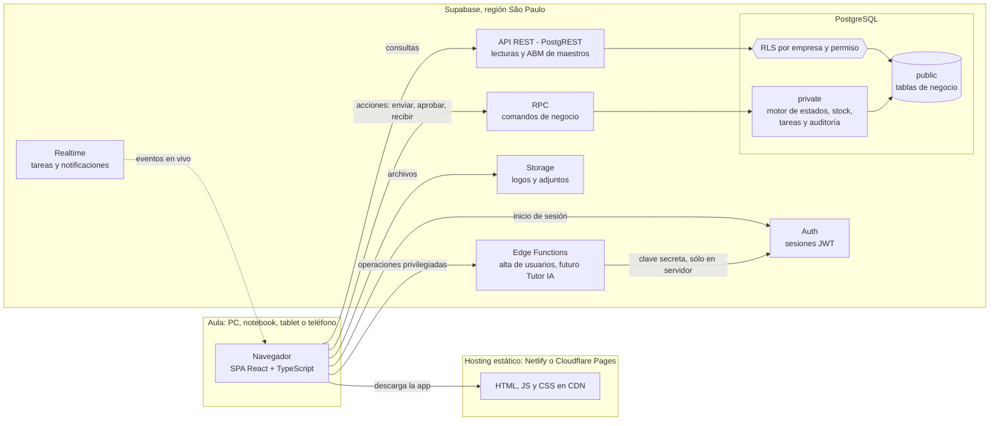
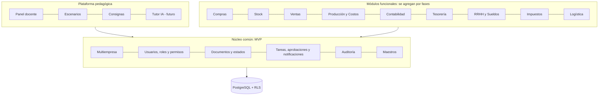
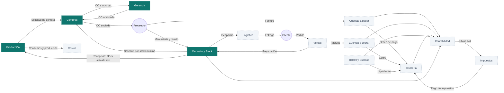

# Arquitectura — INTEGR-AR · ERP Educativo

> **Revisión de Fase 0 (26/09/2026):** el nuevo pedido de arquitectura se documenta en [docs/fase-0-2027/README.md](docs/fase-0-2027/README.md). Esa propuesta identifica diferencias con el prototipo existente; este documento conserva el contexto anterior y no implica que Supabase ya esté implementado.

> **Versión 0.3 · Fase 1 en curso · septiembre 2026.** Documento vivo: toda decisión relevante se registra en la sección 17.
> Aplicación de la **familia GEST-AR** (propiedad del autor). "INTEGR-AR" es su nombre de trabajo (D-01).
> **Etapa actual:** interfaz del MVP funcionando con backend simulado en el navegador; integración con Supabase pendiente (§7.9).
> **Modelo de producto:** diseñado para la **Escuela Normal Superior N.º 9**. Cada escuela que lo adopte recibe una **instancia propia** (misma aplicación, base de datos independiente). Ver [docs/INSTANCIAS.md](docs/INSTANCIAS.md).

## Índice

1. [Diagnóstico técnico](#1-diagnóstico-técnico)
2. [Principios de arquitectura](#2-principios-de-arquitectura)
3. [Stack: evaluación y recomendación](#3-stack-evaluación-y-recomendación)
4. [Vista general](#4-vista-general)
5. [Diagrama conceptual del ERP](#5-diagrama-conceptual-del-erp)
6. [El núcleo: seis motores compartidos](#6-el-núcleo-seis-motores-compartidos)
7. [Backend: lecturas, comandos y reglas de negocio](#7-backend-lecturas-comandos-y-reglas-de-negocio)
8. [Frontend](#8-frontend)
9. [Autenticación y gestión de usuarios](#9-autenticación-y-gestión-de-usuarios)
10. [Seguridad](#10-seguridad)
11. [Tiempo real y notificaciones](#11-tiempo-real-y-notificaciones)
12. [Instancias, entornos, despliegue y copias de seguridad](#12-instancias-entornos-despliegue-y-copias-de-seguridad)
13. [Estrategia de pruebas](#13-estrategia-de-pruebas)
14. [Preparación para escenarios y Tutor IA](#14-preparación-para-escenarios-y-tutor-ia)
15. [Estructura de carpetas](#15-estructura-de-carpetas)
16. [Riesgos técnicos](#16-riesgos-técnicos)
17. [Decisiones de arquitectura (ADR)](#17-decisiones-de-arquitectura-adr)
18. [Decisiones pendientes](#18-decisiones-pendientes)

Documentos relacionados: [DATABASE.md](DATABASE.md) · [MVP.md](MVP.md) · [ROADMAP.md](ROADMAP.md) · [docs/ROLES_Y_PERMISOS.md](docs/ROLES_Y_PERMISOS.md) · [docs/FLUJO_COMPRAS.md](docs/FLUJO_COMPRAS.md) · [docs/DISENO_UI.md](docs/DISENO_UI.md) · [docs/GLOSARIO.md](docs/GLOSARIO.md) · [docs/INSTANCIAS.md](docs/INSTANCIAS.md)

---

## 1. Diagnóstico técnico

### 1.1 Entorno relevado (26/09/2026)

| Aspecto | Situación | Evaluación |
|---|---|---|
| Directorio | Vacío, sin repositorio git | Punto de partida limpio |
| Ubicación | `OneDrive\Desktop\SAP SIMULADO` | **Resuelto:** movido a `C:\Proyectos\GESTAR-ERP` (ver 1.2) |
| Sistema operativo | Windows 11 Home | Apto. Docker Desktop funciona sobre WSL2 |
| Node.js | v20.20.0 | **Actualizar**: Node 20 dejó de tener soporte en abril 2026. Usar Node 24 LTS |
| npm | 10.8.2 | Apto |
| git | 2.53 | Apto |
| Supabase CLI | No instalado | Usar `npx supabase` (sin instalación global) |
| Docker | Sin verificar | Necesario para correr Supabase localmente (decisión D-05) |

### 1.2 Observaciones sobre el entorno

1. **Mover el proyecto fuera de OneDrive.** Sincronizar `node_modules` (decenas de miles de archivos) degrada el rendimiento, provoca bloqueos de archivos durante `npm install` y conflictos de sincronización. El respaldo del código lo da git + GitHub, no OneDrive. Ubicación sugerida: `C:\dev\integrar-erp`.
2. **Quitar "SAP" del nombre** de la carpeta, del repositorio y de cualquier dominio. El proyecto no debe usar marcas de terceros ni siquiera en nombres internos.
3. **Evitar espacios en la ruta**: varias herramientas de línea de comandos fallan o requieren comillas.
4. **Node 24 LTS**: soporte activo hasta 2028; cubre todo el ciclo 2027.

### 1.3 Diagnóstico del requerimiento

- **Tamaño real.** 17 módulos y ~70 entidades a lo largo del año: es un ERP PYME completo. El riesgo principal **no es técnico sino de alcance**. La mitigación es el desarrollo por fases con un MVP estricto.
- **Lo que determina el éxito es el núcleo.** Si multiempresa, permisos, documentos, flujo de trabajo, stock y auditoría están bien resueltos, cada módulo nuevo (Ventas, Producción, Sueldos…) repite un patrón conocido: nuevos tipos de documento, nuevas transiciones, nuevas reglas de tareas. Si el núcleo está mal, cada módulo obliga a rediseñar.
- **El valor pedagógico está en las transiciones**, no en los formularios: quién inicia, quién autoriza, hacia qué sector sigue, qué efecto produce. La arquitectura pone el foco en el **motor de documentos y estados**.
- **Perfil de carga.** ~30 estudiantes por aula, varias empresas por curso, ráfagas de actividad simultánea en horario de clase, **todos saliendo a internet por la misma IP pública** de la escuela. Volumen de datos muy bajo. No hay problema de escala de datos; sí hay que cuidar concurrencia, límites por IP y conectividad.
- **Usuarios menores de edad.** Obliga a minimizar datos personales (no pedir emails reales, no cargar datos sensibles).
- **Producto replicable.** El sistema es para la ENS N.º 9, pero podrá venderse a otras escuelas como instancia independiente. No agranda el MVP, pero exige desde el primer día que nada propio de la escuela quede escrito en el código y que todo cambio de base sea una migración versionada.

---

## 2. Principios de arquitectura

1. **La base de datos es la autoridad de las reglas de negocio.** Todo cambio de estado de un documento pasa por una función del servidor que valida, ejecuta y audita en una única transacción. El frontend nunca decide un estado; sólo lo solicita.
2. **Multiempresa desde el primer día.** `company_id` en toda tabla de negocio, RLS en todas las tablas y claves foráneas compuestas que impiden referencias entre empresas.
3. **Documentos, no formularios.** Cada operación es un documento numerado, con estado, responsable, historial y vínculos con los documentos anteriores y siguientes.
4. **Todo deja rastro.** Auditoría inmutable y legible por personas ("María López, Gerencia, aprobó OC-00023").
5. **Comportamiento descripto por datos.** Estados, transiciones, reglas de aprobación y reglas de tareas viven en tablas de catálogo con textos explicativos. El docente puede leerlos y ajustarlos; la interfaz y el futuro Tutor IA los usan para explicar el proceso.
6. **Aburrido y probado antes que novedoso.** Pocas piezas, herramientas populares, fácil de mantener por una sola persona.
7. **Mínimo privilegio.** Cada rol ve y hace sólo lo que su sector necesita. Gerencia, Auditoría y Docente ven el consolidado.
8. **Pedagogía visible.** El sistema explica qué sigue, quién lo hace y por qué.
9. **Una instancia por escuela, un solo código.** Lo que distingue a una escuela de otra es configuración, nunca una copia modificada del código.

---

## 3. Stack: evaluación y recomendación

### 3.1 Veredicto

**La propuesta inicial es adecuada** para los criterios planteados (bajo costo, plan gratuito, mantenimiento, seguridad, escala escolar, experiencia de desarrollo). No se reemplaza ninguna pieza; se agregan librerías de soporte y se corrige **dónde vive la lógica de negocio**.

| Capa | Elección | Por qué | Descartado |
|---|---|---|---|
| Lenguaje | TypeScript estricto | Tipos generados desde la base; refactors seguros durante todo 2027 | JavaScript plano |
| Build | Vite | Rápido, simple; genera una SPA estática que se aloja gratis | Next.js: el SSR no aporta en una app detrás de login y suma complejidad |
| UI | React + Tailwind CSS + shadcn/ui + Lucide | Componentes accesibles (Radix) cuyo código queda en el repo; estética sobria y propia | MUI / Ant Design: más pesados y de estética muy reconocible |
| Ruteo | React Router | Estándar y bien documentado | TanStack Router (muy bueno, menos difundido) |
| Datos del servidor | TanStack Query | Caché, reintentos, invalidación tras acciones, sondeo periódico de respaldo | Redux para datos remotos |
| Formularios | React Hook Form + Zod | Rinde bien con formularios de muchas líneas (una OC con 20 ítems); validación tipada | Formik |
| Tablas | TanStack Table (patrón *data table* de shadcn) | Paginación, orden y filtros en servidor | Grillas comerciales |
| Gráficos | Recharts (componentes *chart* de shadcn) | Integrado al sistema visual | Chart.js |
| Documentos / PDF | HTML + CSS de impresión → "Guardar como PDF" del navegador | Costo cero; un solo diseño para pantalla e impresión | Generación de PDF en servidor (fase posterior si hace falta) |
| Base de datos | Supabase PostgreSQL | Relacional serio, RLS, transacciones, funciones | Bases NoSQL: no aptas para un ERP relacional |
| Lógica de negocio | Funciones PL/pgSQL expuestas como RPC | Atomicidad (todo o nada), imposible de eludir desde el navegador, rápidas | Lógica en React (eludible); Edge Functions (sin transacciones multi-tabla simples, más latencia) |
| Autenticación | Supabase Auth (usuario + contraseña) | Integrada con RLS mediante `auth.uid()` | Auth propia |
| Tareas privilegiadas | Supabase Edge Functions | Único lugar donde vive la clave secreta (alta de usuarios) | — |
| Tiempo real | Supabase Realtime | La bandeja de Compras se actualiza sola cuando Producción envía una solicitud: efecto pedagógico fuerte | Sólo sondeo periódico |
| Archivos | Supabase Storage | Logos; adjuntos en fases posteriores | — |
| Hosting | Netlify o Cloudflare Pages | Planes gratuitos que admiten uso institucional y comercial | Vercel Hobby: sus términos lo limitan a uso personal no comercial |
| Pruebas | Vitest · pgTAP · Playwright | Unidad, base de datos (RLS y flujos), extremo a extremo | — |
| Calidad / CI | ESLint · Prettier · GitHub Actions | Gratuito y simple | — |

### 3.2 Ajustes clave respecto de la idea inicial

1. **Las transiciones de estado viven en PostgreSQL, no en React.** Con Supabase, cualquier estudiante puede abrir la consola del navegador y llamar a la API con su propio token. Si "aprobar una OC" fuera un `update ... set estado = 'APROBADO'` desde React, bastaría con que RLS permita actualizar esa tabla para que alguien se autoapruebe o saltee pasos. Por eso:
   - **Lecturas**: consultas directas a tablas, filtradas por RLS.
   - **Maestros** (clientes, proveedores, productos): ABM directo con RLS por permiso + auditoría por *trigger*.
   - **Documentos y stock**: **sin permisos de escritura directa**. Sólo se modifican mediante funciones RPC `security definer` que validan permiso, estado, separación de funciones y datos, y registran auditoría, tareas y notificaciones en la misma transacción.
2. **PDF**: empezar con vistas HTML diseñadas para impresión A4 (`@media print`). Es gratis, se ve igual en pantalla y en papel, y el navegador ya exporta a PDF.
3. **Hosting**: Netlify o Cloudflare Pages en lugar de Vercel Hobby (restricción de uso).
4. **Región de Supabase**: São Paulo (`sa-east-1`), la de menor latencia desde Misiones.
5. **Node 24 LTS** y proyecto fuera de OneDrive.

### 3.3 Costos estimados

| Etapa | Supabase | Hosting | Total aprox. |
|---|---|---|---|
| Desarrollo y piloto (hasta marzo 2027) | Free | Free | USD 0 |
| Uso regular con varios cursos | Pro recomendado (backups diarios, sin pausa por inactividad) | Free | ~USD 25/mes |
| Cada escuela adicional (instancia vendida) | Proyecto propio | Free | USD 10–25/mes según organización, a trasladar al precio ([docs/INSTANCIAS.md §8](docs/INSTANCIAS.md#8-costos-por-instancia-orientativos-verificar-vigentes)) |

Los precios y límites de los planes cambian: verificarlos al momento de pasar a producción.

---

## 4. Vista general



**Regla de oro:** el navegador sólo tiene la clave **publicable** (ex `anon`). La clave secreta (ex `service_role`) existe únicamente como variable de entorno de las Edge Functions.

---

## 5. Diagrama conceptual del ERP

### 5.1 Capas



### 5.2 Circulación de información entre áreas (visión completa 2027)



En verde, lo que cubre el MVP. Gerencia lee indicadores de todas las áreas (no se dibujan esas flechas para no saturar el diagrama).

---

## 6. El núcleo: seis motores compartidos

Cada módulo funcional se construye **sobre** estos seis motores. Ninguno pertenece a un módulo en particular.

### 6.1 Multiempresa

- **Dos niveles de aislamiento.** Entre escuelas: cada escuela tiene su **propia instancia** (base de datos, usuarios y archivos separados; ver [docs/INSTANCIAS.md](docs/INSTANCIAS.md)). Dentro de una escuela: varias **empresas simuladas** que comparten la base y se separan por `company_id`.
- Jerarquía dentro de la instancia: **Escuela → Curso → Empresa simulada**. Cada curso trabaja con una o varias empresas (por ejemplo, una por grupo).
- **Esquema compartido con `company_id` en cada registro de negocio.** Es el modelo más simple y barato; con RLS bien probado es seguro.
- Tres barreras contra la mezcla de datos:
  1. **RLS**: toda consulta se filtra por las empresas en las que el usuario tiene el permiso correspondiente.
  2. **Claves foráneas compuestas** `(company_id, id)`: la base rechaza, por ejemplo, una línea de OC de la empresa A que apunte a un producto de la empresa B.
  3. **Validación en los comandos RPC** y **pruebas automáticas** de aislamiento (pgTAP).
- Empresas **plantilla**: una empresa marcada como plantilla (p. ej. *Forestal del Norte SRL*) se clona para cada curso o grupo, y puede **reiniciarse** a su estado inicial (ver [DATABASE.md §12](DATABASE.md#12-plantillas-clonado-y-reinicio-de-empresas)).

### 6.2 Identidad y permisos (RBAC en tres capas)

La lista de roles del requerimiento mezcla conceptos distintos. Se propone separarlos:

| Capa | Pregunta que responde | Valores | Dónde se guarda |
|---|---|---|---|
| **Escuela (instancia)** | ¿Quién sos en la escuela? | SUPERADMIN (soporte del proveedor), ADMIN (administración escolar), DOCENTE, ESTUDIANTE | `profiles.app_role`, `course_members` |
| **Funcional** | ¿Qué hacés en la empresa simulada? | GERENCIA, COMPRAS, VENTAS, DEPOSITO, PRODUCCION, CONTABILIDAD, TESORERIA, RRHH, IMPUESTOS, LOGISTICA, AUDITOR, DOCENTE (supervisor) | `member_roles` |
| **Organizacional** | ¿En qué sector/isla trabajás? | Compras, Depósito, Gerencia… (por empresa) | `sectors`, `islands` |

Ejemplo: *Juan Pérez es ESTUDIANTE de la escuela; en Forestal del Norte SRL tiene el rol COMPRAS en el sector Compras (Isla 2). En la empresa del otro curso no tiene membresía: no ve nada.*

- **Permiso** = `recurso.acción`, con acciones `read`, `create`, `update`, `approve`, `cancel`, `delete`, `export`. Ejemplo: `purchase_order.approve`.
- Roles → permisos en `role_permissions`. Un usuario puede tener varios roles en una empresa, cada uno asociado a un sector.
- El rol DOCENTE dentro de una empresa es **supervisor**: tiene todos los permisos y no lo afectan los bloqueos de módulos.
- El docente puede **bloquear o habilitar módulos** por empresa (`company_modules`); un permiso sólo es efectivo si su módulo está habilitado.
- **Separación de funciones** (control interno) como regla explícita y enseñable: quien crea una OC no puede aprobarla. Ver [docs/ROLES_Y_PERMISOS.md](docs/ROLES_Y_PERMISOS.md).

### 6.3 Motor de documentos

- Tabla común **`documents`** (cabecera) para todo comprobante: tipo, número correlativo por empresa y tipo (`OC-00023`), estado, fecha de negocio, sector de origen, contraparte, totales, auditoría. Cada tipo agrega su tabla específica (`purchase_orders`, …) y sus líneas.
- Ventaja decisiva: tareas, aprobaciones, notificaciones, auditoría, vínculos, impresión, comentarios y adjuntos apuntan a `documents.id` con **integridad referencial real**, y funcionan igual para los 15+ tipos de documento que llegarán durante el año.
- **Máquina de estados por tipo de documento**, descripta en catálogos: `document_types`, `document_statuses`, `document_transitions` (con el permiso requerido y un texto explicativo para el estudiante).
- **Estados por documento, no una lista única para todo el proceso.** Una solicitud de compra nunca está "PAGADA"; su ciclo termina al ser ordenada. El **estado del proceso** ("expediente de compra": solicitado → en gestión → aprobado → en tránsito → recibido → facturado → pagado) se **deriva** de la cadena de documentos para tableros e indicadores.
- **Vínculos entre documentos** (`document_links`): SC-00001 → OC-00003 → REC-00002 (→ factura → pago → asiento, en fases siguientes). Es la base del panel "Flujo documental" que muestra la integración entre áreas.
- **Numeración** correlativa sin huecos, asignada al crear el documento. Los documentos no se borran: se **anulan** (se conserva la correlatividad y la trazabilidad, como en la práctica administrativa real).

### 6.4 Motor de flujo de trabajo

- **Transición** (`private.transition_document`): única puerta para cambiar el estado de un documento. Valida que la transición exista para el estado actual, verifica el permiso, actualiza, audita y dispara tareas y notificaciones.
- **Tareas ("Mi trabajo")**: se **materializan** en la tabla `tasks`. Reglas de catálogo (`task_rules`) indican qué tarea abrir cuando un documento **entra** en un estado y a quién asignarla (un rol, el aprobador que resulte de las reglas, o el creador). Al **salir** del estado, la tarea se resuelve automáticamente. El docente y los escenarios también pueden crear tareas.
- **Aprobaciones**: `approval_rules` por tipo de documento y rango de monto → rol aprobador y nivel. `approval_requests` registra cada decisión (quién, cuándo, comentario). MVP: un nivel; el modelo admite varios.
- **Notificaciones**: se generan junto con las tareas y ante eventos relevantes (stock mínimo, OC recibida). Se entregan en tiempo real.

### 6.5 Libro de stock

- **El stock nunca se edita.** Sólo cambia mediante **movimientos** inmutables (`stock_movements`) generados por documentos: recepción, ajuste, consumo, producción, despacho.
- `stock_balances` mantiene el saldo por producto y depósito, actualizado **en la misma transacción** que el movimiento, junto con el **costo promedio ponderado (PPP)**.
- El **kardex** es la consulta de movimientos de un producto con saldo posterior a cada uno.
- Invariante verificada por pruebas: saldo = suma de movimientos.
- El "stock actual" que pide el requerimiento en la ficha de producto es un **dato calculado** (vista), no una columna editable del producto.

### 6.6 Auditoría

- `audit_events`: registro **sólo de inserción** (sin actualizaciones ni borrados, ni siquiera para el docente).
- Dos fuentes: (a) los comandos de negocio escriben eventos con semántica ("Aprobó OC-00023 por $ 812.400,00", estado anterior y nuevo); (b) un *trigger* genérico registra altas y modificaciones de maestros con el detalle campo por campo.
- Guarda una **fotografía legible** del actor (nombre, rol, sector) para que el historial siga siendo comprensible aunque luego cambien las asignaciones.
- Cada documento muestra su historial; Gerencia, Auditoría y Docente ven el registro completo con filtros.

---

## 7. Backend: lecturas, comandos y reglas de negocio

### 7.1 Esquemas de PostgreSQL

| Esquema | Contenido | Expuesto por la API |
|---|---|---|
| `public` | Tablas de negocio (con RLS) y funciones RPC pensadas para ser invocadas | Sí |
| `private` | Funciones auxiliares: permisos, transiciones, stock, auditoría, errores | **No** |
| `auth`, `storage` | Gestionados por Supabase | — |

### 7.2 Patrón de acceso

| Operación | Mecanismo | Ejemplo |
|---|---|---|
| Leer datos | `SELECT` directo vía API, filtrado por RLS | Listado de órdenes de compra |
| ABM de maestros | `INSERT`/`UPDATE` directo con RLS por permiso + *trigger* de auditoría | Alta de proveedor |
| Crear o editar un documento | RPC | `po_create`, `po_update` |
| Cambiar el estado de un documento | RPC | `po_submit`, `po_approve` |
| Mover stock | Sólo dentro de una RPC | `gr_confirm` |
| Consultas compuestas | Vistas con `security_invoker` o RPC de lectura | Tablero, acciones disponibles |
| Operaciones privilegiadas | Edge Function | Alta masiva de estudiantes |

### 7.3 Anatomía de un comando

Todo comando de negocio sigue los mismos pasos, **dentro de una única transacción** (si algo falla, no queda nada a medias):

1. Identificar al usuario (`auth.uid()`).
2. Bloquear el documento (`SELECT … FOR UPDATE`) para evitar dobles aprobaciones simultáneas.
3. Validar que la transición sea válida para el estado actual.
4. Validar permiso, reglas de aprobación y separación de funciones.
5. Validar datos (cantidades, precios, pertenencia a la empresa). **Los totales se recalculan en el servidor**; nunca se confía en los del cliente.
6. Aplicar efectos: líneas, stock, vínculos, recálculo de estados de documentos relacionados.
7. Registrar la transición: auditoría, cierre y apertura de tareas, notificaciones.
8. Devolver el documento actualizado.

### 7.4 Errores de negocio

- Los comandos lanzan errores con un **código estable** y un **mensaje para el estudiante**, más una **pista pedagógica** opcional. PostgREST los entrega al frontend como `code`, `message`, `details`, `hint`.
- Ejemplos: `SEPARACION_FUNCIONES` ("No podés aprobar una orden que creaste vos"), `TRANSICION_INVALIDA`, `STOCK_INSUFICIENTE`, `CANTIDAD_EXCEDE_PENDIENTE`, `SIN_PERMISO`, `MODULO_BLOQUEADO`.
- El frontend traduce cada código a un aviso claro y registra el error en `user_errors` (Fase 2) para que el docente y, más adelante, el Tutor IA detecten dificultades.

### 7.5 Concurrencia

- Bloqueo del documento al transicionar; la segunda aprobación simultánea falla con "la orden ya no está pendiente de aprobación".
- Numeración mediante `UPDATE document_sequences … RETURNING` (bloqueo de fila; sin huecos).
- Stock: bloqueo de la fila de saldo; orden de bloqueo consistente (documento → líneas → saldos ordenados por producto) para evitar interbloqueos.

### 7.6 Fechas y zona horaria

- Marcas de tiempo técnicas: `timestamptz` (UTC en la base, se muestran en hora de Argentina).
- **Fecha de negocio** del documento: tipo `date`, calculada en `America/Argentina/Buenos_Aires` (evita que un documento emitido a las 22 h figure con fecha del día siguiente).
- **Fecha simulada opcional por empresa** (`companies.simulation_date`): permite que la empresa "viva" en otro momento que el calendario real (útil para vencimientos y escenarios). Decisión D-09.

### 7.7 Importes y cantidades

- Nunca `float`. Importes `numeric(14,2)`, precios y costos unitarios `numeric(14,4)`, cantidades `numeric(14,3)`.
- Moneda `ARS` por defecto; columna `currency` prevista para el futuro.
- Formato es-AR en la interfaz: `$ 1.234.567,89`, fechas `dd/mm/aaaa`.

### 7.8 Convenciones

- **Identificadores técnicos en inglés** (tablas, columnas, funciones, código TypeScript); **interfaz, URLs, estados de documentos, mensajes y documentación en español**. Glosario en [docs/GLOSARIO.md](docs/GLOSARIO.md).
- Tablas en plural `snake_case`; PK `id uuid`; FK `<entidad>_id`.
- RPC públicas con prefijo del documento: `pr_` (solicitud), `po_` (orden), `gr_` (recepción), `sa_` (ajuste).
- Sin *enums* nativos de PostgreSQL (difíciles de modificar): catálogos o restricciones `check`.
- Migraciones con la CLI de Supabase; **el esquema sólo cambia por migración versionada**, nunca a mano desde el panel en producción.

### 7.9 Etapa actual: backend simulado

Por decisión del 26/09/2026, la base de datos se integra después. Mientras tanto, la interfaz funciona completa contra un **backend simulado** que respeta el mismo contrato:

| Pieza actual | Archivo | Equivalente en Supabase |
|---|---|---|
| Catálogos (roles, permisos, tipos y estados de documento, transiciones, reglas de tareas) | `src/lib/domain/catalog.ts` | Tablas de catálogo cargadas por migración |
| Tipos de dominio | `src/lib/domain/types.ts` | Tablas de DATABASE.md (y tipos generados) |
| Motor de negocio (`cmd*`) | `src/lib/mock/engine.ts` | Funciones RPC `security definer` en PL/pgSQL |
| Consultas de lectura | `src/lib/mock/queries.ts` | Consultas con RLS y vistas `security_invoker` |
| Almacenamiento con escritura "todo o nada" | `src/lib/mock/db.ts` (localStorage + copia transaccional) | Transacciones de PostgreSQL |
| Tiempo real entre pestañas | evento `storage` del navegador | Supabase Realtime |
| Datos demo | `src/lib/mock/seed.ts` | `seed/` + función `seed_demo_company` |
| **Contrato para la interfaz** | `src/lib/api/index.ts` (`api`, `commands`, `auth`, `realtime`) | Se mantiene: sólo cambia su implementación |

Reglas para que la migración sea directa:
1. La interfaz **sólo** usa `src/lib/api`; nunca importa `mock/` directamente.
2. Cada `cmd*` del motor se traduce 1:1 a una RPC con el mismo nombre (`cmdApprovePurchaseOrder` → `po_approve`) y los mismos códigos de error de negocio.
3. El motor ya valida permisos, estados y separación de funciones como lo hará la base: sirve de **especificación ejecutable** para escribir las RPC y sus pruebas pgTAP.
4. El backend simulado **no es seguro** (todo corre en el navegador): es sólo para desarrollo y demostración, nunca para uso real con estudiantes.

---

## 8. Frontend

### 8.1 Organización por funcionalidades

El código se organiza por **funcionalidad de negocio** (`features/purchasing/orders`), no por tipo técnico. Cada funcionalidad contiene su acceso a datos, esquemas de validación, componentes y páginas. Los componentes reutilizables del ERP (tabla de datos, insignia de estado, cabecera de documento, editor de líneas, historial, flujo documental) viven en `components/common`. Ver [§15](#15-estructura-de-carpetas).

### 8.2 Rutas legibles

Las URL están en español e incluyen la empresa y el número de documento, para que los estudiantes puedan compartirlas y nombrarlas:

```
/login
/empresas                                   selector de empresa
/e/:empresa                                 tablero
/e/:empresa/mi-trabajo
/e/:empresa/compras/solicitudes/SC-00012
/e/:empresa/compras/ordenes/OC-00023
/e/:empresa/deposito/recepciones/REC-00007
/e/:empresa/stock/productos/MP-004/kardex
/e/:empresa/auditoria
/e/:empresa/documentos/:id/imprimir
/docente/...                                panel docente
/admin/...                                  administración de la escuela
```

### 8.3 Estado

- **Datos del servidor**: TanStack Query, con claves que siempre incluyen la empresa (`['company', companyId, 'purchase-orders', filtros]`). Tras cada comando se invalidan las consultas afectadas.
- **Sesión**: contexto con usuario, empresa activa, roles, sectores y permisos efectivos (RPC `my_permissions`).
- **Estado de interfaz**: local a cada componente. No se necesita un gestor global.

### 8.4 Permisos en la interfaz

- `useCan('purchase_order.approve')` oculta o deshabilita acciones. Es **sólo comodidad**: la autoridad es el servidor.
- En la ficha de cada documento, la RPC `document_available_actions` devuelve las acciones posibles **y el motivo cuando no lo son** ("Requiere aprobación de Gerencia", "Separación de funciones"), para que el estudiante entienda por qué no puede.
- El menú lateral se arma desde un **registro de módulos** (código, ruta, ícono, permiso requerido) cruzado con los módulos habilitados por el docente.

### 8.5 Anatomía de una pantalla de documento

1. Cabecera: número, insignia de estado, contraparte, fechas, totales.
2. Barra de acciones según estado y permisos.
3. Pestañas: **Detalle** · **Flujo documental** (documentos anteriores y siguientes) · **Historial** (auditoría).
4. Panel lateral **"¿Qué sigue?"**: próximo paso, qué sector lo realiza y por qué (textos del catálogo de transiciones).

### 8.6 Documentos imprimibles

- Vista de impresión A4 por tipo de documento, con estética de comprobante empresarial y firmas ("Solicitó", "Autorizó", "Recibió") completadas con los datos de la auditoría.
- Leyenda obligatoria en encabezado, pie y marca de agua: **"DOCUMENTO DE SIMULACIÓN EDUCATIVA — SIN VALIDEZ FISCAL"**.
- Nunca se incluyen elementos que imiten comprobantes oficiales (CAE, códigos QR fiscales).
- Detalle visual en [docs/DISENO_UI.md](docs/DISENO_UI.md).

---

## 9. Autenticación y gestión de usuarios

- **Sin registro público.** Los estudiantes los crea el docente; los docentes, el ADMIN de la escuela. El SUPERADMIN (soporte del proveedor) crea la cuenta ADMIN inicial al instalar la instancia.
- **Ingreso con nombre de usuario y contraseña, sin email real.** Supabase Auth requiere un email; se usa un **email sintético** construido a partir del usuario (`jperez.5a@<dominio-sintético-de-la-instancia>`). Así no se recolectan emails de menores. Los docentes sí pueden usar su email real para recuperar la contraseña.
- **Alta masiva** de estudiantes mediante la Edge Function `admin-users` (el docente pega una lista de nombres; el sistema propone usuarios y contraseñas iniciales imprimibles).
- **Primer ingreso**: cambio de contraseña obligatorio (`profiles.must_change_password`).
- **Recuperación**: el docente restablece la contraseña desde su panel (no hay correo).
- **Computadoras compartidas**: botón "Salir" siempre visible, cierre de sesión por inactividad configurable y opción de no recordar la sesión. Una sesión olvidada abierta permite que otro estudiante actúe con ese nombre, lo que **invalida la auditoría**.
- **Validación técnica pendiente** (spike S-01): confirmar que el dominio sintético elegido es aceptado por Supabase Auth.

---

## 10. Seguridad

Lista de control, obligatoria desde el MVP:

- [ ] RLS habilitado en **todas** las tablas de `public` (verificación automática en CI y con el *Security Advisor* de Supabase).
- [ ] Ninguna clave secreta en el frontend ni en el repositorio (`.env` fuera de git; `.env.example` sin valores reales).
- [ ] Funciones `security definer` con `set search_path = ''` y verificación explícita de permisos al inicio.
- [ ] `EXECUTE` revocado a `anon` y `public` en todas las RPC; otorgado sólo a `authenticated`.
- [ ] Tablas de documentos, stock y auditoría **sin políticas de escritura**: sólo se modifican vía RPC.
- [ ] `company_id` inmutable (trigger) y FK compuestas con `company_id`.
- [ ] Auditoría y movimientos de stock inmutables (trigger que rechaza `UPDATE` y `DELETE`).
- [ ] Vistas con `security_invoker = true` (respetan el RLS de las tablas base).
- [ ] Políticas de Storage por carpeta de empresa (`{company_id}/…`).
- [ ] Límites de tasa de Auth ajustados para 30+ inicios de sesión desde una misma IP.
- [ ] Datos personales mínimos (Ley 25.326): nombre, apellido, curso. Nada de DNI, domicilio real ni teléfono de estudiantes. Los datos de la empresa simulada son ficticios.
- [ ] Dependencias actualizadas (Dependabot) y cabeceras de seguridad en el hosting.

---

## 11. Tiempo real y notificaciones

- Suscripción de Realtime a `notifications` (del usuario) y a `tasks` (de la empresa activa). Realtime respeta RLS.
- **Respaldo por sondeo**: TanStack Query refresca la bandeja cada 30–60 s si la conexión en vivo se corta (redes escolares con *firewall*).
- El plan gratuito limita las conexiones concurrentes (del orden de 200): suficiente para varios cursos, pero se monitorea. Con más carga, pasar a Pro o usar *Broadcast* desde la base.
- Contador de "Mi trabajo" y campana de notificaciones en la barra superior.

---

## 12. Instancias, entornos, despliegue y copias de seguridad

Cada escuela es una **instancia** independiente del mismo código. El modelo completo (alta, configuración, actualizaciones, costos, cuentas) está en [docs/INSTANCIAS.md](docs/INSTANCIAS.md).

| Entorno / instancia | Base de datos | Frontend | Uso |
|---|---|---|---|
| Local | Supabase CLI + Docker | `npm run dev` | Desarrollo diario y pruebas |
| Demo | Proyecto Supabase propio | Sitio propio | Probar cada versión antes de producción, capacitación, mostrar a otras escuelas |
| ENS N.º 9 | Proyecto Supabase propio (São Paulo) | Sitio propio | Aula |
| Otras escuelas (futuro) | Un proyecto por escuela | Un sitio por escuela (mismo código) | Clientes |

- **Proyectos por cuenta**: el plan gratuito de Supabase admite pocos proyectos activos por cuenta. ENS N.º 9 + demo ya ocupan dos; si GEST-AR usa otro en la misma cuenta, hace falta separar cuentas o pasar a un plan pago. Cada escuela adicional requiere plan pago o una organización propia (D-04, D-17).
- **Pausa por inactividad**: los proyectos gratuitos se pausan tras una semana sin uso (receso de verano e invierno). Se reactivan desde el panel; con plan Pro no ocurre.
- **Migraciones**: se escriben y prueban localmente, se versionan en `supabase/migrations/` y se aplican con `npx supabase db push` a cada instancia en orden **demo → ENS N.º 9 → demás escuelas**, siguiendo una lista de control (más adelante, desde GitHub Actions).
- **Versiones**: etiquetas `vX.Y.Z` con notas de versión; todas las instancias en la misma versión o, como máximo, una por detrás.
- **Tipos**: `npx supabase gen types typescript --local > src/types/database.types.ts` tras cada migración.
- **Backups**: el plan gratuito no ofrece copias gestionadas descargables. Programar un volcado semanal (`supabase db dump`) desde GitHub Actions hacia almacenamiento privado. Contienen datos de estudiantes: acceso restringido y retención limitada.
- **SPA en el hosting**: regla de reescritura de todas las rutas a `index.html`.

---

## 13. Estrategia de pruebas

| Nivel | Herramienta | Qué se prueba | Obligatorio en MVP |
|---|---|---|---|
| Base de datos | pgTAP (`npx supabase test db`) | Aislamiento entre empresas, permisos por rol, cada transición válida e inválida, separación de funciones, invariantes de stock | **Sí** |
| Unidad | Vitest | Formateadores, mapeo de errores, cálculos de totales en UI | Sí (liviano) |
| Componentes | Testing Library | Formularios con líneas, acciones según permisos | Opcional |
| Extremo a extremo | Playwright | El circuito completo SC → OC → aprobación → recepción → stock con cuatro usuarios | **Sí** (al cierre del MVP) |

Las pruebas de RLS son las más importantes del proyecto: un error ahí mezcla datos entre empresas o permite autoaprobaciones.

---

## 14. Preparación para escenarios y Tutor IA

No se implementan en el MVP, pero ninguna decisión los bloquea:

**Escenarios**
- Un escenario = datos iniciales + tareas/consignas + criterios de logro, aplicado a una empresa.
- `scenario_runs` registra inicio y fin por empresa; la actividad del escenario se obtiene de la auditoría en esa ventana de tiempo (no hace falta marcar cada registro).
- Las tareas ya admiten origen `DOCENTE` o `ESCENARIO`.
- El reinicio y clonado de empresas (plantillas) es la base para "reiniciar escenario".

**Tutor IA**
- Las reglas del proceso ya están **descriptas en datos** con textos explicativos (tipos de documento, estados, transiciones, reglas de tareas): el tutor puede leerlas en lugar de "adivinar" el proceso.
- La auditoría, las tareas abiertas y el registro de errores (`user_errors`) son el contexto que el tutor necesita para orientar.
- Se implementará como Edge Function que consulta los datos **con el token del estudiante** (respetando RLS), con la clave del proveedor de IA sólo en el servidor, datos personales seudonimizados y **acceso de sólo lectura**: el tutor explica y pregunta, nunca ejecuta acciones por el estudiante.

---

## 15. Estructura de carpetas

```
integrar-erp/
├── README.md · ARCHITECTURE.md · DATABASE.md · MVP.md · ROADMAP.md
├── docs/
│   ├── ROLES_Y_PERMISOS.md         matriz de roles y permisos
│   ├── FLUJO_COMPRAS.md            circuito del MVP, estados y reglas
│   ├── DISENO_UI.md                guía visual y de redacción
│   ├── GLOSARIO.md                 términos del dominio ES ↔ identificadores
│   └── INSTANCIAS.md               una instancia por escuela: alta, configuración, actualizaciones
├── supabase/
│   ├── config.toml                 (se genera con `supabase init`)
│   ├── migrations/                 esquema versionado: única fuente de verdad
│   ├── seed.sql                    datos para desarrollo local
│   ├── seed/                       plantilla demo: Forestal del Norte SRL
│   ├── functions/
│   │   ├── _shared/                utilidades comunes de Edge Functions
│   │   └── admin-users/            alta, baja y reseteo de usuarios
│   └── tests/database/             pruebas pgTAP (RLS, flujos, invariantes)
├── src/
│   ├── app/                        arranque, router, providers, layouts, registro de módulos
│   ├── components/
│   │   ├── ui/                     componentes shadcn/ui (generados)
│   │   └── common/                 DataTable, StatusBadge, DocumentHeader, LineItemsEditor,
│   │                               AuditTimeline, DocumentFlow, Money, EmptyState…
│   ├── features/
│   │   ├── auth/                   ingreso, cambio de contraseña
│   │   ├── dashboard/              tableros por rol
│   │   ├── my-work/                "Mi trabajo" (bandeja de tareas)
│   │   ├── notifications/
│   │   ├── company/                datos de empresa, sectores, islas, miembros
│   │   ├── teacher/                panel docente
│   │   ├── customers/
│   │   ├── suppliers/
│   │   ├── products/
│   │   ├── purchasing/             requisitions/ · orders/
│   │   ├── inventory/              receipts/ · stock/ · adjustments/
│   │   └── audit/
│   ├── lib/                        cliente Supabase, query client, permisos, errores, formatos es-AR
│   ├── hooks/
│   ├── types/                      database.types.ts (generado)
│   └── styles/
├── e2e/                            pruebas Playwright
├── scripts/                        utilidades (alta de instancias, backups, generación de tipos)
└── public/
```

Estructura interna de cada funcionalidad:

```
features/purchasing/orders/
├── api.ts          consultas y comandos (TanStack Query + Supabase)
├── schemas.ts      validación Zod
├── components/     OrderForm, OrderLines, ApproveDialog…
├── pages/          OrdersListPage, OrderDetailPage, OrderPrintPage
└── index.ts
```

---

## 16. Riesgos técnicos

| # | Riesgo | Prob. | Impacto | Mitigación |
|---|---|---|---|---|
| R1 | Alcance excesivo: intentar muchos módulos a la vez | Alta | Alto | Fases estrictas; MVP cerrado; cada módulo reutiliza el núcleo |
| R2 | Reglas de negocio eludibles desde el navegador | Alta si la lógica está en React | Alto | Comandos RPC; sin escritura directa en documentos y stock |
| R3 | Error de RLS que mezcle datos entre empresas | Media | Muy alto | Funciones auxiliares únicas, FK compuestas, pgTAP de aislamiento en CI |
| R4 | PL/pgSQL menos familiar que TypeScript | Media | Medio | Plantilla de comando única, convenciones, pruebas por comando, funciones cortas |
| R5 | Límites del plan gratuito (pausa, conexiones, tamaño) | Media | Medio | Monitoreo; plan Pro al pasar a uso regular |
| R6 | Sin backups gestionados en plan gratuito | Media | Alto | Volcado semanal automatizado; plan Pro |
| R7 | Límite de inicios de sesión por IP (toda el aula comparte IP) | Alta | Alto al inicio de clase | Ajustar límites de Auth; prueba con 30 ingresos simultáneos antes del piloto |
| R8 | *Firewall* escolar bloquea WebSockets o dominios | Media | Medio | Sondeo de respaldo; prueba de conectividad en la escuela (spike S-03) |
| R9 | Sesiones abiertas en PCs compartidas | Alta | Medio (auditoría inválida) | Cierre por inactividad, "Salir" visible, educación sobre responsabilidad del usuario |
| R10 | Datos personales de menores | Media | Alto | Email sintético, datos mínimos, datos demo ficticios |
| R11 | Concurrencia: dobles aprobaciones, numeración | Media | Medio | Bloqueos de fila, validación de estado, pruebas |
| R12 | Imprecisiones contables o impositivas | Media | Medio | Validación docente de cada asiento modelo; simulación simplificada y declarada |
| R13 | Dependencia de una sola persona | Alta | Alto | Esta documentación, pruebas, convenciones, ADR |
| R14 | Desfase entre reglas de la UI y del servidor | Media | Bajo | Catálogos únicos en la base; acciones disponibles calculadas en servidor |
| R15 | Cambios de precios o planes de los proveedores | Media | Medio | Stack portable: PostgreSQL estándar + SPA estática |
| R16 | Equipos del aula lentos o navegadores viejos | Media | Medio | Relevar equipamiento (D-11); interfaz liviana, sin animaciones |
| R17 | Instancias desincronizadas (versiones o migraciones distintas entre escuelas) | Media | Alto | Un solo código; migraciones idénticas; despliegue en orden demo → ENS N.º 9 → demás; automatización |
| R18 | Titularidad del software sin aclarar antes de vender | Media | Muy alto | Acuerdo escrito con la escuela o autoridad correspondiente; registro de autoría (D-15) |
| R19 | Carga de soporte al sumar escuelas | Media | Medio | ADMIN escolar autogestionado, manuales, instancia demo para capacitar, alcance de soporte en contrato |
| R20 | Datos de la ENS N.º 9 escritos en el código | Media | Alto al replicar | Regla de diseño: todo en `school_settings` o variables de entorno; revisión en cada PR |

---

## 17. Decisiones de arquitectura (ADR)

| ADR | Decisión | Motivo principal | Consecuencia |
|---|---|---|---|
| 001 | SPA React + Vite + TypeScript sobre Supabase; sin SSR | Simplicidad, hosting gratuito | Toda la seguridad reside en la base (RLS + RPC) |
| 002 | Transiciones y efectos de negocio en funciones PostgreSQL (RPC `security definer`); RLS para lecturas | Atomicidad e imposibilidad de eludir reglas | Parte de la lógica se escribe en PL/pgSQL; se compensa con pruebas pgTAP |
| 003 | Multiempresa (empresas simuladas) dentro de cada instancia con `company_id` + RLS + FK compuestas | Costo y simplicidad | Aislamiento entre empresas depende de RLS: pruebas obligatorias |
| 004 | Identidad en capas: escolar, funcional (roles por empresa) y organizacional (sectores) | La lista original mezclaba "quién sos", "qué hacés" y "dónde trabajás" | Un estudiante puede rotar de rol sin cambiar de usuario |
| 005 | Cabecera común `documents` + tablas por tipo; máquina de estados en catálogos | Tareas, aprobaciones, auditoría, vínculos e impresión uniformes | Dos inserciones por documento (las hace la RPC) |
| 006 | Estados por documento; estado del proceso derivado | Cada comprobante tiene su propio ciclo de vida | Tableros usan vistas derivadas |
| 007 | Stock como libro de movimientos inmutable + saldos transaccionales con PPP | Trazabilidad (kardex) e integridad | No existe "editar stock": se hace un ajuste documentado |
| 008 | Tareas materializadas y generadas por reglas de estado | Bandeja consistente; admite tareas del docente y escenarios | Toda transición pasa por el motor |
| 009 | Auditoría de negocio sólo de inserción | Trazabilidad y enseñanza de control interno | Crece en volumen; se archiva por ciclo lectivo |
| 010 | Ingreso por nombre de usuario (email sintético); altas sólo por docentes | Protección de datos de menores | Recuperación de contraseña a cargo del docente |
| 011 | Documentos imprimibles en HTML/CSS; PDF por el navegador | Costo cero | PDF "exacto" queda para una fase posterior si hace falta |
| 012 | Identificadores técnicos en inglés; interfaz, URLs, estados y documentación en español | Convenciones del ecosistema + claridad para estudiantes | Glosario obligatorio |
| 013 | Sin *enums* nativos; catálogos o `check` | Los *enums* son difíciles de modificar | — |
| 014 | **Una instancia por escuela** (base, Auth, Storage y sitio propios); se elimina la capa multi-institución | Modelo comercial de réplicas; aislamiento total de datos de menores entre escuelas | Hay que operar varias instancias con versiones y migraciones idénticas |
| 015 | Un solo código; diferencias entre escuelas por configuración (`school_settings`, variables de entorno, indicadores de funcionalidades) | Evitar copias divergentes imposibles de mantener | Prohibido escribir datos de una escuela en el código |

---

## 18. Decisiones pendientes

Las marcadas con ★ bloquean el inicio del desarrollo. Las marcadas con **(venta)** no bloquean el desarrollo para la ENS N.º 9, pero deben resolverse antes de ofrecer el sistema a otra escuela.

| # | Decisión | Propuesta |
|---|---|---|
| D-01 | Nombre de la aplicación | **Parcialmente resuelto (26/09/2026):** es una aplicación de la familia GEST-AR y usa su identidad visual. "INTEGR-AR" sigue como nombre de trabajo; si se vende, verificar disponibilidad de marca |
| D-02 | Ubicación del código y repositorio | **Resuelto (26/09/2026):** `C:\Proyectos\GESTAR-ERP` (fuera de OneDrive, junto a GESTAR-Godot), con git local. Pendiente: repositorio **privado** en GitHub |
| D-03 | Hosting del frontend | GEST-AR se publica en Vercel. Para INTEGR-AR, si se va a vender, el plan Hobby de Vercel no admite uso comercial: usar Netlify, Cloudflare Pages o Vercel Pro |
| D-04 | Cuenta y plan de Supabase | **Diferido:** la base se integra después del frontend (§7.9). Verificar cuántos proyectos gratuitos usa GEST-AR; Pro al pasar a uso regular |
| D-05 | Desarrollo local con Docker Desktop | **Diferido** con D-04. Recomendado; alternativa: proyecto de desarrollo en la nube |
| D-06 | Ingreso sin email real para estudiantes | Recomendado (email sintético) |
| D-07 | Umbral de aprobación de OC y base de cálculo | $ 500.000 con IVA incluido, configurable por empresa |
| D-08 | Separación de funciones activada por defecto | Sí; el docente puede desactivarla si una isla tiene un solo estudiante |
| D-09 | Fecha de negocio simulada por empresa | Prevista en el modelo; interfaz en fase posterior |
| D-10 | Organización por curso: una empresa por curso o una por grupo | El modelo soporta ambas; define datos demo y panel docente |
| D-11 | Equipamiento del aula (dispositivos, navegadores, red) | Relevamiento antes del piloto |
| D-12 | Orden de módulos según la planificación anual de 4.º, 5.º y 6.º | Ajustar ROADMAP a la secuencia didáctica real |
| D-13 | Método de inventario y valuación | Inventario permanente con PPP (se registra costo desde el MVP) |
| D-14 | Licencia del proyecto | **Propietaria** (todos los derechos reservados); licencia de uso por contrato con cada escuela |
| D-15 (venta) | Titularidad del software | **Resuelto (26/09/2026):** la aplicación es propiedad del autor, como parte de la familia GEST-AR. Recomendado: registro de autoría y dejarlo documentado frente a la ENS N.º 9 ([docs/INSTANCIAS.md §12](docs/INSTANCIAS.md#12-temas-a-resolver-antes-de-la-primera-venta)) |
| D-16 (venta) | Modelo comercial | Servicio gestionado: licencia de uso + alojamiento + soporte + actualizaciones; **sin entregar el código** |
| D-17 (venta) | A nombre de quién están las cuentas de infraestructura de cada escuela | Del proveedor, con contrato de tratamiento de datos ([docs/INSTANCIAS.md §9](docs/INSTANCIAS.md#9-a-nombre-de-quién-están-las-cuentas-decisión-d-17)) |
| D-18 | Condiciones para la instancia de la ENS N.º 9 (quién paga la infraestructura, uso sin cargo) | A acordar con la escuela |
