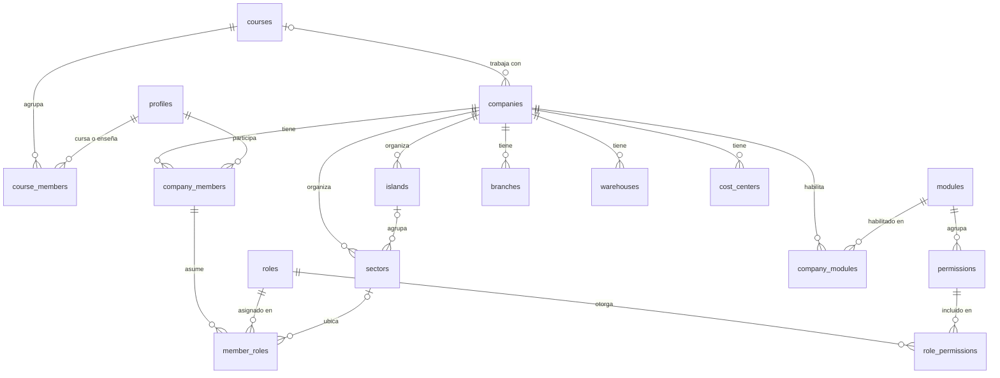
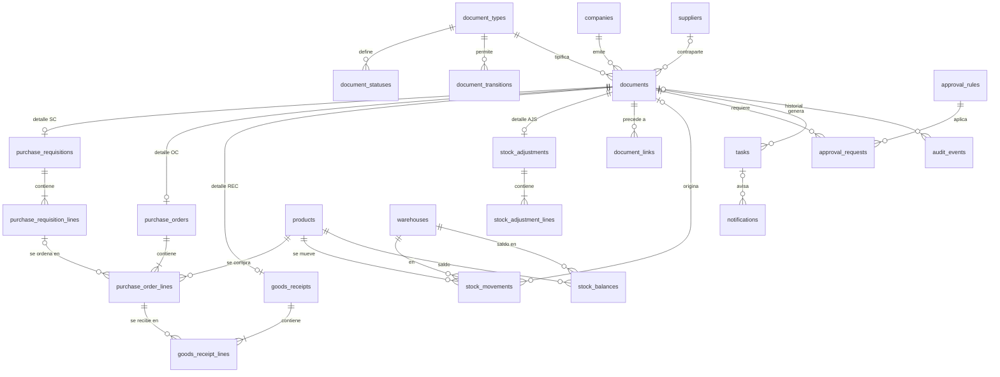

# Modelo de datos — INTEGR-AR

> **Revisión de Fase 0 (26/09/2026):** el nuevo pedido de arquitectura se documenta en [docs/fase-0-2027/README.md](docs/fase-0-2027/README.md). Esa propuesta identifica diferencias con el prototipo existente; este documento conserva el contexto anterior y no implica que Supabase ya esté implementado.

> **Versión 0.1 · Fase 0 · modelo preliminar.** Los bloques de definición son **borradores de diseño**, no migraciones ejecutables. Las migraciones reales se escriben y prueban en la Fase 1.
> Contexto de arquitectura: [ARCHITECTURE.md](ARCHITECTURE.md). Estados y reglas del circuito: [docs/FLUJO_COMPRAS.md](docs/FLUJO_COMPRAS.md).
> **Una base de datos por escuela** (instancia): este modelo describe la base de **una** escuela. No existen tablas de instituciones. Ver [docs/INSTANCIAS.md](docs/INSTANCIAS.md).

## Índice

1. [Convenciones](#1-convenciones)
2. [Mapa de dominios](#2-mapa-de-dominios)
3. [Diagramas entidad-relación](#3-diagramas-entidad-relación)
4. [Escuela y empresa](#4-escuela-y-empresa)
5. [Roles, permisos y módulos](#5-roles-permisos-y-módulos)
6. [Maestros](#6-maestros)
7. [Núcleo de documentos](#7-núcleo-de-documentos)
8. [Compras y stock (MVP)](#8-compras-y-stock-mvp)
9. [Flujo de trabajo: aprobaciones, tareas y notificaciones](#9-flujo-de-trabajo-aprobaciones-tareas-y-notificaciones)
10. [Auditoría](#10-auditoría)
11. [Seguridad: RLS, funciones y triggers](#11-seguridad-rls-funciones-y-triggers)
12. [Plantillas, clonado y reinicio de empresas](#12-plantillas-clonado-y-reinicio-de-empresas)
13. [Catálogo de funciones RPC del MVP](#13-catálogo-de-funciones-rpc-del-mvp)
14. [Invariantes e índices](#14-invariantes-e-índices)
15. [Tablas de fases futuras](#15-tablas-de-fases-futuras)
16. [Datos de demostración](#16-datos-de-demostración)
17. [Migraciones](#17-migraciones)

---

## 1. Convenciones

| Tema | Regla |
|---|---|
| Instancia | Una base por escuela. Los datos de la escuela viven en `school_settings` (una única fila); nunca en el código |
| Nombres | Tablas en inglés, plural, `snake_case`. Glosario en [docs/GLOSARIO.md](docs/GLOSARIO.md) |
| Claves primarias | `id uuid default gen_random_uuid()`; `bigint identity` en tablas de alto volumen sólo de inserción (movimientos, auditoría) |
| Multiempresa | Toda tabla de negocio tiene `company_id uuid not null`, **incluidas las tablas de líneas** (RLS sin *joins*) |
| FK compuestas | Toda tabla de empresa declara `unique (company_id, id)`; las referencias entre tablas de empresa usan `(company_id, x_id)` → impide referencias cruzadas entre empresas |
| Auditoría de registro | `created_at`, `created_by`, `updated_at`, `updated_by` (triggers) |
| "Estado" | Maestros: `is_active boolean` (se desactivan, no se borran). Documentos: `status` validado contra catálogo |
| Importes | `numeric(14,2)`; precios y costos unitarios `numeric(14,4)`; cantidades `numeric(14,3)`; alícuotas `numeric(5,2)` |
| Fechas | `timestamptz` para eventos técnicos; `date` para fechas de negocio |
| Valores codificados | Catálogos (con etiquetas y descripciones) o `check`; **sin enums nativos** |
| Borrado | Documentos: nunca (se anulan). Maestros: se desactivan. Borrado físico sólo por reinicio de empresa |
| Vistas | `with (security_invoker = true)` para que apliquen el RLS de las tablas base |

Columnas estándar abreviadas en este documento como `…audit` = `created_at, created_by, updated_at, updated_by`.

---

## 2. Mapa de dominios

| Dominio | Tablas | Fase |
|---|---|---|
| Escuela | `school_settings`, `profiles`, `courses`, `course_members` | MVP |
| Empresa | `companies`, `branches`, `warehouses`, `cost_centers`, `islands`, `sectors` | MVP |
| Seguridad | `modules`, `roles`, `permissions`, `role_permissions`, `company_members`, `member_roles`, `company_modules` | MVP |
| Maestros | `customers`, `suppliers`, `product_categories`, `units_of_measure`, `products`, `supplier_products` | MVP |
| Documentos | `document_types`, `document_statuses`, `document_transitions`, `document_sequences`, `documents`, `document_links` | MVP |
| Compras | `purchase_requisitions` (+`_lines`), `purchase_orders` (+`_lines`) | MVP |
| Stock | `goods_receipts` (+`_lines`), `stock_adjustments` (+`_lines`), `stock_movement_types`, `stock_movements`, `stock_balances` | MVP |
| Flujo | `approval_rules`, `approval_requests`, `task_rules`, `tasks`, `notifications` | MVP |
| Auditoría | `audit_events` | MVP |
| Pedagogía | `user_errors`, `scenarios`, `scenario_runs`, `assignments`… | Fases 2 y 8 |
| Resto de módulos | ver [§15](#15-tablas-de-fases-futuras) | Fases 2 a 9 |

---

## 3. Diagramas entidad-relación

### 3.1 Escuela, empresa y seguridad

`school_settings` es una tabla de una sola fila sin relaciones: no aparece en el diagrama.



### 3.2 Documentos, compras, stock y flujo



---

## 4. Escuela y empresa

```sql
school_settings (                       -- una sola fila: la escuela dueña de esta instancia
  id smallint PK default 1 check (id = 1),
  official_name text not null,          -- "Escuela Normal Superior N.º 9"
  short_name text not null,             -- "ENS N.º 9"
  logo_path text,                       -- Storage: school/logo.png
  city text, province text, contact_email text,
  timezone text not null default 'America/Argentina/Buenos_Aires',
  features jsonb not null default '{}', -- funcionalidades opcionales habilitadas
  service_info jsonb not null default '{}',  -- datos del contrato; sólo SUPERADMIN
  updated_by, updated_at
)

profiles (                              -- 1:1 con auth.users; se crea por trigger
  id                    uuid PK → auth.users(id) on delete cascade,
  username              text unique not null,          -- lo que el estudiante escribe al ingresar
  first_name            text not null,
  last_name             text not null,
  app_role              text not null default 'ESTUDIANTE'
                        check (app_role in ('SUPERADMIN','ADMIN','DOCENTE','ESTUDIANTE')),
  is_active             boolean not null default true,
  must_change_password  boolean not null default true,
  …audit
)
-- SUPERADMIN = soporte del proveedor · ADMIN = administración escolar

courses (                               -- "5.º A — 2027"
  id uuid PK,
  academic_year int not null, name text not null, orientation text,
  is_active boolean default true,
  unique (academic_year, name)
)

course_members (
  course_id → courses, user_id → profiles,
  role text check (role in ('DOCENTE','ESTUDIANTE')),
  PK (course_id, user_id)
)

companies (                             -- empresa simulada
  id uuid PK,
  course_id uuid null → courses,
  slug text unique not null,            -- para URLs: /e/forestal-del-norte-5a
  legal_name text not null,             -- razón social
  trade_name text,                      -- nombre comercial
  tax_id text not null,                 -- CUIT simulado
  vat_condition text not null default 'RESPONSABLE_INSCRIPTO',
  activity text,
  address_line text, city text, province text, postal_code text,
  start_date date,                      -- inicio de actividades
  logo_path text,                       -- Storage: {company_id}/logo.png
  simulation_date date null,            -- fecha de negocio simulada (null = hoy)
  is_template boolean not null default false,
  status text not null default 'ACTIVA' check (status in ('ACTIVA','ARCHIVADA')),
  settings jsonb not null default '{}', -- p. ej. {"sod_enabled": true, "allow_negative_stock": false}
  …audit
)

branches      (id, company_id, code, name, address_line, city, is_active, …audit, unique(company_id, code))
warehouses    (id, company_id, branch_id null, code, name, is_active, …audit, unique(company_id, code))
cost_centers  (id, company_id, code, name, is_active, …audit, unique(company_id, code))
islands       (id, company_id, number int, name, unique(company_id, number))      -- islas del aula
sectors       (id, company_id, code, name, island_id null, cost_center_id null, description, is_active,
               unique(company_id, code))
```

Todas las tablas con `company_id` declaran además `unique (company_id, id)` para habilitar FK compuestas.

---

## 5. Roles, permisos y módulos

```sql
modules (                               -- catálogo global
  code text PK,                         -- 'masters','purchasing','inventory','management','audit', …
  name text not null, description text, sort int, phase int
)

roles (                                 -- catálogo global de roles funcionales
  id uuid PK, code text unique not null,  -- 'COMPRAS','GERENCIA','DOCENTE', …
  name text not null, description text,   -- descripción pedagógica del puesto
  default_sector_code text,               -- sector sugerido al asignar
  is_supervisor boolean not null default false,  -- DOCENTE: todos los permisos, ignora bloqueos
  is_system boolean not null default true        -- a futuro: roles personalizados por empresa
)

permissions (
  code text PK,                         -- 'purchase_order.approve'
  module_code text not null → modules,
  resource text not null,               -- 'purchase_order'
  action text not null check (action in ('read','create','update','approve','cancel','delete','export')),
  description text
)

role_permissions (role_id → roles, permission_code → permissions, PK (role_id, permission_code))

company_members (
  id uuid PK, company_id → companies on delete cascade, user_id → profiles,
  job_title text,                       -- puesto ficticio: "Analista de Compras"
  is_active boolean not null default true,
  …audit, unique (company_id, user_id), unique (company_id, id)
)

member_roles (
  id uuid PK, company_id, member_id, role_id → roles, sector_id null,
  FK (company_id, member_id) → company_members(company_id, id) on delete cascade,
  FK (company_id, sector_id) → sectors(company_id, id),
  unique (member_id, role_id, sector_id)
)

company_modules (
  company_id → companies on delete cascade, module_code → modules,
  is_enabled boolean not null default true, updated_by, updated_at,
  PK (company_id, module_code)
)
```

La matriz completa de roles y permisos está en [docs/ROLES_Y_PERMISOS.md](docs/ROLES_Y_PERMISOS.md). Los catálogos (`modules`, `roles`, `permissions`, `role_permissions`) son **datos del sistema**: se cargan por migración, no por *seed*.

---

## 6. Maestros

```sql
customers (
  id uuid PK, company_id, code text not null,
  legal_name text not null, trade_name text, tax_id text,
  vat_condition text not null check (vat_condition in
    ('RESPONSABLE_INSCRIPTO','MONOTRIBUTO','EXENTO','CONSUMIDOR_FINAL')),
  address_line, city, province, postal_code, phone, email, contact_name,  -- ficticios
  payment_terms_days int not null default 0,
  credit_limit numeric(14,2) null,
  notes text, is_active boolean default true, …audit,
  unique (company_id, code), unique (company_id, id)
)

suppliers (                             -- mismos campos que customers, más:
  …,
  lead_time_days int,                   -- demora habitual de entrega
  category text                         -- aserradero, herrajes, pinturería…
)

product_categories (id, company_id, code, name, parent_id null, unique(company_id, code))

units_of_measure (                      -- catálogo global
  code text PK,                         -- 'UN','KG','L','M','M2','M3','PIE','CAJA','PAR','ROL'
  name text not null,                   -- 'PIE' = pie cuadrado (pie tablar), unidad usual de la madera
  allows_decimals boolean not null default true
)

products (
  id uuid PK, company_id, code text not null, name text not null, description text,
  category_id null,
  product_type text not null check (product_type in
    ('MATERIA_PRIMA','INSUMO','PRODUCTO_TERMINADO','MERCADERIA_REVENTA','SERVICIO')),
  uom_code text not null → units_of_measure,
  is_stockable boolean not null,        -- false para SERVICIO
  standard_cost numeric(14,4) default 0,
  sale_price numeric(14,2) null,
  vat_rate numeric(5,2) not null default 21.00,   -- 21 · 10,5 · 27 · 0
  min_stock numeric(14,3) not null default 0,
  reorder_qty numeric(14,3) null,        -- cantidad sugerida al reponer
  default_supplier_id null, default_warehouse_id null,
  location text,                         -- "Estantería B-3"
  is_active boolean default true, …audit,
  unique (company_id, code), unique (company_id, id),
  FK (company_id, category_id), FK (company_id, default_supplier_id), FK (company_id, default_warehouse_id)
)

supplier_products (                     -- "productos ofrecidos" por proveedor (P1 en MVP)
  company_id, supplier_id, product_id,
  supplier_sku text, last_price numeric(14,4), lead_time_days int,
  PK (supplier_id, product_id)
)
```

Se agrega `MERCADERIA_REVENTA` a los tipos pedidos porque la empresa es industrial **y** comercial (compra productos que revende sin transformar).

El **stock actual** del producto no es una columna: se obtiene de `stock_balances` (vista `v_product_stock`).

---

## 7. Núcleo de documentos

```sql
document_types (                        -- catálogo global
  code text PK,                         -- 'PURCHASE_ORDER'
  prefix text unique not null,          -- 'OC'
  name text not null,                   -- 'Orden de compra'
  module_code text not null → modules,
  resource text not null,               -- 'purchase_order' (raíz de los permisos)
  description text,                     -- qué es, quién lo emite, para qué sirve (pedagógico)
  is_printable boolean not null default true
)

document_statuses (
  doc_type → document_types, code text,
  label text not null,                  -- 'Pendiente de aprobación'
  description text,                     -- qué significa y qué se espera
  badge text not null check (badge in ('neutral','info','warning','success','danger')),
  is_initial boolean default false, is_final boolean default false, sort int,
  PK (doc_type, code)
)

document_transitions (
  doc_type, from_status, action text, to_status,
  -- action: SUBMIT, APPROVE, REJECT, WITHDRAW, REOPEN, SEND, CONFIRM, CANCEL, CLOSE, SYSTEM
  permission_code text null → permissions,   -- null sólo en transiciones SYSTEM
  label text,                           -- texto del botón: "Enviar a aprobación"
  help_text text,                       -- explicación para el panel "¿Qué sigue?"
  requires_comment boolean default false,-- rechazos y anulaciones exigen motivo
  PK (doc_type, from_status, action, to_status),
  FK (doc_type, from_status) → document_statuses, FK (doc_type, to_status) → document_statuses
)

document_sequences (
  company_id, doc_type, next_number int not null default 1, padding int not null default 5,
  PK (company_id, doc_type)
)

documents (                             -- cabecera común de todo comprobante
  id uuid PK,
  company_id uuid not null → companies on delete cascade,
  doc_type text not null → document_types,
  number int not null,
  display_number text not null,         -- 'OC-00023'
  status text not null,
  document_date date not null,          -- fecha de negocio (real o simulada)
  sector_id uuid null,                  -- sector que origina el documento
  supplier_id uuid null, customer_id uuid null,
  currency char(3) not null default 'ARS',
  subtotal numeric(14,2) not null default 0,
  tax_total numeric(14,2) not null default 0,
  total numeric(14,2) not null default 0,
  notes text,
  status_reason text,                   -- motivo del último rechazo o anulación
  …audit,
  unique (company_id, doc_type, number),
  unique (company_id, id),
  unique (id, doc_type),                -- permite validar el tipo desde la tabla específica
  FK (doc_type, status) → document_statuses(doc_type, code),
  FK (company_id, sector_id) → sectors, FK (company_id, supplier_id) → suppliers,
  FK (company_id, customer_id) → customers,
  check (supplier_id is null or customer_id is null)
)

document_links (                        -- trazabilidad entre documentos
  company_id, from_document_id, to_document_id,
  link_type text not null default 'ORIGEN',
  created_at timestamptz default now(),
  PK (from_document_id, to_document_id),
  FK (company_id, from_document_id) → documents(company_id, id) on delete cascade,
  FK (company_id, to_document_id)   → documents(company_id, id) on delete cascade
)
```

**Tabla específica por tipo** (patrón de herencia por tabla): la PK es `document_id`, que referencia a `documents` **junto con el tipo**, de modo que una fila de `purchase_orders` sólo puede colgar de un documento de tipo `PURCHASE_ORDER`:

```sql
purchase_orders (
  document_id uuid PK,
  doc_type text not null default 'PURCHASE_ORDER' check (doc_type = 'PURCHASE_ORDER'),
  company_id uuid not null,
  FK (document_id, doc_type) → documents(id, doc_type) on delete cascade,
  …campos propios
)
```

### 7.1 Tipos de documento

| Código | Prefijo | Nombre | Módulo | Fase |
|---|---|---|---|---|
| `PURCHASE_REQUISITION` | SC | Solicitud de compra | purchasing | **MVP** |
| `PURCHASE_ORDER` | OC | Orden de compra | purchasing | **MVP** |
| `GOODS_RECEIPT` | REC | Recepción de mercadería | inventory | **MVP** |
| `STOCK_ADJUSTMENT` | AJS | Ajuste de stock | inventory | **MVP** |
| `RFQ` | SCT | Solicitud de cotización | purchasing | 3 |
| `SUPPLIER_QUOTE` | COT | Cotización de proveedor | purchasing | 3 |
| `SUPPLIER_INVOICE` | FCP | Factura de proveedor (simulada) | payables | 3 |
| `PAYMENT_ORDER` | OP | Orden de pago | treasury | 3 |
| `SALES_QUOTE` | PRE | Presupuesto | sales | 4 |
| `SALES_ORDER` | PV | Pedido de venta | sales | 4 |
| `DELIVERY_NOTE` | REM | Remito | sales | 4 |
| `SALES_INVOICE` | FV | Factura de venta (simulada) | receivables | 4 |
| `CUSTOMER_RECEIPT` | RBO | Recibo de cobro | treasury | 4 |
| `STOCK_TRANSFER` | TRF | Transferencia entre depósitos | inventory | 4 |
| `PRODUCTION_ORDER` | OPR | Orden de producción | production | 5 |
| `JOURNAL_ENTRY` | AS | Asiento contable | accounting | 2 |
| `PAYROLL_RUN` | LIQ | Liquidación de sueldos | payroll | 6 |
| `SHIPMENT` | DES | Despacho | logistics | 7 |

---

## 8. Compras y stock (MVP)

```sql
purchase_requisitions (                 -- SC
  document_id PK (+ doc_type check), company_id,
  needed_by date,
  priority text not null default 'NORMAL' check (priority in ('BAJA','NORMAL','ALTA','URGENTE')),
  reason text not null                  -- por qué se necesita (obligatorio: se enseña a justificar)
)

purchase_requisition_lines (
  id uuid PK, company_id, document_id, line_no int not null,
  product_id, quantity numeric(14,3) not null check (quantity > 0), uom_code,
  qty_ordered numeric(14,3) not null default 0,   -- mantenido por RPC: cubierto por OC no anuladas
  notes text,
  unique (document_id, line_no), FK (company_id, document_id), FK (company_id, product_id)
)

purchase_orders (                       -- OC
  document_id PK (+ doc_type check), company_id,
  -- proveedor y totales en documents
  expected_date date,                   -- fecha de entrega comprometida
  warehouse_id not null,                -- depósito de destino
  payment_terms_days int not null default 0,
  delivery_terms text,
  approved_at timestamptz, sent_at timestamptz
)

purchase_order_lines (
  id uuid PK, company_id, document_id, line_no int not null,
  product_id,
  requisition_line_id uuid null,        -- vínculo con la línea de SC que atiende
  quantity numeric(14,3) not null check (quantity > 0),
  unit_price numeric(14,4) not null check (unit_price >= 0),   -- neto, sin IVA
  discount_pct numeric(5,2) not null default 0,
  vat_rate numeric(5,2) not null,
  line_subtotal numeric(14,2) not null, line_tax numeric(14,2) not null, line_total numeric(14,2) not null,
  qty_received numeric(14,3) not null default 0,   -- mantenido por RPC
  unique (document_id, line_no),
  FK (company_id, requisition_line_id) → purchase_requisition_lines(company_id, id)
)

goods_receipts (                        -- REC
  document_id PK (+ doc_type check), company_id,
  purchase_order_id uuid not null,      -- documento OC recibido
  warehouse_id not null,
  supplier_delivery_note text not null, -- N.º de remito del proveedor
  received_at timestamptz,
  carrier_name text
)

goods_receipt_lines (
  id uuid PK, company_id, document_id,
  po_line_id not null → purchase_order_lines, product_id,
  quantity numeric(14,3) not null check (quantity > 0),
  unit_cost numeric(14,4) not null,     -- = precio neto de la OC (base del PPP)
  notes text
)

stock_adjustments (                     -- AJS
  document_id PK (+ doc_type check), company_id, warehouse_id,
  reason_code text not null check (reason_code in
    ('INVENTARIO_INICIAL','CONTEO_FISICO','ROTURA','CONSUMO_INTERNO','OTRO'))
)

stock_adjustment_lines (
  id uuid PK, company_id, document_id, product_id,
  quantity_delta numeric(14,3) not null check (quantity_delta <> 0),
  unit_cost numeric(14,4) null,         -- requerido en ajustes positivos
  notes text
)

stock_movement_types (                  -- catálogo
  code text PK, name text, direction smallint check (direction in (1,-1)), description text
)
-- MVP: STOCK_INICIAL (+), RECEPCION_COMPRA (+), ANULACION_RECEPCION (−),
--      AJUSTE_POSITIVO (+), AJUSTE_NEGATIVO (−)
-- Futuro: CONSUMO_PRODUCCION (−), INGRESO_PRODUCCION (+), DESPACHO_VENTA (−),
--         DEVOLUCION_CLIENTE (+), DEVOLUCION_PROVEEDOR (−), TRANSFERENCIA_SALIDA (−), TRANSFERENCIA_ENTRADA (+)

stock_movements (                       -- kardex: sólo inserción
  id bigint generated always as identity PK,
  company_id, product_id, warehouse_id,
  movement_type text not null → stock_movement_types,
  quantity numeric(14,3) not null,      -- con signo: + entrada, − salida
  unit_cost numeric(14,4), total_cost numeric(14,2),
  balance_qty numeric(14,3) not null,   -- saldo posterior (para el kardex)
  balance_avg_cost numeric(14,4),       -- PPP posterior
  document_id uuid null, document_line_id uuid null,
  movement_date date not null,          -- fecha de negocio
  created_by uuid, created_at timestamptz default now()
)

stock_balances (
  company_id, product_id, warehouse_id,
  qty_on_hand numeric(14,3) not null default 0,
  avg_unit_cost numeric(14,4) not null default 0,  -- PPP
  last_movement_at timestamptz,
  PK (product_id, warehouse_id)
)
```

**Costo promedio ponderado** en cada entrada:
`nuevo_ppp = (saldo × ppp_actual + cantidad_entrada × costo_entrada) / (saldo + cantidad_entrada)`.
Las salidas se valúan al PPP vigente.

---

## 9. Flujo de trabajo: aprobaciones, tareas y notificaciones

```sql
approval_rules (
  id uuid PK, company_id, doc_type,
  level int not null default 1,
  min_amount numeric(14,2) not null default 0,
  max_amount numeric(14,2) null,         -- null = sin tope
  approver_role_id → roles,
  require_different_user boolean not null default true,   -- separación de funciones
  description text, is_active boolean default true, …audit
)
-- MVP (Forestal del Norte): OC ≤ 500.000 → COMPRAS · OC > 500.000 → GERENCIA

approval_requests (
  id uuid PK, company_id, document_id, rule_id, level, approver_role_id,
  amount numeric(14,2) not null,         -- monto evaluado (fotografía)
  status text not null check (status in ('PENDIENTE','APROBADO','RECHAZADO','CANCELADO')),
  requested_by, requested_at, decided_by, decided_at, comment text
)

task_rules (                            -- catálogo: qué tarea abrir al entrar en un estado
  doc_type, status, task_type text,
  assignee_kind text not null check (assignee_kind in ('ROLE','APPROVER','CREATOR')),
  role_code text null,                   -- si assignee_kind = 'ROLE'
  title_template text not null,          -- 'Aprobar {number} por {total}'
  description text,                      -- qué hay que hacer y por qué
  notify boolean not null default true,
  PK (doc_type, status, task_type)
)

tasks (
  id uuid PK, company_id,
  document_id uuid null,                 -- null en tareas no documentales (p. ej. stock mínimo)
  task_type text not null, title text not null, description text,
  origin_status text null,               -- estado del documento que la originó
  context jsonb,                         -- p. ej. {"product_id": "…"} para REPONER_STOCK
  assigned_role_id null, assigned_sector_id null, assigned_user_id null,
  status text not null default 'PENDIENTE'
    check (status in ('PENDIENTE','EN_CURSO','RESUELTA','CANCELADA')),
  priority text default 'NORMAL', due_date date,
  source text not null default 'SISTEMA' check (source in ('SISTEMA','DOCENTE','ESCENARIO')),
  claimed_by, claimed_at, completed_by, completed_at,
  created_by, created_at
)

notifications (
  id uuid PK, company_id, recipient_user_id → profiles,
  type text not null,                    -- 'NUEVA_TAREA','OC_APROBADA','STOCK_MINIMO', …
  title text not null, body text,
  link_path text,                        -- ruta interna a la que lleva
  document_id null, task_id null,
  read_at timestamptz null, created_at timestamptz default now()
)
```

### 9.1 Reglas de tareas del MVP

| Documento | Al entrar en | Tarea | Asignada a |
|---|---|---|---|
| SC | `SOLICITADO` | Atender {número} | Rol COMPRAS |
| SC | `ORDENADO_PARCIAL` | Completar {número} (saldo sin ordenar) | Rol COMPRAS |
| OC | `PENDIENTE_APROBACION` | Aprobar {número} por {total} | Aprobador según regla |
| OC | `RECHAZADO` | Revisar {número} rechazada | Creador |
| OC | `APROBADO` | Enviar {número} al proveedor | Rol COMPRAS |
| OC | `ENVIADO` | Recibir mercadería de {número} | Rol DEPOSITO |
| OC | `RECIBIDO_PARCIAL` | Recibir saldo de {número} | Rol DEPOSITO |
| REC | `BORRADOR` | Confirmar {número} | Creador |
| — | stock < mínimo | Evaluar reposición de {producto} | Rol DEPOSITO |

Las notificaciones se reparten a cada usuario con el rol destinatario en ese momento (máx. ~30 por empresa).

---

## 10. Auditoría

```sql
audit_events (                          -- sólo inserción
  id bigint generated always as identity PK,
  company_id uuid null → companies on delete cascade,   -- null: eventos de la escuela (usuarios, cursos, configuración)
  occurred_at timestamptz not null default now(),
  actor_user_id uuid null,               -- null = sistema
  actor_name text,                       -- fotografía: "María López"
  actor_role_code text,                  -- "GERENCIA"
  actor_sector_id uuid, actor_sector_name text,
  action text not null,                  -- CREATE, UPDATE, SUBMIT, APPROVE, REJECT, SEND, CONFIRM, CANCEL…
  entity_type text not null,             -- 'purchase_order', 'product', 'member_role'…
  entity_id uuid, entity_label text,     -- 'OC-00023', 'MP-004 Placa MDF 18 mm'
  document_id uuid null → documents on delete set null,
  from_status text, to_status text,
  summary text not null,                 -- "Aprobó OC-00023 por $ 812.400,00"
  changes jsonb,                         -- diferencias campo a campo (maestros)
  metadata jsonb
)
```

Vista de ejemplo en pantalla:

```
14:03  Juan Pérez    · Compras   · Creó OC-00023                         BORRADOR → —
14:07  Juan Pérez    · Compras   · Envió OC-00023 a aprobación            BORRADOR → PENDIENTE_APROBACION
14:15  María López   · Gerencia  · Aprobó OC-00023 por $ 812.400,00       PENDIENTE_APROBACION → APROBADO
15:42  Pedro Gómez   · Depósito  · Registró REC-00007 (remito 0003-4521)  — → CONFIRMADO
```

El sector del actor se determina por el rol que otorgó el permiso usado en la acción.

---

## 11. Seguridad: RLS, funciones y triggers

### 11.1 Funciones auxiliares (esquema `private`)

Devuelven **conjuntos** (evaluados una vez por consulta), no booleanos por fila: es el patrón más eficiente para RLS.

```sql
-- Empresas en las que el usuario actual tiene un permiso efectivo
create or replace function private.companies_with_permission(p_permission text)
returns setof uuid
language sql stable security definer
set search_path = ''
as $$
  select m.company_id
  from public.company_members m
  join public.member_roles mr on mr.member_id = m.id
  join public.roles r on r.id = mr.role_id
  where m.user_id = (select auth.uid())
    and m.is_active
    and (
      r.is_supervisor                     -- DOCENTE: todo, sin bloqueo de módulos
      or exists (
        select 1
        from public.role_permissions rp
        join public.permissions p on p.code = rp.permission_code
        join public.company_modules cm
          on cm.company_id = m.company_id and cm.module_code = p.module_code
        where rp.role_id = r.id
          and rp.permission_code = p_permission
          and cm.is_enabled
      )
    )
  union
  select c.id from public.companies c   -- SUPERADMIN y ADMIN de la escuela ven todas las empresas
  where exists (select 1 from public.profiles pr
                where pr.id = (select auth.uid())
                  and pr.app_role in ('SUPERADMIN','ADMIN') and pr.is_active);
$$;

-- Pares (empresa, tipo de documento) que el usuario puede leer
create or replace function private.readable_document_scopes()
returns table (company_id uuid, doc_type text)
language sql stable security definer set search_path = ''
as $$ /* une companies_with_permission(dt.resource || '.read') para cada document_type */ $$;

-- Pares (empresa, rol) del usuario actual: para tareas asignadas a su rol
create or replace function private.my_company_roles()
returns table (company_id uuid, role_id uuid)
language sql stable security definer set search_path = '' as $$ … $$;
```

### 11.2 Políticas tipo

```sql
-- Maestros: lectura y ABM por permiso; sin DELETE (se desactivan)
alter table public.products enable row level security;

create policy products_select on public.products for select to authenticated
  using (company_id in (select private.companies_with_permission('product.read')));

create policy products_insert on public.products for insert to authenticated
  with check (company_id in (select private.companies_with_permission('product.create')));

create policy products_update on public.products for update to authenticated
  using      (company_id in (select private.companies_with_permission('product.update')))
  with check (company_id in (select private.companies_with_permission('product.update')));

-- Documentos: sólo lectura directa; toda escritura por RPC
alter table public.documents enable row level security;

create policy documents_select on public.documents for select to authenticated
  using ((company_id, doc_type) in (select company_id, doc_type
                                    from private.readable_document_scopes()));
-- (sin políticas INSERT/UPDATE/DELETE)

-- Tareas: las propias, las de mis roles, o todas si tengo task.read (Gerencia, Auditoría)
create policy tasks_select on public.tasks for select to authenticated
  using (
    assigned_user_id = (select auth.uid())
    or (company_id, assigned_role_id) in (select company_id, role_id from private.my_company_roles())
    or company_id in (select private.companies_with_permission('task.read'))
  );

-- Notificaciones: sólo las propias
create policy notifications_select on public.notifications for select to authenticated
  using (recipient_user_id = (select auth.uid()));
```

Las líneas de cada documento usan la misma política que su cabecera (vía `company_id` y el permiso de lectura del tipo). `audit_events`: legible con `audit.read`, o por quien puede leer el documento asociado.

### 11.3 Esqueleto de un comando RPC

```sql
-- Borrador ilustrativo: se implementa y prueba en la Fase 1
create or replace function public.po_approve(p_document_id uuid, p_comment text default null)
returns public.documents
language plpgsql
security definer
set search_path = ''
as $$
declare
  v_doc public.documents;
  v_req public.approval_requests;
begin
  select * into v_doc from public.documents
   where id = p_document_id and doc_type = 'PURCHASE_ORDER'
   for update;                                              -- 1. bloqueo
  if not found then
    perform private.raise_business_error('DOCUMENTO_INEXISTENTE', 'La orden de compra no existe.');
  end if;

  select * into v_req from public.approval_requests
   where document_id = v_doc.id and status = 'PENDIENTE'
   order by level limit 1 for update;
  if not found then                                         -- 2. estado
    perform private.raise_business_error('TRANSICION_INVALIDA',
      format('%s no está pendiente de aprobación.', v_doc.display_number));
  end if;

  perform private.require_role(v_doc.company_id, v_req.approver_role_id,
    'Esta orden debe aprobarla el rol indicado por la regla de aprobación.');  -- 3. permiso

  if v_req.require_different_user and v_doc.created_by = (select auth.uid()) then
    perform private.raise_business_error('SEPARACION_FUNCIONES',
      'No podés aprobar una orden de compra que creaste vos.',
      'Separación de funciones: quien compra no autoriza su propia compra.');   -- 4. control interno
  end if;

  update public.approval_requests
     set status = 'APROBADO', decided_by = (select auth.uid()), decided_at = now(), comment = p_comment
   where id = v_req.id;

  -- 5. transición: valida catálogo, actualiza estado, audita, cierra/abre tareas, notifica
  return private.transition_document(v_doc.id, 'APPROVE', p_comment);
end;
$$;

revoke execute on function public.po_approve(uuid, text) from public, anon;
grant  execute on function public.po_approve(uuid, text) to authenticated;
```

### 11.4 Triggers

| Trigger | Tablas | Efecto |
|---|---|---|
| `handle_new_user` | `auth.users` (insert) | Crea `profiles` desde los metadatos del alta |
| `set_updated_at` | Todas con `updated_at` | Mantiene `updated_at`/`updated_by` |
| `prevent_company_change` | Todas con `company_id` | Rechaza cambios de `company_id` |
| `audit_row_change` | Maestros, `companies`, `sectors`, `company_members`, `member_roles`, `approval_rules`, `company_modules` | Registra alta/modificación con diferencias |
| `forbid_mutation` | `audit_events`, `stock_movements` | Rechaza `UPDATE` y `DELETE` |

### 11.5 Storage

Bucket `company-assets` (privado), rutas `{company_id}/logo.png`, `{company_id}/attachments/{document_id}/…`. Políticas: el primer segmento de la ruta debe pertenecer a `companies_with_permission(...)`.

---

## 12. Plantillas, clonado y reinicio de empresas

Cada tabla se clasifica para saber qué hacer al reiniciar o clonar:

| Clase | Ejemplos | Al clonar | Al reiniciar |
|---|---|---|---|
| Estructura | `sectors`, `islands`, `warehouses`, `cost_centers`, `approval_rules`, `company_modules` | Se copia | Se conserva |
| Maestros | `customers`, `suppliers`, `products`, `supplier_products` | Se copia | Se restaura desde la plantilla |
| Personas | `company_members`, `member_roles` | No se copia | Se conserva |
| Transaccional | `documents` (y todo lo que cuelga), `stock_movements`, `stock_balances`, `tasks`, `notifications`, `approval_requests` | No se copia | Se borra y se recarga el stock inicial |
| Numeración | `document_sequences` | Se reinicia en 1 | Se reinicia en 1 |
| Auditoría | `audit_events` | No se copia | Se conserva y se registra un evento `RESET` |

Funciones previstas: `private.seed_demo_company(company_id)` (MVP), `private.clone_company(template_id, …)` y `private.reset_company(company_id)` (Fase 8, adelantables si el piloto lo necesita).

---

## 13. Catálogo de funciones RPC del MVP

| Función | Quién | Efecto |
|---|---|---|
| `my_context()` | Todos | Perfil, rol en la escuela, datos de la escuela, empresas con roles y sectores |
| `my_permissions(company_id)` | Todos | Permisos efectivos en la empresa |
| `document_available_actions(document_id)` | Todos | Acciones posibles y motivo si no lo son |
| `pr_create(company_id, header, lines)` | Producción, Depósito | SC en `BORRADOR` |
| `pr_update(document_id, header, lines)` | Creador / su sector | Sólo en `BORRADOR` |
| `pr_submit(document_id)` | Creador / su sector | → `SOLICITADO`; tarea a Compras |
| `pr_reject(document_id, reason)` | Compras | → `RECHAZADO` |
| `pr_close(document_id, reason)` | Compras | `ORDENADO_PARCIAL` → `CERRADO` |
| `pr_cancel(document_id, reason)` | Solicitante | → `ANULADO` (sin OC asociadas) |
| `po_create(company_id, header, lines)` | Compras | OC en `BORRADOR`; recalcula cobertura de SC; vínculos |
| `po_update(document_id, header, lines)` | Compras | Sólo en `BORRADOR` |
| `po_submit(document_id)` | Compras | Evalúa reglas → `PENDIENTE_APROBACION` |
| `po_withdraw(document_id)` | Creador | `PENDIENTE_APROBACION` → `BORRADOR` |
| `po_approve(document_id, comment)` | Aprobador | → `APROBADO` |
| `po_reject(document_id, reason)` | Aprobador | → `RECHAZADO` |
| `po_reopen(document_id)` | Compras | `RECHAZADO` → `BORRADOR` |
| `po_send(document_id)` | Compras | → `ENVIADO`; tarea a Depósito |
| `po_close(document_id, reason)` | Compras, Gerencia | `RECIBIDO_PARCIAL` → `CERRADO` |
| `po_cancel(document_id, reason)` | Compras, Gerencia | → `ANULADO` (sin recepciones); libera cobertura de SC |
| `gr_create(company_id, po_id, header, lines, confirm)` | Depósito | REC en `BORRADOR` o confirmada |
| `gr_confirm(document_id)` | Depósito | Stock, PPP, kardex, estado de la OC, notificaciones |
| `gr_cancel(document_id, reason)` | Depósito (otro usuario) / Gerencia | Borrador: anula. Confirmada: contramovimiento (P1) |
| `sa_create` / `sa_confirm` / `sa_cancel` | Depósito | Ajuste de stock |
| `task_claim(task_id)` / `task_release(task_id)` | Destinatarios | Tomar o liberar una tarea |
| `notifications_mark_read(ids)` | Destinatario | Marca leídas |
| `company_create_from_template(course_id, name, template)` | Docente | Crea empresa con datos demo |
| `member_assign_role(company_id, user_id, role_code, sector_code)` / `member_remove_role(...)` | Docente | Asignaciones |
| `company_set_module(company_id, module_code, enabled)` | Docente | Bloquea o habilita módulos |

Edge Function `admin-users`: alta masiva de estudiantes (DOCENTE), alta de docentes (ADMIN), alta de la cuenta ADMIN inicial (SUPERADMIN), restablecer contraseña, desactivar usuario.

Funciones internas (`private`): `transition_document`, `open_tasks_for_status`, `close_tasks_for_status`, `notify_role`, `next_document_number`, `post_stock_movement`, `recompute_po_status`, `recompute_pr_coverage`, `log_audit`, `current_actor`, `require_permission`, `require_role`, `raise_business_error`, `business_date`.

---

## 14. Invariantes e índices

### 14.1 Invariantes (verificadas con pgTAP)

1. `stock_balances.qty_on_hand` = suma de `stock_movements.quantity` por producto y depósito.
2. `purchase_order_lines.qty_received` = suma de cantidades de recepciones **confirmadas**.
3. `purchase_requisition_lines.qty_ordered` = suma de cantidades en líneas de OC **no anuladas**.
4. `documents.total` = suma de las líneas; recalculado en servidor.
5. Sin stock negativo, salvo que la empresa lo habilite (`settings.allow_negative_stock`).
6. No existen referencias entre empresas distintas (garantizado por FK compuestas).
7. Ningún usuario lee ni modifica datos de una empresa en la que no es miembro.
8. `audit_events` y `stock_movements` nunca se modifican.

### 14.2 Índices principales

- `company_id` en toda tabla de empresa (casi todos cubiertos por los `unique (company_id, …)`).
- `documents (company_id, doc_type, status)`, `documents (company_id, document_date desc)`.
- `tasks (company_id, status, assigned_role_id)`, `tasks (assigned_user_id) where status in ('PENDIENTE','EN_CURSO')`.
- `notifications (recipient_user_id, read_at)`.
- `stock_movements (company_id, product_id, warehouse_id, id)`.
- `audit_events (company_id, occurred_at desc)`, `audit_events (document_id)`.
- `company_members (user_id)`, `member_roles (member_id)`.

---

## 15. Tablas de fases futuras

La mayoría son **nuevos tipos de documento** sobre `documents` más sus líneas.

| Módulo | Tablas principales | Fase |
|---|---|---|
| Pedagogía (base) | `user_errors`, `document_comments`, `attachments` | 2 |
| Contabilidad | `accounts` (plan de cuentas), `fiscal_years`, `fiscal_periods`, `journal_entries`, `journal_entry_lines`, `posting_rules` | 2 |
| Compras completo | `rfqs` (+líneas, +proveedores invitados), `supplier_quotes` (+líneas), `supplier_invoices` (+líneas), `supplier_ledger_entries` | 3 |
| Tesorería | `cash_boxes`, `bank_accounts`, `payment_methods`, `payment_orders` (+ítems), `treasury_movements`, `checks`, `bank_reconciliations` | 3 |
| Ventas | `price_lists`, `sales_quotes`, `sales_orders` (+líneas), `delivery_notes` (+líneas), `sales_invoices` (+líneas), `customer_receipts` (+líneas); lo reservado no se guarda: es lo que les falta entregar a los pedidos en curso (docs/FASE_4_VENTAS_Y_CLIENTES.md) | 4 |
| Producción | `bills_of_materials` (+líneas), `work_centers`, `production_orders`, `production_consumptions`, `production_outputs` | 5 |
| Costos | `cost_records`, `overhead_rates`, `standard_costs`; vistas de desvíos previsto vs. real | 5 |
| RRHH | `employees`, `job_positions`, `employee_categories`, `attendance_records`, `leaves`, `hr_events` (novedades) | 6 |
| Sueldos | `payroll_concepts`, `payroll_runs`, `payslips`, `payslip_lines` | 6 |
| Impuestos | `tax_types`, `tax_rates`, `tax_obligations`, `tax_calendar`, `withholdings`, `perceptions` | 7 |
| Logística | `carriers`, `vehicles`, `routes`, `shipments`, `shipment_items` | 7 |
| Escenarios | `scenarios`, `scenario_runs`, `assignments` (consignas), `assignment_submissions` | 8 |
| Tutor IA | `tutor_sessions`, `tutor_messages` | 9 |

Notas de diseño anticipadas:
- **Cuenta corriente** de clientes y proveedores: libro de movimientos (`*_ledger_entries`) generado por facturas, pagos y cobros; el saldo es una suma, nunca una columna editable.
- **Integración contable**: cada comando que produce un hecho contable llama a `private.post_journal_entry(evento, document_id)`, que arma el asiento a partir de `posting_rules` (cuenta debe/haber por tipo de evento). El asiento se vincula al documento de origen.
- **Empleados ≠ usuarios**: los empleados son personas ficticias de la empresa simulada; los estudiantes son usuarios. Opcionalmente se podrá vincular un miembro con un legajo ("Juan Pérez, Analista de Compras").

---

## 16. Datos de demostración

**Empresa plantilla: FORESTAL DEL NORTE SRL** (datos ficticios, iguales en todas las instancias)

| Dato | Valor |
|---|---|
| Razón social | Forestal del Norte SRL |
| Actividad | Fabricación de muebles y productos derivados de la madera |
| Ubicación | Eldorado, Misiones (domicilio ficticio) |
| CUIT | Simulado, con formato válido y leyenda "(simulado)" en pantalla |
| Sucursales | Planta Eldorado · Showroom Posadas |
| Depósitos | `DEP-MP` Materias primas e insumos · `DEP-PT` Productos terminados |
| Centros de costo | Administración · Comercial · Aserrado · Carpintería · Terminación |
| Islas | 1 Gerencia y Control de Gestión · 2 Compras · 3 Ventas y Clientes · 4 Contabilidad e Impuestos · 5 Tesorería y Finanzas · 6 RRHH y Sueldos · 7 Producción y Costos · 8 Depósito y Logística |

**Productos (20)**

| Código | Descripción | Tipo | Unidad |
|---|---|---|---|
| MP-001 | Tabla de pino elliottis 1" × 6" | Materia prima | PIE |
| MP-002 | Tabla de eucalipto grandis 1" × 8" | Materia prima | PIE |
| MP-003 | Tirante de pino 2" × 3" | Materia prima | PIE |
| MP-004 | Placa MDF 18 mm 1,83 × 2,60 m | Materia prima | UN |
| MP-005 | Placa MDF 5,5 mm (fondos) | Materia prima | UN |
| MP-006 | Placa fenólica 18 mm | Materia prima | UN |
| MP-007 | Tablero de pino *finger joint* 18 mm | Materia prima | UN |
| IN-001 | Cola vinílica para madera | Insumo | KG |
| IN-002 | Barniz poliuretánico | Insumo | L |
| IN-003 | Tornillo para madera 4 × 40 (caja × 500) | Insumo | CAJA |
| IN-004 | Bisagra cazoleta 35 mm | Insumo | UN |
| IN-005 | Corredera telescópica 45 cm | Insumo | PAR |
| IN-006 | Lija grano 120 | Insumo | UN |
| IN-007 | Film *stretch* para embalaje | Insumo | ROL |
| PT-001 | Mesa de comedor de pino 1,60 m | Producto terminado | UN |
| PT-002 | Silla de eucalipto | Producto terminado | UN |
| PT-003 | Placard de MDF 2 puertas | Producto terminado | UN |
| PT-004 | Cama 2 plazas de eucalipto | Producto terminado | UN |
| MR-001 | Colchón 2 plazas (reventa) | Mercadería de reventa | UN |
| SV-001 | Servicio de flete y entrega | Servicio | UN |

- **Stock inicial** mediante un ajuste `INVENTARIO_INICIAL`, con **algunos productos por debajo del mínimo** (p. ej. MP-004) para que el circuito de compra arranque el primer día.
- **10 proveedores** por rubro: aserradero, maderera de placas, herrajes, pinturería, bulonera, embalajes, fábrica de colchones, transporte, ferretería industrial, proveedor de servicios.
- **10 clientes** con condiciones de IVA variadas: mueblerías (RI), carpinteros (monotributo), constructora (RI), organismo (exento), mostrador (consumidor final).
- **Precios de referencia** actualizables por el docente con un porcentaje de ajuste (inflación) — función prevista `company_reprice(company_id, pct)`.
- **Con los módulos correspondientes**: 10 empleados (Fase 6), cuentas bancarias y cajas simuladas (Fase 3), plan de cuentas básico (Fase 2).
- Regla para todos los nombres: **claramente ficticios**; verificar que no coincidan con comercios reales conocidos de la región.

---

## 17. Migraciones

- Ubicación: `supabase/migrations/AAAAMMDDHHMMSS_descripcion.sql` (formato de la CLI).
- Orden previsto para la Fase 1:
  1. `extensions_and_schemas` — esquemas `private`, extensiones, funciones utilitarias
  2. `school` — configuración de la escuela, perfiles, cursos
  3. `companies` — empresas y estructura organizativa
  4. `rbac` — módulos, roles, permisos, membresías + **catálogos cargados**
  5. `masters` — clientes, proveedores, productos
  6. `documents_core` — catálogos de documentos, secuencias, cabecera, vínculos
  7. `workflow` — aprobaciones, tareas, notificaciones
  8. `audit` — auditoría y triggers
  9. `purchasing` — SC y OC
  10. `inventory` — recepciones, ajustes, movimientos, saldos
  11. `rls_policies` — políticas de todas las tablas
  12. `rpc_*` — comandos por dominio
  13. `demo_template` — función de datos demo
- **Catálogos del sistema** (roles, permisos, tipos y estados de documento, reglas de tareas) van en migraciones porque toda instancia los necesita. **Datos demo** van en `seed/` y en la función `seed_demo_company`. **Datos de la escuela** los carga el procedimiento de alta de la instancia, nunca una migración.
- Las migraciones son **idénticas para todas las instancias**: no existen migraciones "sólo para una escuela".
- Nunca editar una migración ya aplicada en una instancia: se crea una nueva.
