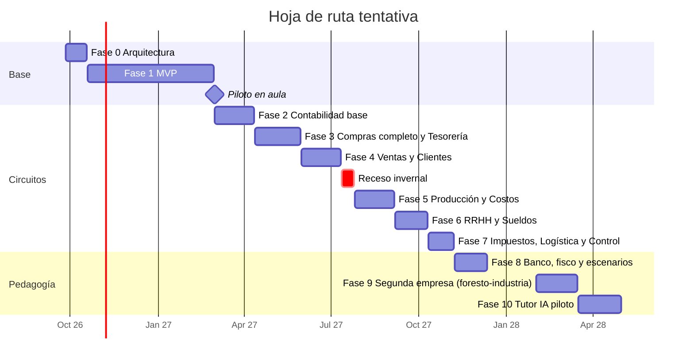

# Hoja de ruta 2026–2027 — INTEGR-AR

> **Revisión de Fase 0 (26/09/2026):** el nuevo pedido de arquitectura se documenta en [docs/fase-0-2027/README.md](docs/fase-0-2027/README.md). Esa propuesta identifica diferencias con el prototipo existente; este documento conserva el contexto anterior y no implica que Supabase ya esté implementado.

> Versión 0.1 · Fase 0. Fechas **tentativas**: se ajustan a la planificación anual real de 4.º, 5.º y 6.º año (decisión D-12) y al ritmo de desarrollo observado en la Fase 1.

## 1. Criterio de ordenamiento

1. **Núcleo primero**: todo módulo depende de multiempresa, permisos, documentos, flujo de trabajo y auditoría.
2. **Contabilidad antes que los circuitos que la alimentan**: así cada módulo nuevo genera sus asientos automáticos desde el primer día, sin "contabilizar hacia atrás".
3. **Circuitos completos antes que módulos sueltos**: se prioriza cerrar un ciclo (compra → pago) sobre abrir muchas pantallas.
4. **Cada fase termina usable en el aula**: nada queda "a medio camino" entre fases.

## 2. Calendario

Las fechas del receso invernal dependen del calendario escolar de la provincia.

## 3. Fases

### Fase 0 — Arquitectura (26/09 – 18/10/2026)
- **Entregables**: ARCHITECTURE, DATABASE, MVP, ROADMAP, README, roles y permisos, flujo de compras, guía de UI, glosario.
- **Salida**: decisiones ★ de [ARCHITECTURE.md §18](ARCHITECTURE.md#18-decisiones-pendientes) resueltas; spikes S-01 a S-04 de [MVP.md §11](MVP.md#11-spikes-técnicos-fase-0-antes-de-s0) exitosos.

### Fase 1 — MVP (19/10/2026 – 28/02/2027)
- **Alcance**: ver [MVP.md](MVP.md). Núcleo completo + circuito SC → OC → aprobación → recepción → stock.
- **Salida**: criterios de aceptación CA-01 a CA-15 cumplidos, incluida la instalación de la instancia demo con el procedimiento documentado.
- **Avance al 03/10/2026**: la interfaz del MVP funciona completa con backend simulado (ver [MVP.md §2](MVP.md#2-alcance), "Avance"). El proyecto de desarrollo de Supabase ya existe; falta construir la base (migraciones, RLS, RPC y pruebas).

### Fase 1.5 — Piloto (marzo 2027, en paralelo con Fase 2)
- Un curso, una empresa. Relevar dificultades, tiempos, errores frecuentes (base para el Tutor IA).
- Guía rápida para estudiantes y guía para docentes.
- **Salida**: lista priorizada de ajustes incorporada a la Fase 2.

### Fase 2 — Contabilidad base y mejoras del piloto (marzo – abril 2027)
- Plan de cuentas básico (validado por el docente), ejercicios y períodos.
- Asientos manuales con validación de partida doble; libro diario, mayor, balance de sumas y saldos.
- Motor de imputación (`posting_rules`) listo para los circuitos siguientes.
- Mejoras transversales: comentarios y adjuntos en documentos, registro de errores de estudiantes (`user_errors`), editor de reglas de aprobación, aprobación de ajustes de stock, consignas simples del docente.
- **Salida**: se puede registrar y consultar la contabilidad de la empresa manualmente.

### Fase 3 — Ciclo de compras y pagos + Tesorería (abril – mayo 2027)
- Solicitud de cotización, cotizaciones de proveedores y cuadro comparativo.
- Factura de proveedor simulada con control OC–recepción–factura.
- Cuenta corriente de proveedores; orden de pago; pago.
- Tesorería: cajas, cuentas bancarias simuladas, movimientos, transferencias, cheques simulados, conciliación simplificada, flujo de fondos.
- Asientos automáticos: compra (Mercaderías/Materias primas + IVA Crédito Fiscal a Proveedores), pago (Proveedores a Caja/Banco).
- **Salida**: el circuito del requerimiento original completo, de la necesidad de Producción al impacto en bancos y contabilidad.

### Fase 4 — Ventas y Clientes (junio – julio 2027)
- Presupuesto, pedido, reserva de stock, preparación, remito, factura simulada, cuenta corriente de clientes, cobro.
- Listas de precios; condición de IVA del cliente en la factura.
- Asientos automáticos de venta, costo de ventas y cobro.
- Escenarios habilitados: venta a crédito, cliente moroso, falta de stock.

### Fase 5 — Producción y Costos (julio – septiembre 2027)
- **Listas de materiales** (fórmula de cada producto terminado: qué materias primas e insumos consume y en qué cantidad). No figuraba en el requerimiento, pero sin ellas no se pueden calcular automáticamente las "materias primas necesarias".
- Orden de producción: planificada → liberada → en proceso → terminada; consumo real vs. previsto; ingreso del producto terminado.
- Centros de trabajo y centros de costo; materia prima, mano de obra y costos indirectos; costo unitario; previsto vs. real.
- Sugerencia automática de solicitudes de compra por faltantes de materiales.

### Fase 6 — RRHH y Sueldos (septiembre – octubre 2027)
- Legajos ficticios, puestos, categorías, asistencia, novedades, licencias, vacaciones, horas extras.
- Liquidación mensual simulada: conceptos remunerativos, no remunerativos, descuentos, aportes y contribuciones (tasas configurables, sin pretensión de exactitud legal vigente).
- Recibo de sueldo simulado; asiento de sueldos; pago por Tesorería.

### Fase 7 — Impuestos, Logística y Control de gestión (octubre – noviembre 2027)
- Libros IVA compras y ventas; posición mensual de IVA; Ingresos Brutos simplificado; retenciones y percepciones básicas.
- Calendario de obligaciones con estados PENDIENTE / PRESENTADO / PAGADO / VENCIDO (vencimientos automáticos).
- Logística: transportistas, vehículos, despachos, entregas, rutas, estado de entrega.
- Tablero de control de gestión: indicadores por área, alertas, comparaciones entre períodos.

### Fase 8 — Banco y fisco simulados, escenarios y panel docente avanzado (noviembre – diciembre 2027)
- Entorno simulado operado por estudiantes (isla 9): el banco (cuenta, órdenes, extracto, cargos, cheques y préstamos) y el fisco (padrón, puntos de venta, autorización de facturas, recepción de declaraciones, cuenta corriente tributaria e intimaciones), cada uno en modo automático u operado por la isla ([docs/FASE_8_BANCO_Y_FISCO.md](docs/FASE_8_BANCO_Y_FISCO.md)).
- Motor de escenarios: datos iniciales, consignas, criterios de logro, progreso por isla.
- Los siete escenarios: compra de materia prima, venta a crédito, producción, cliente moroso, falta de stock, pago de salarios, problema de liquidez.
- Clonado de empresas desde plantilla y reinicio de escenarios.
- Seguimiento de progreso y exportación de actividad para evaluación.

### Fase 9 — Una segunda empresa: la foresto-industria (febrero – marzo 2028, a validar)
- Varias empresas plantilla: el docente elige el rubro al crear la empresa de su curso; Forestal del Norte (mueblería) sigue igual ([docs/FASE_9_FORESTOINDUSTRIA.md](docs/FASE_9_FORESTOINDUSTRIA.md)).
- Una foresto-industria ficticia de primera transformación (playa de rollizos, aserradero con secado y remanufactura, tableros) con el motor actual.
- Producción por desarme: un rollizo da varios productos a la vez (coproductos y subproductos) y el costo se reparte entre ellos.

### Fase 10 — Tutor IA (piloto, marzo – abril 2028; antes Fase 9, renumerada el 30/10)
- Orientación contextual: qué hacer, qué significa un documento, por qué se bloqueó una acción.
- Detección de errores frecuentes a partir de `user_errors` y la auditoría.
- Preguntas guía; **nunca resuelve la actividad ni ejecuta acciones por el estudiante**.

### Línea paralela — Productización para otras escuelas (cuando haya una escuela interesada)

El sistema es para la ENS N.º 9; otras escuelas reciben una **instancia propia** ([docs/INSTANCIAS.md](docs/INSTANCIAS.md)). Esta línea **no compite con las fases pedagógicas**: se activa cuando aparezca un interesado real, idealmente con al menos las Fases 1 a 4 estables.

| Frente | Tareas |
|---|---|
| Legal y comercial | Titularidad acordada por escrito con la ENS N.º 9 (D-15); registro de autoría; marca (D-01); contrato de licencia y servicio con cláusulas de datos personales; precio; facturación |
| Técnico | Script de alta de instancia; despliegue de versiones a todas las instancias desde GitHub Actions; monitoreo básico por instancia; backups automatizados por instancia |
| Operativo | Instancia demo presentable; manual del ADMIN escolar; manual docente; guía del estudiante; procedimiento de soporte y de fin de servicio |

**Desde ahora** (sin costo extra) se cumplen las reglas que hacen posible replicar: un solo código, datos de la escuela fuera del código, migraciones idénticas, versionado.

## 4. Funcionalidades pospuestas deliberadamente

| Funcionalidad | Motivo | Cuándo reconsiderar |
|---|---|---|
| Motor de flujos de trabajo configurable por interfaz gráfica | Los catálogos en tablas alcanzan; una interfaz de diseño de flujos es sobreingeniería | Si varias escuelas piden circuitos distintos |
| Aprobaciones de varios niveles | El modelo las admite; el MVP usa un nivel | Fase 3 (pagos grandes) |
| Roles personalizados por empresa | Los roles de catálogo cubren el aula | Si un docente necesita puestos propios |
| Multimoneda | Poco valor pedagógico en el nivel | Escenario de importación |
| Lotes, números de serie, vencimientos de productos | No aplica al rubro de la empresa demo | Si se agrega una empresa alimenticia |
| Ajuste por inflación contable, consolidación, cierre de ejercicio complejo | Exceden el nivel secundario | — |
| Facturación electrónica real o conexión con organismos | Fuera del objetivo educativo; riesgo de confusión con documentos reales | Nunca |
| Aplicación móvil nativa y modo sin conexión | La web responsiva cubre las consultas | — |
| Integración con GEST-AR | Productos independientes | Cuando ambos estén estables (p. ej. inicio de sesión común) |
| Varias escuelas en una misma base (SaaS multi-escuela) | Se eligió una instancia por escuela: aislamiento total y modelo de venta por réplica | Si se superan ~10 escuelas y operar instancias se vuelve costoso |
| Notificaciones por email | Los estudiantes no tienen email registrado | — |
| Generador de reportes a medida | Los tableros y la exportación CSV alcanzan | 2028 |

## 5. Tareas transversales (en cada fase)

- Migraciones versionadas + pruebas pgTAP del nuevo circuito (RLS, transiciones, invariantes).
- Catálogos: tipos y estados de documento, transiciones con textos de ayuda, reglas de tareas y aprobación.
- Vistas de impresión con la leyenda de simulación.
- Actualización de la plantilla Forestal del Norte con datos del nuevo módulo.
- Actualización de esta documentación y del glosario.
- Revisión del *Security Advisor* de Supabase antes de cada despliegue.
- Nueva versión etiquetada y desplegada en orden: demo → ENS N.º 9 → demás escuelas.
- Toda diferencia entre escuelas se resuelve con configuración, nunca con código específico.

## 6. Backlog de ideas

- Ajuste masivo de precios por porcentaje (contexto inflacionario): hecho en la Fase 4d, por lista de precios.
- "Modo clase": el docente congela la empresa al final de la hora para revisar.
- Comparación entre empresas del mismo curso (rendimiento de cada grupo).
- Cuestionarios breves integrados al completar un circuito.
- Exportación del historial de un estudiante como portfolio.
- Glosario contextual: al pasar el mouse por "Remito" o "PPP" aparece la definición.
