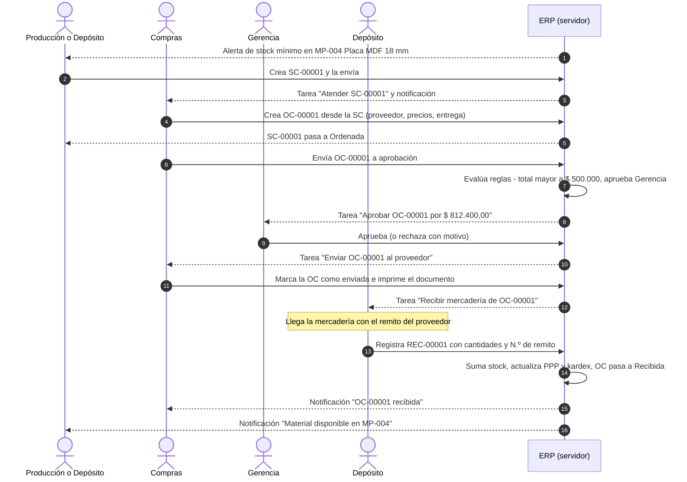
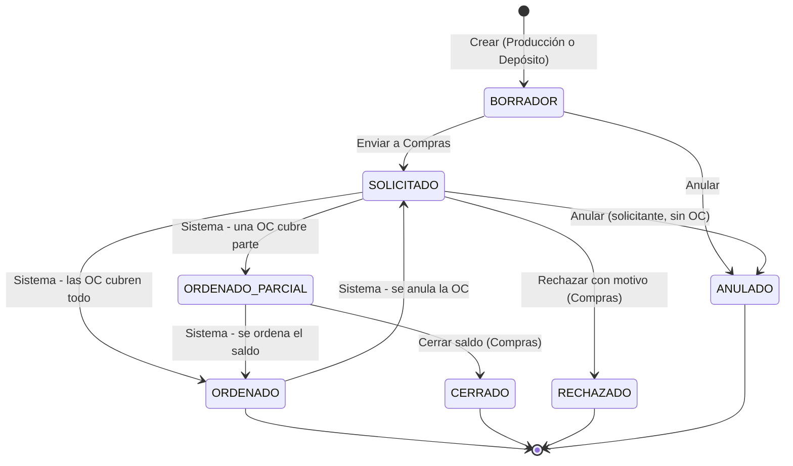
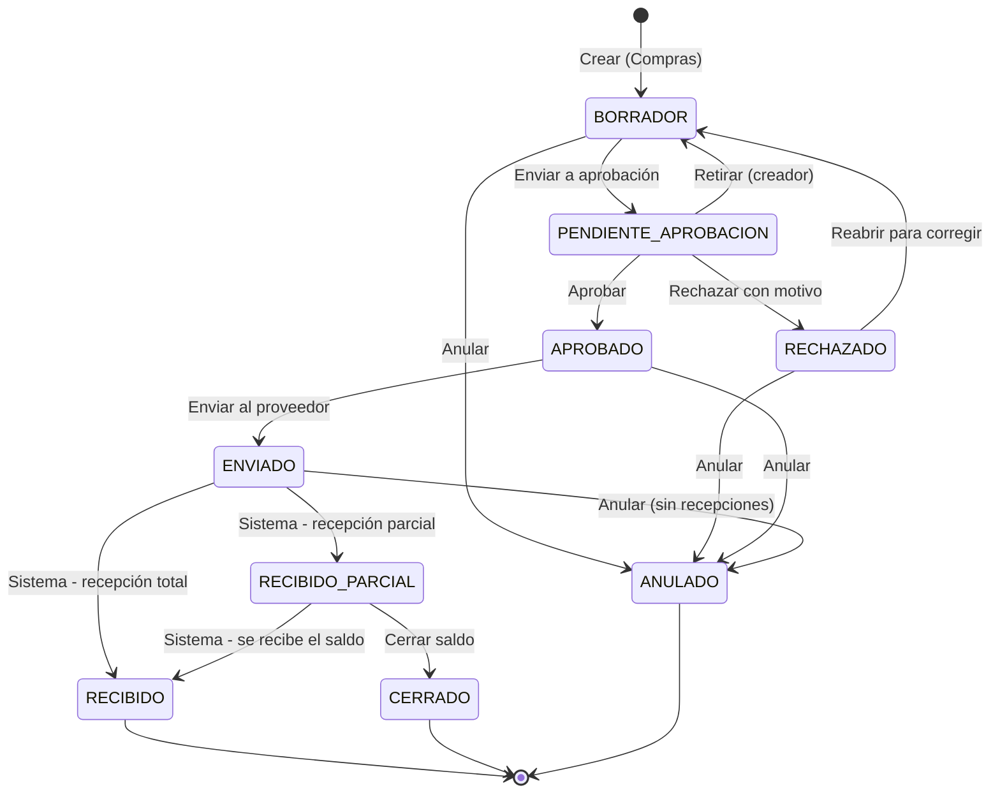
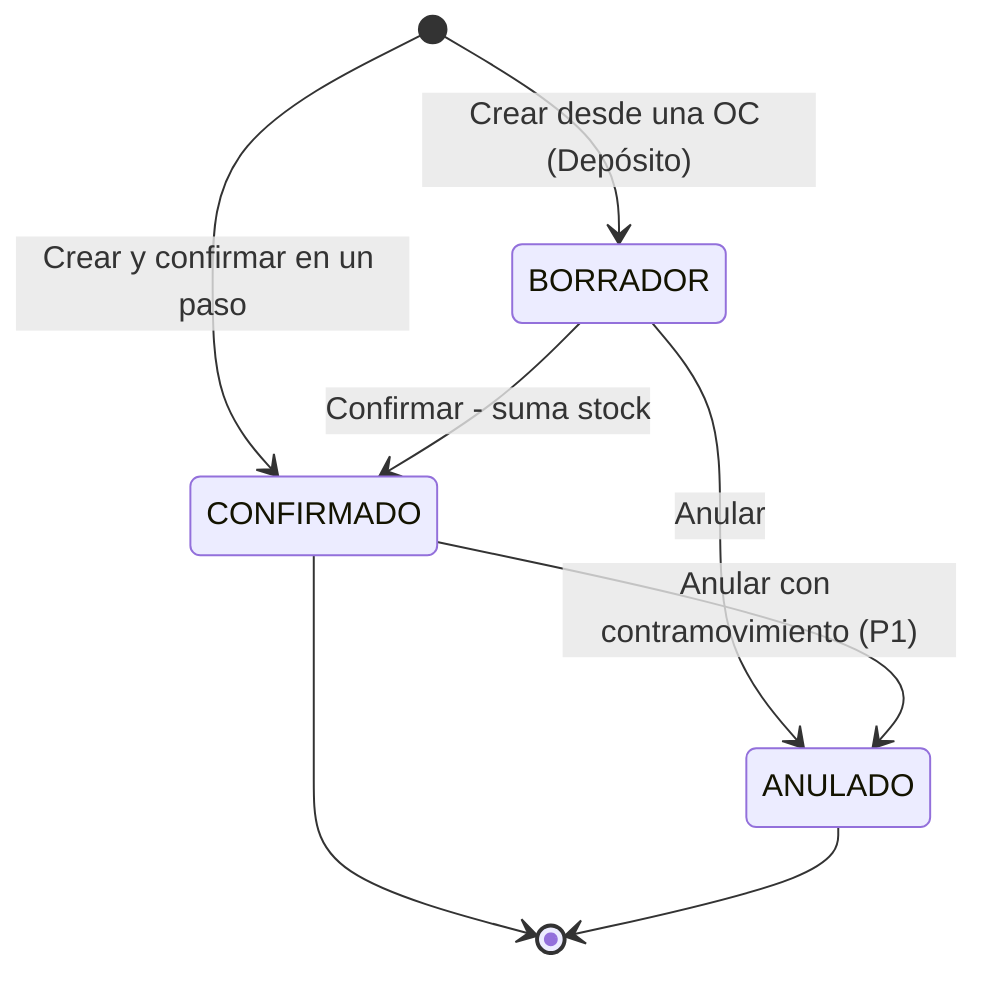

# Flujo del MVP: Solicitud de compra → Orden de compra → Aprobación → Recepción → Stock

> Versión 0.1 · Fase 0. Tablas y funciones en [DATABASE.md](../DATABASE.md). Permisos en [ROLES_Y_PERMISOS.md](ROLES_Y_PERMISOS.md).

## 1. Visión general

Cada paso **(a)** cambia el estado de un documento, **(b)** resuelve la tarea del sector anterior y abre la del siguiente, **(c)** notifica y **(d)** queda en la auditoría. Todo ocurre en el servidor, en una única transacción.

## 2. Documentos y estados

### 2.1 Solicitud de compra (SC)

Documento interno por el cual un sector pide a Compras que adquiera algo. **No compromete a la empresa con terceros.**

| Estado | Etiqueta | Insignia | Significado |
|---|---|---|---|
| `BORRADOR` | Borrador | neutral | El solicitante la está preparando; sólo él y su sector la editan |
| `SOLICITADO` | Solicitada | info | Enviada; Compras debe atenderla |
| `ORDENADO_PARCIAL` | Ordenada parcialmente | info | Parte de lo pedido ya está en una OC |
| `ORDENADO` | Ordenada | success | Todo lo pedido está incluido en OC vigentes |
| `CERRADO` | Cerrada con saldo | neutral | Compras decidió no ordenar el resto (motivo obligatorio) |
| `RECHAZADO` | Rechazada | danger | Compras no la atenderá (motivo obligatorio) |
| `ANULADO` | Anulada | neutral | Dejada sin efecto por el solicitante |

### 2.2 Orden de compra (OC)

Documento **externo** que compromete a la empresa con un proveedor: qué, cuánto, a qué precio, cuándo y dónde entregar.

| Estado | Etiqueta | Insignia | Significado |
|---|---|---|---|
| `BORRADOR` | Borrador | neutral | Compras la prepara: proveedor, ítems, precios, entrega |
| `PENDIENTE_APROBACION` | Pendiente de aprobación | warning | Espera la decisión del aprobador que indica la regla |
| `RECHAZADO` | Rechazada | danger | El aprobador la objetó; Compras puede corregirla o anularla |
| `APROBADO` | Aprobada | success | Autorizada; falta comunicarla al proveedor |
| `ENVIADO` | Enviada al proveedor | info | El proveedor la recibió; Depósito espera la mercadería |
| `RECIBIDO_PARCIAL` | Recibida parcialmente | info | Llegó una parte; queda saldo pendiente |
| `RECIBIDO` | Recibida | success | Se recibió todo lo ordenado |
| `CERRADO` | Cerrada con saldo | neutral | Se da por terminada con saldo sin recibir (motivo obligatorio) |
| `ANULADO` | Anulada | neutral | Sin efecto; libera las cantidades de las SC asociadas |

**Por qué no hay estados FACTURADO y PAGADO en la OC.** La factura y el pago son documentos propios (Fase 3), con sus propios ciclos. El **estado del proceso de compra** (solicitado → en gestión → aprobado → en tránsito → recibido → facturado → pagado) se calcula a partir de la cadena de documentos y se muestra en tableros. Así cada comprobante conserva un ciclo de vida claro, como en una empresa real.

### 2.3 Recepción de mercadería (REC)

Documento interno en el que Depósito deja constancia de lo que **efectivamente llegó**, contra la OC y el remito del proveedor. **Es el único que suma stock en el circuito de compras.**

### 2.4 Ajuste de stock (AJS)

Corrige el stock con un motivo documentado (inventario inicial, conteo físico, rotura, consumo interno). En el MVP permite **simular consumos** hasta que exista el módulo de Producción. Estados: `BORRADOR` → `CONFIRMADO` / `ANULADO`.

## 3. Paso a paso

| # | Quién | Acción en el sistema | Documento y estado | Efectos automáticos | Qué aprende el estudiante |
|---|---|---|---|---|---|
| 0 | Sistema | Un movimiento deja un producto bajo su stock mínimo | — | Notificación a Depósito y Compras; tarea "Evaluar reposición" a Depósito | El stock mínimo como disparador de la reposición |
| 1 | Producción o Depósito | Crea la SC (manual o "Crear SC desde alerta" con la cantidad sugerida); indica motivo, prioridad y fecha necesaria | SC `BORRADOR` | Número SC-00001 asignado; auditoría | Toda compra empieza con una necesidad justificada de un área |
| 2 | Solicitante | Envía la SC | SC `SOLICITADO` | Tarea "Atender SC" al rol Compras; notificación "Nueva solicitud de compra" | Quien necesita no compra: pide a quien tiene la función |
| 3 | Compras | Toma la tarea; crea la OC desde una o varias SC: elige proveedor (sugerido: habitual), precios (sugerido: último precio), fecha de entrega, depósito, condición de pago | OC `BORRADOR` · SC `ORDENADO` u `ORDENADO_PARCIAL` | Vínculo SC → OC; cobertura de las líneas; totales e IVA calculados en servidor | La OC transforma una necesidad interna en un compromiso con un tercero |
| 4 | Compras | Envía la OC a aprobación | OC `PENDIENTE_APROBACION` | Se evalúan las reglas: define el rol aprobador; tarea y notificación al aprobador; se resuelve la tarea "Atender SC" | Niveles de autorización según el monto |
| 5a | Aprobador | Aprueba (comentario opcional) | OC `APROBADO` | Registro de la decisión; tarea "Enviar al proveedor" a Compras; notificación | Autorización como control previo al compromiso |
| 5b | Aprobador | Rechaza (motivo obligatorio) | OC `RECHAZADO` | Tarea "Revisar OC rechazada" al creador | Un rechazo se fundamenta y se corrige |
| 6 | Compras | Envía la OC al proveedor (imprime o exporta el documento) | OC `ENVIADO` | Tarea "Recibir mercadería" al rol Depósito; notificación "Mercadería pendiente de recepción" | Comunicación formal con el proveedor |
| 7 | Depósito | Con la mercadería y el remito del proveedor, registra la recepción: N.º de remito, cantidades efectivamente recibidas por línea | REC `CONFIRMADO` · OC `RECIBIDO` o `RECIBIDO_PARCIAL` | Movimientos de stock (+); saldo y PPP actualizados; `qty_received` de la OC; vínculo OC → REC; notificación a Compras y al solicitante; tarea resuelta o renovada por el saldo | Control por oposición: lo recibido se compara con lo pedido |
| 8 | Todos | Consultan stock, kardex, flujo documental e historial | — | Tablero actualizado; alerta de mínimo resuelta | Integración: una misma operación atravesó cuatro áreas |

Continuación en la Fase 3: factura del proveedor (control OC–REC–FC), cuenta corriente, orden de pago, pago por Tesorería y asientos automáticos.

## 4. Reglas de negocio

### Solicitud de compra
- R-SC-1. Al menos una línea; cantidades mayores que cero; productos activos de la misma empresa.
- R-SC-2. Motivo obligatorio. Fecha necesaria no anterior a la fecha del documento.
- R-SC-3. Sólo se edita en `BORRADOR`, por el creador o miembros de su mismo sector.
- R-SC-4. Sólo el solicitante (o su sector) la anula, y sólo si ninguna OC vigente la cubre.
- R-SC-5. El estado `ORDENADO` / `ORDENADO_PARCIAL` lo calcula el sistema según la cobertura de sus líneas en OC no anuladas.

### Orden de compra
- R-OC-1. Proveedor activo obligatorio; al menos una línea; precio unitario ≥ 0; depósito de destino obligatorio.
- R-OC-2. Una línea vinculada a una SC no puede superar la cantidad pendiente de esa línea. Cantidades adicionales se agregan como línea sin vínculo.
- R-OC-3. Subtotales, IVA y total se recalculan en el servidor.
- R-OC-4. Al enviar a aprobación se toma la regla vigente según el **total con IVA**; si ninguna aplica, error de configuración (nunca aprobación automática silenciosa).
- R-OC-5. Separación de funciones: el creador no puede aprobar (si `sod_enabled`).
- R-OC-6. Rechazo, cierre y anulación exigen motivo.
- R-OC-7. No se anula una OC con recepciones confirmadas: se cierra el saldo.
- R-OC-8. Anular una OC libera la cobertura de las SC asociadas, que vuelven a `SOLICITADO` u `ORDENADO_PARCIAL` y regeneran la tarea para Compras.

### Recepción
- R-REC-1. Sólo contra OC en `ENVIADO` o `RECIBIDO_PARCIAL`.
- R-REC-2. N.º de remito del proveedor obligatorio.
- R-REC-3. Cantidad recibida por línea > 0 y ≤ pendiente de la línea de OC (sin sobre-recepción en el MVP; tolerancias en fases futuras).
- R-REC-4. Sólo productos inventariables generan movimientos de stock (los servicios no).
- R-REC-5. Costo de entrada = precio unitario neto de la OC (sin IVA). Actualiza el PPP.
- R-REC-6. Anular una recepción confirmada genera contramovimientos y requiere stock suficiente; debe hacerlo otro usuario de Depósito o Gerencia (P1).

### Stock
- R-STK-1. El stock sólo cambia por movimientos originados en documentos.
- R-STK-2. Sin stock negativo, salvo configuración de la empresa.
- R-STK-3. Cuando un movimiento lleva un producto por debajo del mínimo, se notifica y se abre tarea de reposición (una sola abierta por producto).

## 5. Caminos alternativos y excepciones

| Situación | Comportamiento | Valor pedagógico |
|---|---|---|
| Gerencia rechaza la OC por precio alto | OC `RECHAZADO` → Compras reabre, cambia de proveedor o precio y reenvía | Negociación y justificación de compras |
| El creador intenta aprobar su propia OC | Error `SEPARACION_FUNCIONES` con explicación | Control interno |
| El proveedor entrega menos de lo pedido | Recepción parcial → OC `RECIBIDO_PARCIAL` → nueva tarea de recepción por el saldo | Remito vs. orden: diferencias |
| El proveedor no entregará el saldo | Compras cierra el saldo con motivo → OC `CERRADO` | Decisión administrativa documentada |
| Compras consolida dos SC en una sola OC | Líneas de OC vinculadas a líneas de distintas SC | Eficiencia en compras |
| Una SC se divide entre dos proveedores | Dos OC, cada una cubre parte → la SC pasa a `ORDENADO` cuando se cubre todo | Abastecimiento múltiple |
| Se anula una OC ya enviada | Sólo sin recepciones; las SC vuelven a pendientes | Consecuencias de anular |
| Dos personas aprueban a la vez | La segunda recibe "la orden ya no está pendiente de aprobación" | Concurrencia en sistemas reales |
| Depósito registra una cantidad errónea | Anulación con contramovimiento por otro usuario (P1), o ajuste documentado | Corrección con trazabilidad, nunca "borrar" |

## 6. Estado derivado del proceso ("expediente de compra")

Para tableros de Gerencia y Control de Gestión:

| Estado del proceso | Condición |
|---|---|
| Solicitado | SC `SOLICITADO` sin OC |
| En gestión | OC en `BORRADOR`, `PENDIENTE_APROBACION` o `RECHAZADO` |
| Aprobado | OC `APROBADO` |
| En tránsito | OC `ENVIADO` o `RECIBIDO_PARCIAL` |
| Recibido | OC `RECIBIDO` o `CERRADO` |
| Facturado · Pagado | Fase 3 |

Indicadores derivados (Fase 1, tablero): cantidad y monto de OC por estado, SC pendientes de atender, OC atrasadas (fecha de entrega vencida sin recepción), **tiempo promedio SC → recepción** (lead time interno), productos bajo mínimo, valor del inventario.

## 7. Documentos imprimibles del circuito

| Documento | Contenido principal | Firmas |
|---|---|---|
| Solicitud de compra | Sector solicitante, motivo, prioridad, ítems, fecha necesaria | Solicitó · Recibió Compras |
| Orden de compra | Datos de la empresa y del proveedor, ítems, precios, IVA, total, entrega, condición de pago | Emitió · Autorizó |
| Recepción | OC de referencia, N.º de remito del proveedor, cantidades recibidas vs. pedidas, observaciones | Recibió · Controló |

Todos llevan la leyenda **"DOCUMENTO DE SIMULACIÓN EDUCATIVA — SIN VALIDEZ FISCAL"**. Las firmas se completan con los datos de la auditoría (nombre, sector, fecha y hora).
