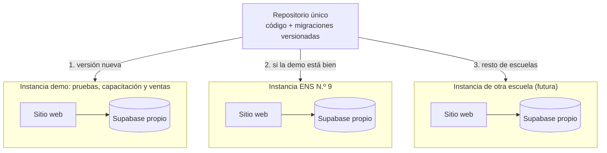

# Modelo de instancias: una escuela, una instalación

> Versión 0.1 · Fase 0 · septiembre 2026. Complementa [ARCHITECTURE.md](../ARCHITECTURE.md) (ADR-014 y ADR-015).

## 1. Decisión

INTEGR-AR se desarrolla para la **Escuela Normal Superior N.º 9 (ENS N.º 9)**. Si otra escuela se interesa, se le **vende una réplica**: la misma aplicación, con **base de datos, usuarios, archivos y configuración propios**. Ninguna escuela comparte datos con otra.

Dentro de cada instancia se mantiene la **multiempresa**: una escuela tiene varios cursos y cada curso opera una o varias empresas simuladas.

## 2. Qué cambia respecto del diseño inicial

| Antes | Ahora | Motivo |
|---|---|---|
| Varias instituciones en una misma base (`institutions`, `institution_members`) | **Una escuela por instalación**; sus datos en `school_settings` (una única fila) | Aislamiento total entre clientes; RLS más simple; cada escuela puede irse con sus datos |
| SUPERADMIN de toda la plataforma | `SUPERADMIN` = soporte del proveedor; `ADMIN` = administración de la escuela | Cada escuela se autogestiona sin depender del proveedor para lo cotidiano |
| Multiempresa | **Se mantiene** dentro de la instancia | Cursos y grupos siguen necesitando empresas separadas |
| Usuarios con código de institución | Usuarios sin prefijo; dominio de email sintético propio de cada instancia | Ya no hay otras escuelas en la base |

El MVP **no se agranda**: se quita una capa (instituciones) y se agregan reglas de disciplina que cuestan poco hoy y mucho más adelante.

## 3. Reglas de diseño (desde el primer commit)

1. **Un solo código fuente.** Nunca una copia modificada ("fork") por escuela. Las diferencias entre escuelas son configuración, no código.
2. **Nada de la ENS N.º 9 escrito en el código**: nombre, logo, localidad, contacto, dominio. Todo sale de `school_settings` o de variables de entorno.
3. **Todo cambio de base de datos es una migración versionada**, idéntica para todas las instancias. No existen migraciones "sólo para una escuela".
4. **Catálogos del sistema en migraciones** (roles, permisos, tipos y estados de documento). **Datos de cada escuela**, creados por el procedimiento de alta.
5. **Versionado semántico** (`v1.4.2`) con notas de versión. Todas las instancias en la misma versión, o como máximo una por detrás.
6. **Funcionalidades opcionales por escuela** mediante indicadores de configuración (`school_settings.features`), nunca ramas de código.
7. **Alta de una instancia reproducible** con un procedimiento escrito (MVP) y luego automatizado (productización).

## 4. Componentes de una instancia

| Componente | ¿Uno por escuela? | Nota |
|---|---|---|
| Proyecto Supabase (base de datos, Auth, Storage, Edge Functions) | Sí | Región São Paulo |
| Sitio del frontend (Netlify o Cloudflare Pages) | Sí | Mismo código compilado con variables propias |
| Dirección web | Sí | Subdominio del producto, p. ej. `ens9.<dominio-del-producto>` |
| Dominio sintético para emails de estudiantes | Sí | Evita choques de usuarios entre instancias |
| Configuración de la escuela | Sí | `school_settings` |
| Plantilla Forestal del Norte SRL | Igual en todas | Datos demo ficticios |
| Backups | Sí | Programados por instancia |

## 5. Configuración de una instancia

**Variables de entorno del sitio** (distintas en cada instancia):
- `VITE_SUPABASE_URL`, `VITE_SUPABASE_PUBLISHABLE_KEY`
- `VITE_AUTH_EMAIL_DOMAIN`

**Tabla `school_settings`** (una sola fila, editable por el ADMIN de la escuela):
- Nombre oficial y nombre corto ("Escuela Normal Superior N.º 9" / "ENS N.º 9")
- Logo, localidad, provincia, contacto institucional
- Zona horaria (por defecto `America/Argentina/Buenos_Aires`)
- `features`: funcionalidades opcionales habilitadas
- Datos del contrato de servicio (fecha de alta, plan), sólo visibles para SUPERADMIN

La interfaz muestra la marca del producto y, a su lado, el nombre y logo de la escuela.

## 6. Alta de una instancia nueva (lista de control)

1. Crear el proyecto Supabase (región São Paulo) en la cuenta que defina el contrato (decisión D-17).
2. Configurar Auth: registro público desactivado, límites de inicio de sesión por IP ajustados al aula, dominio sintético.
3. Aplicar todas las migraciones (`npx supabase db push`), desplegar Edge Functions, cargar secretos.
4. Ejecutar la inicialización: fila de `school_settings`, cuenta `SUPERADMIN` de soporte, cuenta `ADMIN` de la escuela.
5. Crear el sitio del frontend con sus variables de entorno y su dirección web.
6. Programar el backup semanal.
7. Prueba de humo: ingreso, crear empresa desde la plantilla, circuito corto de compra.
8. Entregar las credenciales iniciales al ADMIN de la escuela y capacitar.

Objetivo: menos de 2 horas siguiendo esta lista durante 2027; un script lo automatiza en la etapa de productización.

## 7. Actualizaciones

- Cada versión se publica con etiqueta (`vX.Y.Z`) y notas de versión en español.
- Orden de despliegue: **demo → ENS N.º 9 → demás escuelas**.
- Migraciones compatibles hacia atrás siempre que sea posible (durante el despliegue conviven por minutos el frontend anterior y el nuevo).
- Ventanas de actualización fuera del horario de clase.
- Productización: GitHub Actions con una matriz de instancias (secretos por instancia) que aplica migraciones y despliega en orden, deteniéndose ante el primer error.

## 8. Costos por instancia (orientativos, verificar vigentes)

| Concepto | Opción | Costo aprox. |
|---|---|---|
| Supabase | Gratuito: posible para una escuela, pero con pausa por inactividad y sin backups gestionados | USD 0 |
| Supabase | Pro: **recomendado para una instancia vendida** | ~USD 25/mes por organización; cada proyecto adicional en la misma organización suma cómputo (del orden de USD 10/mes) |
| Frontend | Plan gratuito de Netlify o Cloudflare Pages (admiten uso comercial) | USD 0 |
| Dirección web | Subdominio del dominio del producto | Costo del dominio, una vez |

El precio de venta debe cubrir la infraestructura, el soporte y las actualizaciones.

## 9. ¿A nombre de quién están las cuentas? (decisión D-17)

| Opción | Ventajas | Desventajas |
|---|---|---|
| **A. Servicio gestionado**: las cuentas son del proveedor; la escuela paga un abono | Control total de versiones y despliegues; la escuela paga en pesos | El proveedor administra datos de menores de terceros: requiere contrato con cláusulas de confidencialidad y tratamiento de datos |
| **B. Cuentas de la escuela**: la escuela contrata la infraestructura y el proveedor administra con acceso delegado | La escuela es dueña directa de sus datos | Pagos en dólares con tarjeta, difíciles para muchas escuelas; más coordinación en cada actualización |

**Recomendación:** opción A (licencia de uso + alojamiento + soporte + actualizaciones), con contrato que incluya protección de datos personales (Ley 25.326), confidencialidad y entrega de los datos al finalizar.

**No se recomienda entregar el código fuente** a cada escuela: se pierden el control de la propiedad intelectual y la posibilidad de actualizar a todos por igual.

## 10. Instancia demo

- Para probar cada versión antes de producción, capacitar docentes y **mostrar el sistema a escuelas interesadas**.
- Sólo datos ficticios; se reinicia periódicamente.
- Es la segunda instancia real: sirve para demostrar que el procedimiento de alta funciona.

## 11. Fin del servicio de una escuela

1. Exportación de sus datos (CSV por módulo y volcado de la base).
2. Entrega a la escuela y constancia.
3. Baja del proyecto y del sitio; eliminación de backups según lo pactado.

## 12. Temas a resolver antes de la primera venta

No bloquean el desarrollo para la ENS N.º 9, pero **deben estar resueltos antes de ofrecer el sistema a otra escuela**. Son temas legales y comerciales: conviene consultarlos con un abogado y un contador.

| Tema | Por qué importa |
|---|---|
| **Titularidad del software** (D-15) | Si el sistema se desarrolla en el marco de un cargo docente o con recursos de la escuela, puede discutirse a quién pertenecen los derechos. Conviene dejarlo acordado **por escrito** con la ENS N.º 9 o la autoridad que corresponda antes de vender |
| Registro de autoría | Los programas de computación están protegidos por la Ley 11.723. El registro en la Dirección Nacional del Derecho de Autor sirve como prueba de autoría y fecha |
| Marca | Si se vende con el nombre del producto, verificar que esté disponible y evaluar registrarlo en el INPI (D-01) |
| Contrato de licencia y servicio | Alcance, precio, soporte, actualizaciones, disponibilidad, fin del servicio |
| Datos personales | La escuela es responsable de los datos de sus estudiantes; el proveedor los trata por encargo (cláusulas de confidencialidad y seguridad) |
| Facturación | Vender requiere estar inscripto para facturar |
| Escuelas de gestión estatal | Suelen contratar por procedimientos administrativos propios; las de gestión privada deciden directamente |

## 13. Cuándo reconsiderar este modelo

Operar una instancia por escuela es simple con pocas escuelas. Si se superara una cantidad significativa (por ejemplo, más de 10), conviene reevaluar un modelo multi-escuela en una sola base. El diseño actual lo facilita: toda la lógica ya está aislada por `company_id` y centralizada en la base.
