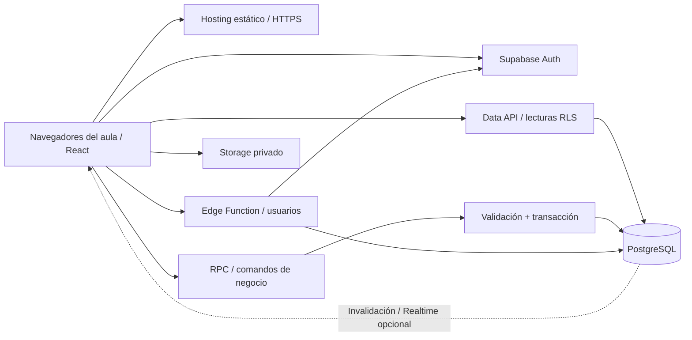
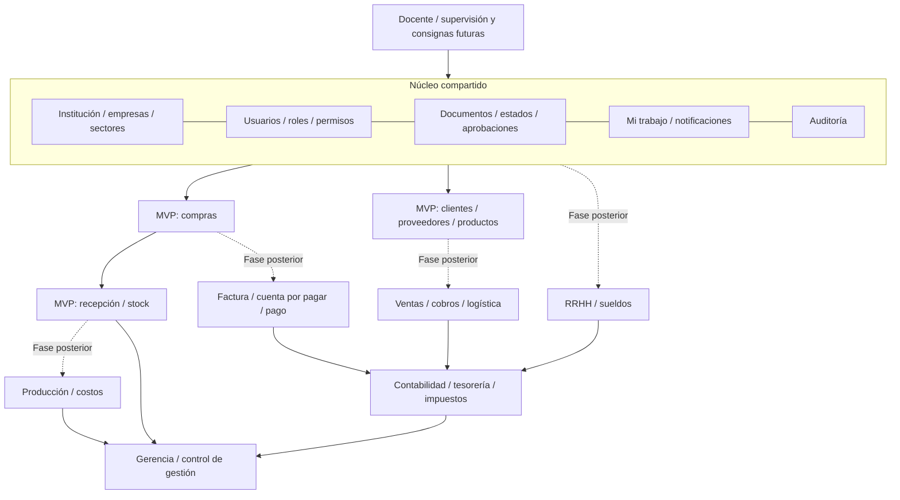

# Arquitectura propuesta — ERP educativo 2027

Fase 0 · 26/09/2026. Leer el [diagnóstico](DIAGNOSTICO.md) para distinguir esta propuesta del código existente. Alcance y aceptación en [MVP.md](MVP.md).

## 1. Elección y evaluación del stack

Se recomienda un **monolito modular**: una aplicación y una base relacional con límites por dominio. Las áreas colaboran sobre datos compartidos y transacciones; no necesitan servicios separados ni colas distribuidas.

| Capa | Elección | Motivo / límite |
|---|---|---|
| Interfaz | React + Vite + TypeScript estricto | SPA detrás de login; SSR no aporta al circuito del aula |
| Diseño | Tailwind CSS + shadcn/ui + Lucide | Identidad propia y componentes accesibles; revisar navegación por teclado, no asumirla por usar una librería |
| Navegación y datos | React Router + TanStack Query | Rutas por empresa; caché separada por usuario y empresa |
| Formularios | React Hook Form + Zod | Validación de entrada y mensajes claros; servidor revalida todo |
| Tablas | HTML accesible; TanStack Table cuando lo justifique la grilla | Búsqueda y paginación en servidor, sin agregar una grilla compleja al inicio |
| Datos y negocio | PostgreSQL de Supabase + funciones transaccionales | FK, restricciones, bloqueos, consistencia y aislamiento |
| Acceso | Supabase Auth + RLS + permisos propios | Auth identifica; membresías y RBAC autorizan |
| Privilegios administrativos | Edge Function acotada para altas/restablecimientos | Admin API y secretos únicamente en servidor |
| Archivos | Supabase Storage privado | Logo opcional; adjuntos posteriores con políticas propias |
| Actualización entre sectores | Invalidación al operar + sondeo; Realtime opcional | La bandeja persistida es la verdad, no el mensaje WebSocket |
| Comprobantes | HTML y CSS de impresión A4 | Imprimir / guardar PDF desde el navegador; PDF de servidor posterior |
| Calidad | TypeScript, lint, pgTAP, Vitest y Playwright | Prioridad: autorización, transacciones y circuito con usuarios diferentes |
| Entorno | Node 24 LTS; npm y lockfile | Fijar versiones al implementar; no instalar “latest” sin validación |

Vite documenta sus requisitos de Node; el equipo tiene Node 20.20.0. Se recomienda actualizar a una versión LTS soportada antes de desarrollar el backend, sin cambiar el entorno durante esta revisión. Fuentes: [Vite](https://vite.dev/guide/), [versiones de Node](https://nodejs.org/en/about/previous-releases).

**Alternativas evaluadas:** Next.js añadiría servidor web sin necesidad funcional inicial; un backend Node/Nest propio duplicaría infraestructura antes de que haya integraciones que lo requieran; self-hosting de Supabase transfiere a la escuela la operación de servicios y copias; SQLite/localStorage no resuelve el uso colaborativo remoto. Si posteriormente aparecen integraciones o trabajos prolongados, añadir un servicio servidor sin cambiar la autoridad transaccional de PostgreSQL.

## 2. Hosting y costo

**Preferencia provisional: Netlify para la SPA y Supabase para el backend.** Vercel también es técnicamente válido; elegir plan conforme al uso previsto. No crear cuentas ni publicar durante Fase 0.

| Opción | Evaluación al 26/09/2026 |
|---|---|
| Supabase Free | Puede servir para desarrollo/piloto dentro de cuotas. Incluye 500 MB de base, 1 GB de archivos y 200 conexiones Realtime simultáneas; no incluye backups automáticos de plan. [Precios](https://supabase.com/pricing) |
| Continuidad en Supabase | Free puede pausarse tras baja actividad durante una semana; preparar reactivación antes de clase. Pro publicado desde USD 25/mes, con cargos adicionales según recursos; presupuestar, no contratar automáticamente. [Pausa](https://supabase.com/docs/guides/platform/free-project-pausing), [precios](https://supabase.com/pricing) |
| Netlify Free | Publica 300 créditos mensuales; despliegues y consumo deben medirse. No equivale a alojamiento ilimitado. [Plan](https://www.netlify.com/pricing/) |
| Vercel Hobby | Orientado a uso personal no comercial. No asumir que cualquier modalidad institucional/comercial encaja; revisar el plan para el uso final. [Hobby](https://vercel.com/docs/plans/hobby) |

Inferencia de diseño: una SPA liviana y un grupo piloto podrían comenzar sin cargo; **no es una garantía de costo ni de disponibilidad**. Acordar cantidad de alumnos, simultaneidad y presupuesto antes de abrir varias aulas. No crear cuentas adicionales para eludir cuotas. Dominio propio, correo y almacenamiento de backups pueden agregar costos.

## 3. Diagrama de despliegue



El frontend contiene solamente URL y clave publicable. La clave secreta / `service_role` nunca va en `VITE_*`, bundles, repositorio ni logs. La Edge Function verifica JWT y permiso institucional antes de usar la Admin API; no acepta como autoridad un rol enviado por el navegador.

## 4. Diagrama conceptual del ERP



Producción es un **rol solicitante en el MVP**, no un módulo de fabricación ya implementado. El dashboard muestra pendientes, compras y stock reales; ventas, caja y sueldos aparecerán cuando existan sus circuitos, nunca como indicadores ficticios sin explicación.

## 5. Instituciones, empresas, personas y roles

Jerarquía: `institutions → companies → sectors / warehouses / documentos`. `profiles` identifica a la persona; `institution_members` habilita su pertenencia escolar; `company_members` delimita las empresas asignadas. Los roles y sectores se asignan dentro de ese alcance. Véanse [modelo](DATABASE.md) y [matriz](ROLES_Y_PERMISOS.md).

Para el piloto se propone **una institución por instalación**, con varias empresas simuladas en la misma base. La institución sigue siendo una entidad explícita con FK: despliegue físico y modelo lógico son decisiones distintas. Esto conserva una futura opción de varias instituciones sin construir ahora un SaaS de escuelas ni asegurar que compartir instancia sea un cambio automático.

Cada registro empresarial, incluidas líneas y tablas de unión, lleva `company_id`. Las FK compuestas impiden enlazar proveedores, productos, depósitos o documentos de otra empresa. Tablas escolares llevan `institution_id`; catálogos globales no contienen datos privados de empresas. Se exige membresía institucional y empresarial activa, usuario activo, módulo habilitado, permiso y alcance del registro.

SUPERADMIN administra la plataforma; ese nombre no equivale a `service_role` ni permite actuar en todas las compras. DOCENTE supervisa sólo empresas asignadas. Un usuario puede acumular roles, pero no eludir separación de funciones: la comprobación compara identidades del creador y del aprobador. La intervención docente se registra a nombre del docente.

Para mantener esa separación sin un historial adicional de coautores, en el MVP sólo el creador puede modificar el contenido material de su OC en borrador, mientras conserve autorización. Si deja de participar, el docente puede anularla y Compras crear una sustituta desde la SC. El docente no modifica contenido ajeno y luego lo aprueba.

## 6. Operaciones y seguridad del servidor

Lecturas mediante RLS y vistas que respeten al invocador. Las políticas también cubren tareas, notificaciones, auditoría y archivos. Una FK válida no concede lectura; una ruta de interfaz oculta no retira permisos.

Escrituras de negocio mediante comandos específicos, por ejemplo `create_requisition`, `submit_purchase_order`, `approve_purchase_order`, `confirm_goods_receipt`. Un comando público no acepta SQL, nombre de tabla, estado arbitrario ni identidad de actor. Auditar catálogos, membresías, parámetros y maestros además de documentos.

Propuesta de frontera SQL: esquemas de datos con RLS, funciones auxiliares en `private` no expuesto por la Data API, y entradas RPC mínimas. Usar `SECURITY INVOKER` por defecto. Si una función interna necesita `SECURITY DEFINER` para escribir sin conceder DML al cliente, fijar `search_path`, cualificar objetos, propietario de privilegios acotados y validar explícitamente identidad/permisos dentro de ella. Revocar ejecución implícita a `PUBLIC`/`anon`, conceder sólo firmas necesarias y probar accesos por API. El detalle de grants y wrappers se debe demostrar en Fase 1A antes de replicar el patrón. [Funciones de base](https://supabase.com/docs/guides/database/functions), [RLS](https://supabase.com/docs/guides/database/postgres/row-level-security).

Si la RPC invocadora llama una función en `private`, el rol invocador requiere `USAGE` del esquema y `EXECUTE` de esa firma. “No expuesto por la API” no significa inaccesible por SQL ni sustituye autorización. Toda función privilegiada debe validar por sí misma al usuario, y su propietario debe tener únicamente los permisos/políticas necesarios para efectuar el comando.

RLS y grants son controles complementarios. Documentos, saldos, movimientos y auditoría no admiten escritura directa del cliente. Tampoco se puede editar desde un perfil el rol propio, la institución o el indicador de bloqueo. Las funciones privilegiadas no deben confundir “usuario autenticado” con “usuario autorizado”.

### Contrato transaccional

1. Resolver `auth.uid()`, usuario activo y alcance vigente antes de revelar datos.
2. Validar clave de idempotencia, empresa, comando y huella de la carga. Misma clave con carga distinta se rechaza; reintento autorizado devuelve el resultado previo.
3. Bloquear filas afectadas en orden estable; comprobar versión esperada y estado dentro del bloqueo.
4. Revalidar permiso, asignación, umbral, integridad y cantidades; calcular importes en servidor con decimales.
5. Aplicar documento, movimientos, saldo, auditoría, tareas y notificaciones en **una transacción**.
6. Confirmar; sólo después actualizar la UI. Si falla, rollback completo, sin éxito visual ni stock parcial.

No repetir automáticamente una mutación sin idempotencia. Las lecturas pueden reintentarse con límites. Realtime sólo invalida consultas autorizadas; al volver la conexión se vuelve a leer. La caché incluye usuario y empresa y se borra al salir/cambiar de contexto; no se ofrece modo offline de escritura en el MVP.

## 7. Documentos, bandeja y stock

Una cabecera común `documents` contiene identidad, empresa, tipo, número, estado, versión y trazabilidad. Los datos de cada comprobante viven en tablas específicas y líneas normalizadas. JSON se reserva para snapshots de auditoría/metadatos; no reemplaza productos, importes o relaciones.

Estados y transiciones **por tipo**; no existe un único estado global desde solicitud hasta pago. Reglas iniciales versionadas en el servidor, catálogo descriptivo de consulta y una tabla simple de umbrales. No construir un editor universal de workflows. Números únicos por empresa/tipo; se conserva toda anulación. No exigir numeración fiscal ni secuencias sin huecos como objetivo del piloto.

`tasks` representa trabajo pendiente por documento y destino (rol o persona); `notifications` sólo avisa. Ambos cambian en la transacción del documento. Al revocar un rol desaparece el acceso aunque exista una notificación antigua. No asignar tareas a sectores sin un participante capaz: mostrar al docente la configuración pendiente.

El stock se deriva de movimientos inmutables y saldos materializados transaccionalmente. Una recepción confirmada ingresa cantidades una sola vez. El inventario inicial también genera movimientos auditados. Cantidades aceptadas no superan el pendiente de la OC; rechazos físicos se registran como observación y no ingresan stock. La recepción parcial deja una tarea hasta completar la orden. Reglas y excepciones en [FLUJO_COMPRAS.md](FLUJO_COMPRAS.md).

Guardar costo unitario de recepción como referencia educativa; posponer PPP, ajustes operativos, transferencias, devoluciones y producción. No usar un “costo actual” mutable para reescribir hechos pasados. Moneda inicial ARS, cantidades `numeric`, zona visual `America/Argentina/Buenos_Aires` y tiempos técnicos UTC.

## 8. Usuarios y experiencia docente

Login visible por usuario y contraseña, respaldado por Supabase Auth. Este admite contraseña asociada a email/teléfono; para evitar recolectar correo de estudiantes se propone un alias de email generado desde código institucional y usuario, con dominio controlado por el proyecto. Verificar alta, recuperación y comportamiento de confirmación en un ensayo técnico; no inventar un sistema propio de contraseñas. [Auth](https://supabase.com/docs/guides/auth/passwords).

En el piloto, el código institucional se obtiene de la configuración pública del despliegue antes de iniciar sesión; no se consultan membresías anónimamente. Si se habilitan varias instituciones en una instalación futura, el login pedirá código de institución. Los alias serán canónicos, únicos e inmutables aunque cambie el nombre visible; no representan buzones personales ni envían correo a dominios ajenos.

Bootstrap: una operación administrativa de servidor crea la institución, su código y el primer docente autorizado. SUPERADMIN se provisiona fuera del registro público; ningún formulario estudiantil puede crear esa asignación. El primer docente configura empresas y sectores y da de alta estudiantes dentro de su alcance.

Altas cerradas, sin registro público; contraseñas temporales individuales. Restablecimiento docente sólo para alumnos autorizados, sin consultar contraseñas existentes. Creación en Auth y perfil no constituye una transacción SQL única: usar alta idempotente con estado pendiente, habilitar acceso sólo al completar membresías y registrar/compensar fallos. No declarar éxito si sólo se creó una de las dos partes.

Panel mínimo: datos institucionales, creación de empresas, alta individual de estudiantes, asignación de roles/sectores, habilitación de módulos y consulta de actividad. Alta masiva, evaluación automática y reinicio de escenarios quedan después. Para repetir la práctica se crea una empresa nueva desde un conjunto demo, archivando la anterior; no se borra su auditoría.

Las PC compartidas exigen salida visible, almacenamiento de sesión por pestaña para el piloto y limpieza de caché al salir. Si se promete cambio obligatorio de contraseña o bloqueo, el servidor debe impedir operar hasta completarlo; una redirección React no es control suficiente. Probar ingreso simultáneo desde la red de la escuela: existen límites de Auth por IP. [Límites](https://supabase.com/docs/guides/auth/rate-limits).

## 9. Interfaz y pedagogía

Sidebar por permisos; barra con empresa, sector activo, búsqueda contextual, notificaciones y perfil; breadcrumbs; “Mi trabajo” como inicio. Documentos con encabezado, líneas, estado, próximo responsable, impacto y recorrido SC → OC → recepción. Filtros y tablas legibles, badges con texto además de color, errores junto al campo y confirmación de acciones con efectos sobre stock.

Identidad sobria propia, sin reproducir software comercial. Escritorio prioritario; tabla desplazable y acciones accesibles en tablet; móvil para consulta de tareas/documentos. Priorizar contraste, foco visible, etiquetas, navegación por teclado y ausencia de animaciones innecesarias. Mostrar explicación breve: “Al confirmar esta recepción, ingresarán 20 unidades al depósito”.

Comprobantes SC, OC y recepción imprimibles con leyenda **DOCUMENTO DE SIMULACIÓN EDUCATIVA — SIN VALIDEZ FISCAL**. Sin identificadores de autorización fiscal ni integración tributaria real. Las tasas usadas en ejercicios son parámetros didácticos, no cálculos legales vigentes.

## 10. Estructura propuesta y evolución del prototipo

La estructura base ya existe. No se crean pantallas vacías para los 17 módulos.

```text
GESTAR-ERP/
  README.md                       estado de la aplicación existente
  docs/fase-0-2027/                esta propuesta y sus decisiones
  src/
    app/                          sesión, empresa, router, layout
    components/ui/                componentes visuales
    components/common/            tablas, estados, documentos, historial
    features/
      auth/ company/ teacher/ dashboard/ my-work/ audit/
      customers/ suppliers/ products/
      purchasing/requisitions/ purchasing/orders/
      inventory/receipts/ inventory/stock/
    lib/
      domain/                     contratos y códigos de error
      api/                        interfaz de consultas/comandos
      supabase/                   adaptador real (Fase 1A)
      mock/                       demo aislada, sólo datos ficticios
    types/                        tipos generados del esquema real
  supabase/
    migrations/                   esquema, RLS, grants y funciones versionados
    functions/admin-users/        operaciones Auth autorizadas
    tests/database/               aislamiento, RBAC, concurrencia/invariantes
    seed/                         datos ficticios reproducibles
  e2e/                            circuito entre usuarios/contextos separados
  scripts/                        operación y verificación de backups
```

Cada feature tendrá consultas/comandos, schemas y componentes sólo cuando se implemente. El adaptador real debe sacar contratos compartidos que hoy dependen de tipos del mock; no prometer que cambiar un import vuelve colaborativa a la demo. Primero verificar contrato por contrato, luego reutilizar la interfaz que cumpla el MVP.

## 11. Operación, pruebas y límites

Desarrollo local con Supabase CLI y Docker si el equipo lo permite; alternativa: proyecto de desarrollo separado en nube, nunca datos de aula. Frontend con reescritura SPA, HTTPS, entornos independientes y migraciones por Git. No hay servidor propio que instalar en cada isla.

Antes del piloto, ensayar recuperación en entorno separado: esquema, datos, usuarios/permisos, configuración y archivos. Los backups de base no incluyen objetos de Storage; el procedimiento debe cubrirlos por separado. Para Free, Supabase recomienda exportaciones periódicas. Propuesta operativa: copia al terminar cada jornada de uso y antes de migraciones, acceso restringido y restauración probada; frecuencia/retención acordadas con la institución. [Backups](https://supabase.com/docs/guides/platform/backups).

Pruebas principales: A/B empresa e institución; rol correcto/incorrecto; revocación con JWT aún vigente; llamada directa a la API; dos aprobaciones; dos recepciones sobre el mismo pendiente; reintento tras respuesta perdida; rollback; saldo = suma de movimientos; trazabilidad; circuito en computadoras distintas. Typecheck y un build exitoso no prueban seguridad ni colaboración.

Preparación futura: módulos con contratos claros y documentos enlazados; eventos de auditoría semánticos para consignas y tutor. Escenarios podrán agregar `scenario_run_id` al iniciar ejecuciones, sin inferir siempre pertenencia por fecha. Tutor IA posterior, con contexto autorizado y orientación, sin capacidad automática para aprobar o resolver ejercicios. No añadir vector DB, agentes ni motor de escenarios en Fase 0/1.

Riesgos y decisiones con acciones concretas: [DIAGNOSTICO.md](DIAGNOSTICO.md), [DECISIONES.md](DECISIONES.md).
