# Modelo de datos preliminar — ERP educativo 2027

Fase 0 · 26/09/2026. **Diseño, no SQL ejecutable ni migración del prototipo existente.** Contrato compartido con [arquitectura](ARCHITECTURE.md), [permisos](ROLES_Y_PERMISOS.md), [flujo](FLUJO_COMPRAS.md) y [decisiones](DECISIONES.md).

## 1. Convenciones e invariantes de identidad

- `id` UUID; eventos voluminosos pueden usar identidad numérica. FK reales, no identificadores sueltos dentro de JSON.
- Tablas escolares: `institution_id`. Tablas empresariales, incluidas líneas y uniones: `company_id NOT NULL`.
- Cada entidad empresarial referenciable expone unicidad `(company_id,id)`; las FK usan ambas columnas. Para documentos se incluye también el tipo cuando corresponda.
- Campos de trazabilidad: `created_at`, `created_by`, `updated_at`, `updated_by`, mantenidos en servidor. Maestros con `is_active`; documentos con estado y `version`.
- Cantidades `numeric(14,3)`, importes `numeric(14,2)`, precios/costos unitarios `numeric(14,4)`. Sin números flotantes para importes.
- Moneda ARS en MVP; IVA y precios son parámetros educativos. Redondear cada línea y sumar importes redondeados en servidor, con ejemplos de aceptación.
- Eventos técnicos `timestamptz` UTC; fecha de negocio `date`, presentación `America/Argentina/Buenos_Aires`.
- Documentos confirmados, movimientos y auditoría no se borran. Reiniciar una práctica significa crear otra empresa y archivar la anterior.

Una institución por instalación en el piloto **no elimina** `institutions`. No se construye todavía administración SaaS ni se promete compartir infraestructura entre escuelas sin revisión adicional.

## 2. Relaciones principales

```mermaid
erDiagram
  institutions ||--o{ institution_members : habilita
  profiles ||--o{ institution_members : pertenece
  institutions ||--o{ companies : organiza
  institution_members ||--o{ company_members : participa
  companies ||--o{ company_members : asigna
  company_members ||--o{ member_roles : ocupa
  sectors ||--o{ member_roles : ubica
  roles ||--o{ member_roles : autoriza
  companies ||--o{ documents : emite
  documents ||--o| purchase_requisitions : solicitud
  documents ||--o| purchase_orders : orden
  documents ||--o| goods_receipts : recepcion
  purchase_requisitions ||--o{ purchase_orders : historial
  purchase_orders ||--o{ goods_receipts : entregas
  goods_receipts ||--o{ stock_movements : ingresa
  documents ||--o{ approval_requests : decisiones
  documents ||--o{ tasks : trabajo
  documents ||--o{ audit_events : recorrido
```

La relación SC→OC del diagrama incluye el historial de anulaciones; **sólo una OC activa por SC**. No se consolidan SC ni se fraccionan sus líneas entre OC en MVP.

## 3. Identidad, organización y permisos

| Entidad | Campos y relaciones principales | Restricción / propósito |
|---|---|---|
| `institutions` | código, nombre, localidad, zona horaria, estado | Código único; datos institucionales configurables |
| `profiles` | `id → auth.users`, nombre visible, activo, alta completa, cambio de contraseña pendiente | Sin contraseñas; estado privilegiado no editable por el alumno |
| `platform_admins` | usuario, activo | SUPERADMIN administrativo; no concede permisos empresariales |
| `institution_members` | institución, usuario, rol escolar DOCENTE/ESTUDIANTE, usuario de acceso, activo | Único institución/usuario y código de acceso por institución |
| `courses`, `course_members` | institución, año/curso; miembro institucional y función en curso | Todas las referencias deben pertenecer a la misma institución |
| `companies` | institución obligatoria, curso opcional, razón social, CUIT simulado, domicilio, actividad, estado | Varias empresas por institución; curso de la misma institución |
| `company_members` | empresa, institución, miembro institucional, activo | FK compuestas hacia empresa y membresía institucional; una participación por empresa/usuario |
| `islands`, `sectors` | islas: empresa, número, nombre; sectores: empresa, código, nombre, isla opcional, activo | FK de sector/isla de la misma empresa; sector no es un permiso por sí mismo |
| `branches`, `warehouses`, `cost_centers` | empresa, código, nombre, activo; depósito con sucursal opcional | Un depósito inicial suficiente; centros de costo preparados para después |
| `roles`, `permissions`, `role_permissions` | catálogo funcional; recurso/acción; asignación | Catálogos protegidos, cargados por migración |
| `member_roles` | empresa, miembro, rol, sector opcional | Múltiples roles/sectores; impedir duplicados incluso con sector nulo |
| `modules`, `company_modules` | catálogo; empresa/módulo/habilitado | Falta de habilitación no concede acceso |

`company_members.institution_id` permite comprobar por FK que la empresa y el miembro pertenecen a la misma institución; no es un ámbito independiente que el cliente pueda elegir. El contexto vigente se resuelve desde la identidad autenticada. Los alias de login se concretan en el ensayo Auth; la pertenencia nunca se deduce del email.

## 4. Maestros y documentos

| Entidad | Datos principales |
|---|---|
| `customers`, `suppliers` | empresa, código, nombre ficticio, CUIT/IVA simulado, contacto, condiciones, activo |
| `products` | empresa, código, descripción, categoría, unidad, tipo, inventariable, proveedor habitual, stock mínimo, costo de referencia, precio de venta propuesto, activo |
| `product_categories`, `units_of_measure` | categorías por empresa; unidades de catálogo y si admiten decimales |
| `documents` | empresa, tipo, número, estado, versión, fecha, sector originante, moneda, totales, notas, actor y fechas |
| `document_types`, `document_statuses` | catálogos de tipos y estados válidos por tipo; descripción pedagógica |
| `document_sequences` | empresa/tipo, siguiente número; unicidad de número por empresa/tipo |
| `purchase_requisitions` | `document_id`, empresa, tipo fijo SC, motivo, fecha necesaria, `active_order_id` opcional |
| `purchase_requisition_lines` | empresa, SC, número de línea, producto, unidad, cantidad positiva |
| `purchase_orders` | `document_id`, empresa, tipo fijo OC, SC origen, proveedor, depósito destino, entrega estimada |
| `purchase_order_lines` | empresa, OC, línea SC, producto/unidad copiados, cantidad, precio, descuento, IVA, importes calculados |
| `goods_receipts` | `document_id`, empresa, tipo fijo REC, OC, proveedor validado contra OC, depósito, referencia completa/normalizada del remito, fecha de entrega |
| `goods_receipt_lines` | empresa, recepción, línea OC, cantidad aceptada, costo unitario educativo, observación |
| `document_links` | empresa, documento origen/destino, relación |

La cabecera compartida contiene sólo datos comunes; proveedor, depósito y referencias propias quedan en subtipos. Cada subtipo tiene FK `(company_id,document_id,doc_type)` a una clave equivalente de `documents`, con tipo fijo. Las líneas apuntan al subtipo correspondiente, no a cualquier cabecera. JSON sólo para metadatos/snapshots, nunca para reemplazar líneas o relaciones.

Tipos de producto: materia prima, insumo, producto terminado, mercadería de reventa y servicio. Un servicio no genera stock. Para el circuito inicial se seleccionan productos inventariables; compra/recepción de servicios queda fuera del MVP. El costo de referencia y precio de venta son propuestas vigentes del maestro, con cambios auditados; no sustituyen ni recalculan precios aprobados y costos recibidos históricos conservados en las líneas de documentos.

### Estados y reglas mínimas

| Documento | Estados |
|---|---|
| SC | BORRADOR, SOLICITADO, EN_PROCESO, ORDENADO, RECHAZADO, ANULADO |
| OC | BORRADOR, PENDIENTE_APROBACION, APROBADO, RECHAZADO, ORDENADO, PARCIALMENTE_RECIBIDO, RECIBIDO, ANULADO |
| REC | BORRADOR, CONFIRMADO, ANULADO |

- SC editable sólo en BORRADOR. Al crear la OC pasa a EN_PROCESO; al emitir la OC pasa a ORDENADO. No hay OC directa sin SC en MVP.
- Crear una OC bloquea su SC, exige ausencia de OC activa y copia **todas** las líneas/cantidades. Cada línea SC aparece exactamente una vez en esa OC; el producto y unidad coinciden.
- `active_order_id` señala la OC vigente y debe corresponder a esa SC. Anular la OC antes de cualquier recepción confirmada libera el vínculo y devuelve la SC a SOLICITADO, con motivo e historial. No se editan cantidades de una SC con OC activa.
- Precio, descuento, IVA y demás contenido material de la OC sólo cambian en borrador por su creador, si conserva permisos; totales calculados en servidor. Rechazo permite corregir y volver a solicitar aprobación; la anterior decisión se conserva. Otro usuario/docente no reescribe la orden: puede rechazarla/anularla según permiso y preparar una sustituta desde la SC con nuevo creador.
- La recepción exige OC ORDENADO o PARCIALMENTE_RECIBIDO y el mismo depósito destino. Cada línea pertenece a esa OC; no se admite duplicarla en la misma recepción ni superar su pendiente. Una referencia completa normalizada de remito sólo puede confirmarse una vez por empresa/proveedor; un remito corresponde a una OC/recepción en el piloto, y las entregas parciales usan remitos distintos.
- Sólo se anula REC en BORRADOR. Una REC CONFIRMADO permanece inmutable; devoluciones/contramovimientos requieren diseño posterior.
- Estados, acciones autorizadas y efectos se detallan en [FLUJO_COMPRAS.md](FLUJO_COMPRAS.md); un catálogo no autoriza transiciones arbitrarias.

## 5. Stock, aprobaciones y colaboración

| Entidad | Campos y controles |
|---|---|
| `stock_movements` | empresa, producto, depósito, tipo, cantidad con signo, costo de referencia, `receipt_line_id` o `initial_stock_line_id`, actor/fecha; sólo inserción |
| `stock_balances` | empresa/producto/depósito únicos, cantidad disponible, versión; saldo materializado, sin edición directa |
| `initial_stock_batches`, `initial_stock_lines` | empresa, estado, líneas producto/depósito/cantidad/costo; apertura docente auditada, una única vez por producto/depósito antes de movimientos operativos |
| `approval_rules` | empresa, tipo, versión, vigencia, rango ARS, rol aprobador, activo; sin solapamientos |
| `approval_requests` | empresa/documento, versión del documento, regla/versión, monto, rol, separación de funciones copiada, estado, solicitante, decisión/motivo/actor/fecha |
| `tasks` | empresa/documento, tipo, destino rol/persona, sector opcional, estado, versión origen |
| `notifications` | empresa, destinatario, tarea/documento opcional, título, fecha, lectura |
| `audit_events` | institución, empresa opcional, actor/rol/sector fotografiados, acción, entidad, documento, estado anterior/nuevo, diferencias, motivo, hora UTC |
| `command_requests` | empresa, actor, comando, clave idempotente, huella, referencia/resultado; único por empresa/actor/comando/clave |

**Stock:** saldo = suma de movimientos por empresa/producto/depósito. Cada movimiento exige exactamente una FK tipada: `(company_id,receipt_line_id)` a línea de recepción o `(company_id,initial_stock_line_id)` a línea de apertura; CHECK exclusivo y tipo coherente. Cada línea origen genera como máximo un ingreso, con unicidad por origen/tipo. La apertura exige unicidad de producto/depósito entre lotes confirmados y ausencia de movimientos operativos, verificadas bajo bloqueo; no se puede repetir creando otro lote. Crear primero de forma segura la fila de saldo evita carreras sobre una ausencia de fila. El costo recibido conserva el precio neto después de descuento de la OC, sin IVA; no representa PPP ni valoración contable del inventario.

**Aprobaciones:** menor a ARS 500.000 → COMPRAS; desde ARS 500.000 inclusive → GERENCIA. Total educativo con IVA. Exactamente una regla aplicable; ninguna o varias producen error de configuración. Una solicitud pendiente por versión; copiar condiciones evita que un cambio de umbral altere una decisión iniciada. Autor de OC nunca aprueba, incluso con varios roles. Intervención de otro docente asignado requiere motivo.

**Bandeja:** una tarea abierta por documento/tipo/destino y etapa. Aprobar, emitir y recibir cierran/abren tareas en la misma transacción; una entrega parcial mantiene pendiente recibir el saldo. Las tareas se resuelven con la operación de negocio; tomar/liberar manualmente se pospone. Notificaciones son avisos; no sustituyen tareas ni permiten leer documentos sin autorización actual.

**Auditoría:** append-only, sin cascada de borrado de empresas/documentos ni `SET NULL` que cambie eventos antiguos. Se archivan entidades; fotografías conservan el contexto. Institución obligatoria para eventos escolares, empresa para los empresariales; eventos de administración de plataforma separados. No guardar contraseñas, tokens ni cargas privadas innecesarias.

## 6. Autorización y comandos transaccionales

RLS cubre todas las tablas privadas, líneas, uniones y vistas; las vistas respetan al invocador. Autoridad efectiva: perfil habilitado y alta completa + membresía institucional activa + empresarial activa + rol/sector vigente + permiso + módulo habilitado + alcance del registro. La condición se repite en RPC privilegiadas y Storage, sin depender sólo de RLS si la función la omite por sus privilegios.

- Leer tareas/notificaciones exige además membresías vigentes y autorización actual sobre el destino/documento. Revocar acceso funciona aunque el JWT siga vigente.
- Escribir documentos, stock, aprobaciones, auditoría, roles o membresías sólo mediante comandos autorizados. El cliente no fija empresa por cambio de una fila, actor, totales, estado ni privilegios propios.
- Los metadatos modificables de Auth no conceden rol. SUPERADMIN no pasa el helper empresarial por una excepción global; DOCENTE sólo supervisa empresas asignadas y se valida también su rol escolar.
- Helpers privados no expuestos; grants mínimos y contratos de ejecución según [ARCHITECTURE.md §6](ARCHITECTURE.md#6-operaciones-y-seguridad-del-servidor). `service_role` sólo en servidor para tareas administrativas concretas.
- Archivos privados bajo institución/empresa/documento; comprobar pertenencia y permiso del documento, no sólo que el prefijo del path tenga un UUID conocido.

| Comandos previstos | Efecto |
|---|---|
| `create/update/submit/reject/cancel_requisition` | SC y tarea de Compras |
| `create/update/submit/approve/reject/issue/cancel_purchase_order` | OC, aprobación independiente, tarea de Depósito |
| `create/update/confirm/cancel_goods_receipt` | Recepción, ingreso de stock y pendiente de OC |
| `confirm_initial_stock` | Apertura docente, una única vez por producto/depósito antes de operaciones |
| `mark_notifications_read` | Lectura personal sin cambiar permisos/documentos |
| `record_document_incident` | Docente asignado registra evento de auditoría INCIDENCIA con documento/motivo; no altera recepción confirmada ni stock |
| Gestión de empresas, maestros, miembros y módulos | Validación institucional/empresarial y auditoría |

Cada comando: autenticar y autorizar ámbito; comprobar idempotencia; bloquear SC→OC→REC y sus líneas cuando corresponda, siempre en ese orden; bloquear saldos por `(producto,depósito)` ordenados; revalidar estado/versión/cantidades; aplicar todos los efectos y auditoría en una transacción. Bloquear la OC y sus líneas permite que dos recepciones distintas compitan de forma segura por el mismo pendiente. Conflictos se devuelven para recargar; no se silencian.

Misma clave y carga devuelve resultado previo **sólo después de revalidar acceso**; carga diferente con igual clave se rechaza. Stock, tareas y auditoría no se duplican ante reintentos. La unicidad del remito confirmado evita duplicados con una clave distinta; se normaliza serie/punto/número completos, sin reducirlos sólo a su parte numérica. Los comandos que toquen múltiples documentos ordenan también identificadores dentro de cada tipo para evitar interbloqueos.

## 7. Validación, índices y fases siguientes

Antes de habilitar el piloto deben probarse: aislamiento entre instituciones/empresas; FK cruzadas rechazadas; perfil/membresía revocados; supervisor no autorizado; multirrol sin autoaprobación; borde exacto de $500.000; dos OC para una SC; dos recepciones sobre el mismo pendiente; primer saldo concurrente; reintento tras respuesta perdida; rollback total; saldo igual a movimientos; auditoría inmutable.

Índices por `company_id` y claves compuestas; documentos empresa/tipo/estado; membresías usuario/institución/empresa; tareas empresa/destino/estado; notificaciones destinatario/fecha; movimientos empresa/producto/depósito/fecha; auditoría empresa/fecha. Medir consultas y planes antes de añadir índices redundantes.

Orden de implementación propuesto: identidad/instituciones → empresas/membresías/RBAC → RLS/grants y pruebas de aislamiento → maestros → documentos/aprobaciones/auditoría → SC/OC → recepciones/stock → bandeja/demo. Cada migración se publica con sus políticas, sin dejar tablas privadas temporalmente expuestas.

| Futuro | Entidades relacionales previstas |
|---|---|
| Compras completo | cotizaciones y líneas, comparativas, facturas de proveedor, cuenta corriente |
| Ventas/tesorería | pedidos, facturas, cobros, pagos, cajas, bancos, movimientos y conciliación |
| Contabilidad/impuestos | cuentas, períodos, asientos y líneas, reglas de contabilización, obligaciones educativas |
| Producción/costos | fórmulas de materiales, órdenes, consumos, producción terminada, costos por orden/centro |
| RRHH/sueldos | empleados ficticios, novedades, liquidaciones, conceptos, recibos; empleado no equivale a usuario |
| Logística/pedagogía | despachos, entregas; escenarios, ejecuciones, consignas y progreso |
| Tutor IA | sesiones y contexto autorizado; sin permiso automático de aprobar operaciones |

Demo posterior: FORESTAL DEL NORTE SRL, Misiones; 10 clientes, 10 proveedores, 20 productos con materias primas y stock inicial auditado. Empleados, bancos y plan de cuentas se incorporan junto con sus módulos, sin tablas operativas vacías para aparentar cobertura.

## 8. Diferencias con el modelo anterior

Se recuperan instituciones explícitas; se elimina el bypass empresarial de ADMIN/SUPERADMIN; se agrega validación de perfil y membresías en tareas/notificaciones; se exige FK de subtipo con empresa; la aprobación fotografía separación de funciones; se formalizan idempotencia y bloqueo de documentos fuente. Se reduce SC→OC y se posponen PPP, ajustes operativos y anulación de recepciones confirmadas. El reinicio destructivo se reemplaza por empresa nueva y archivo. Son propuestas para Fase 1, **no cambios aplicados al código ni a bases existentes**.
