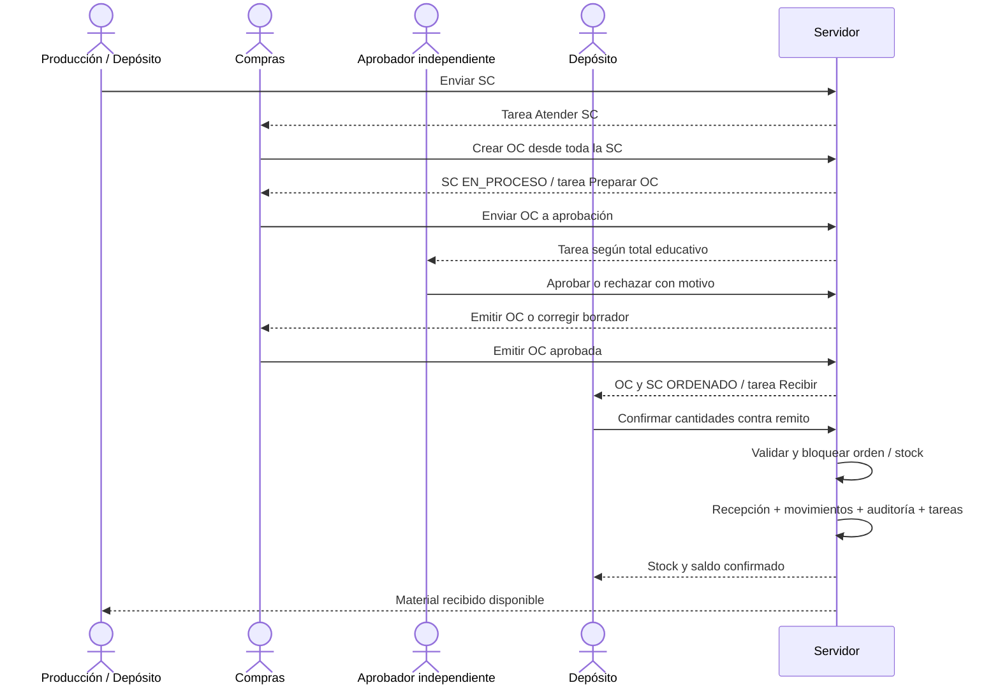
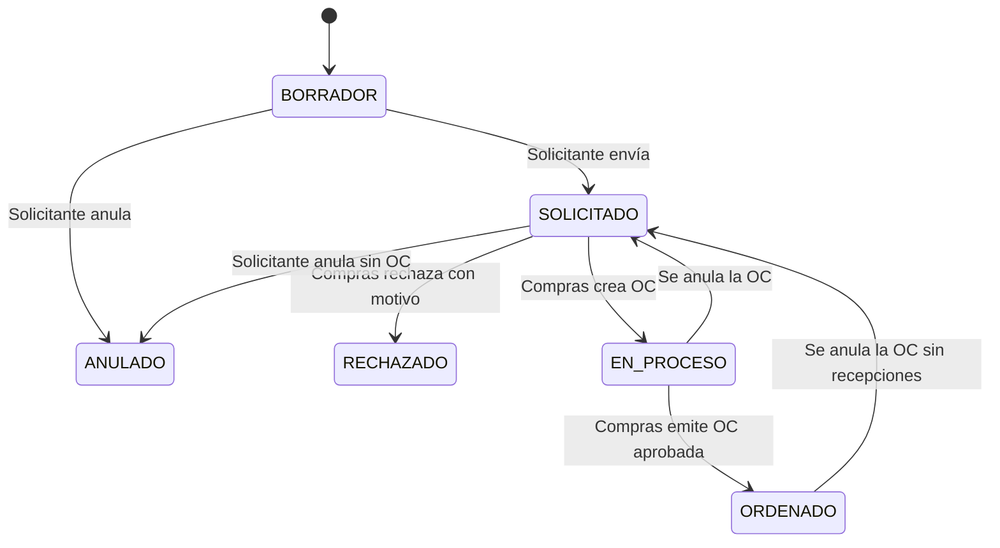
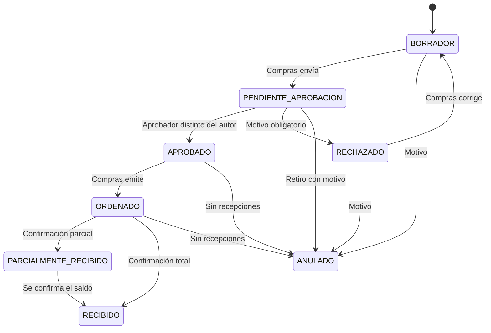
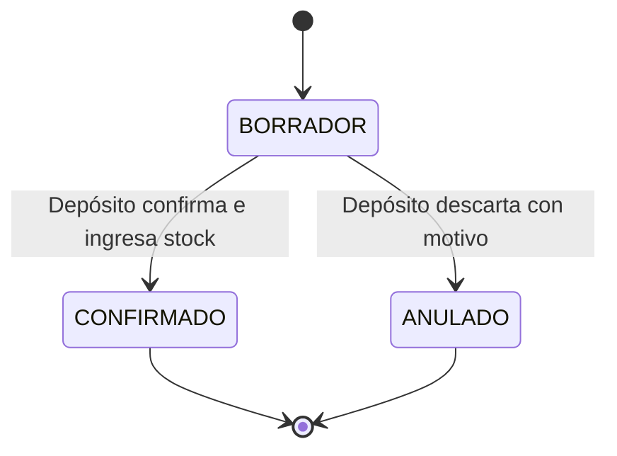

# Flujo del MVP — solicitud, compra, recepción y stock

Contrato propuesto · Fase 0 · 26/09/2026. Complementa [MVP.md](MVP.md), [DATABASE.md](DATABASE.md), [ROLES_Y_PERMISOS.md](ROLES_Y_PERMISOS.md) y las decisiones D05–D10 de [DECISIONES.md](DECISIONES.md). No describe garantías ya implementadas en la demo.

## 1. Límites del circuito

Una solicitud completa origina **una OC activa**, con todas sus líneas y cantidades. Una OC anulada conserva historial y permite crear su reemplazo desde la SC. No consolidar SC, dividir cantidades entre OC, crear compras sin SC ni agregar líneas desvinculadas en el MVP. La recepción sí admite entregas parciales con remitos diferentes.

La solicitud expresa necesidad; la OC aprobada tiene autorización interna; la OC **ORDENADO** fue emitida/comunicada al proveedor simulado. Sólo este último paso marca la SC como ORDENADO. Preparar o aprobar una orden no demuestra que el proveedor haya recibido el pedido.

## 2. Estados y transiciones

### Solicitud de compra

SC `BORRADOR` es editable por su autor o solicitante autorizado de su sector. `SOLICITADO` espera Compras; `EN_PROCESO` tiene OC en preparación/aprobación; `ORDENADO` tiene OC emitida. `RECHAZADO` y `ANULADO` son finales: una nueva necesidad se documenta con otra SC. La SC no adquiere estados FACTURADO o PAGADO.

### Orden de compra

Sólo `BORRADOR` es editable y únicamente por su creador mientras conserve permiso. No hay delegación ni toma de autoría: otro usuario, incluido el docente, no cambia proveedor, precios, impuestos o líneas de una OC ajena. Corregir un rechazo conserva la decisión anterior en historial y exige aprobación de la nueva versión. Si el autor no puede corregir, un usuario autorizado anula sin recepciones y Compras crea una OC sustituta. No se puede editar una orden APROBADO/ORDENADO. No existe cierre de saldo en MVP; `PARCIALMENTE_RECIBIDO` sigue pendiente hasta completar. `RECIBIDO` significa todas las cantidades aceptadas.

### Recepción

No hay transición CONFIRMADO → ANULADO en MVP. El borrador no cambia stock ni cantidades recibidas. Confirmar hace inmutable el documento y sus líneas.

## 3. Reglas del servidor

| Documento | Reglas |
|---|---|
| SC | Motivo, sector, fecha requerida y al menos una línea; producto activo inventariable de la empresa y cantidad positiva; fecha requerida no anterior a la del documento |
| OC | SC SOLICITADO sin otra OC activa; proveedor y depósito activos de la misma empresa; copiar todas las líneas/cantidades; precio neto no negativo; cantidades inalterables respecto de la SC |
| Aprobación | Moneda ARS; total educativo con IVA calculado con decimales en servidor; < $500.000 Compras; ≥ $500.000 Gerencia; guardar regla y versión evaluadas |
| Separación | Creador de OC distinto de aprobador, aunque tenga varios roles; edición material de borradores sólo por el creador autorizado; docente asignado puede aprobar como identidad distinta con motivo, supervisar, rechazar o anular, pero no editar una OC ajena; configuración sin aprobador se informa al docente |
| Emisión | Sólo APROBADO; versión e importes coinciden con la decisión; registrar quién/cuándo comunicó el documento al proveedor simulado |
| Recepción | Sólo contra OC ORDENADO o PARCIALMENTE_RECIBIDO; remito obligatorio; cantidades aceptadas > 0 y ≤ pendiente por línea; no se obliga a recibir todas las líneas en una entrega |
| Productos | No recibir productos ajenos a la OC; servicios pueden existir en el maestro, pero su compra/aceptación queda fuera de este circuito inicial de materiales |
| Costo | Copiar precio unitario neto aprobado de OC a la recepción; IVA simulado no ingresa como costo; guardar referencia histórica, sin calcular PPP |
| Anulación | Motivo obligatorio; permiso específico; sólo anular OC sin recepciones confirmadas; anular también sus recepciones borrador y resolver sus tareas |
| Stock | Sólo movimientos vinculados a apertura docente o recepción confirmada; no edición directa de saldos; no stock negativo |

La numeración es única por empresa y tipo, asignada en servidor. Cada registro y vínculo respeta la empresa mediante FK compuestas. Importes, estado, actor auditado y hora del servidor no se aceptan como valores autoritativos del navegador.

## 4. Tareas y notificaciones

| Cambio confirmado | Tarea que queda pendiente |
|---|---|
| SC enviada | Compras: atender SC |
| OC creada | Compras: preparar OC; resolver Atender SC porque toda la demanda quedó vinculada |
| OC enviada a aprobación | Aprobador elegible: revisar OC; excluir al creador de quienes pueden ejecutarla |
| OC rechazada | Compras: corregir o anular, mostrando el motivo |
| OC aprobada | Compras: emitir OC |
| OC emitida | Depósito: recibir mercadería |
| Recepción parcial | Depósito: recibir saldo; mantener una sola tarea activa para esa OC |
| Recepción completa | Resolver recepción; avisar a Compras y solicitante |
| OC anulada | Resolver tareas de la OC, SC vuelve a SOLICITADO y Compras recibe Atender SC |

Documento, decisiones, movimientos, saldos, auditoría, tareas y notificaciones se actualizan en la misma transacción. No hacer escrituras parciales desde React. Una restricción impide duplicar una tarea activa del mismo documento y propósito. La campana avisa; no reemplaza el estado persistido de Mi trabajo. Sondeo/reconexión vuelven a leer datos autorizados; Realtime sólo mejora la actualización visual.

## 5. Confirmación segura de recepción

1. Resolver usuario, empresa, membresía, módulo y permiso vigentes. Validar también el alcance antes de devolver resultados de una operación ya ejecutada.
2. Usar clave idempotente estable por intento lógico, con empresa, comando y huella de datos. Reintento idéntico devuelve la recepción existente; misma clave con datos diferentes falla.
3. Bloquear OC, recepción y líneas; luego los saldos producto/depósito en orden estable. Crear filas de saldo ausentes sin carreras; revalidar estado y cantidades bajo bloqueo.
4. Comprobar identidad normalizada completa del remito. Restricción única para recepción confirmada por `(empresa, proveedor, referencia_remito_normalizada)` impide duplicación aun con otra clave idempotente. Incluir serie/punto/número cuando existan; no comparar sólo la parte numérica.
5. Recalcular pendiente desde cantidades confirmadas; insertar movimientos, actualizar saldos/acumulados y derivar el estado de la OC por todas sus líneas.
6. Guardar auditoría y actualizar tareas/notificaciones; confirmar todo o revertir todo. La UI sólo anuncia éxito después del commit.

Simplificación del punto 4: un remito corresponde a una OC y una recepción en el piloto. Entregas parciales usan remitos distintos. Un remito que cubra varias OC requiere un modelo posterior y debe rechazarse con explicación, no fragmentarse mediante referencias inventadas.

La misma disciplina aplica a creación de OC y aprobación: restricción de una OC no anulada por SC, bloqueo del documento, versión esperada y permiso reevaluado. Dos operadores concurrentes no crean dos OC activas ni dos aprobaciones. Recibir y anular compiten por el bloqueo de la misma OC: sólo la operación compatible con el estado final puede continuar.

## 6. Excepciones y aprendizaje

- Falta de aprobador: tarea/configuración visible al docente; otro usuario autorizado puede asumirla. Nunca desactivar la separación de funciones para resolver una isla unipersonal.
- Rechazo: motivo visible, Compras reabre el borrador y obtiene otra aprobación; no conserva una autorización para precios modificados.
- Proveedor entrega menos: ingresar sólo lo aceptado, conservar saldo pendiente. Material rechazado físicamente se deja como observación y no suma existencias.
- Proveedor no entregará el saldo: el MVP conserva la OC parcial y su pendiente; cerrar con saldo/recomprar es una ampliación explícita, no marcarla falsamente como RECIBIDO.
- Error antes de confirmar: corregir o anular el borrador. Error confirmado: documento inmutable; docente registra incidencia y conserva auditoría. No “reparar” con ajuste que dejaría incorrecto el remito y `qty_received`; decidir antes del piloto si esta limitación exige adelantar reversión completa.
- Conflicto simultáneo o sesión revocada: mensaje claro, releer estado autorizado; no repetir automáticamente una mutación con una clave nueva.

## 7. Demostración y evidencia

Producción solicita 10 placas; Compras crea la OC completa con total de $600.000; Gerencia aprueba; Compras emite. Depósito recibe 6 con remito R-001 y luego 4 con R-002. Resultado: SC ORDENADO, OC RECIBIDO, dos recepciones confirmadas, ingreso total 10, sin tareas de recepción pendientes y recorrido completo visible.

Repetir la primera confirmación no ingresa otras 6 unidades. Dos intentos concurrentes de recibir 6 contra pendiente 10 no pueden sumar 12. Anular una OC emitida sin recepción libera la SC; intentar anularla tras recibir falla. Las pruebas detalladas, incluyendo aislamiento A/B y permisos revocados, están en [MVP.md](MVP.md#7-criterios-de-seguridad-y-concurrencia).

SC, OC y recepción imprimen **DOCUMENTO DE SIMULACIÓN EDUCATIVA — SIN VALIDEZ FISCAL**. El detalle muestra cantidades solicitadas, ordenadas y efectivamente recibidas sin confundir sus momentos. Factura, cuenta por pagar, pago y asiento serán documentos nuevos enlazados en fases posteriores.
