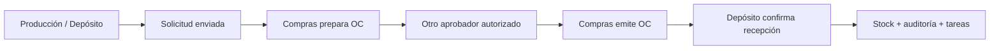

# MVP — circuito colaborativo de compras

Propuesta de Fase 0 · 26/09/2026. Este documento define trabajo futuro; no afirma que el prototipo existente tenga backend, permisos o concurrencia implementados. Referencias: [arquitectura](ARCHITECTURE.md), [modelo de datos](DATABASE.md), [permisos](ROLES_Y_PERMISOS.md), [flujo](FLUJO_COMPRAS.md) y [decisiones](DECISIONES.md).

## 1. Resultado esperado

Estudiantes con usuarios individuales de Producción, Compras, Gerencia y Depósito completan una compra compartida entre computadoras: SC → OC → aprobación → emisión → recepción → stock. Cada participante ve su trabajo pendiente y puede reconstruir los documentos autorizados y sus responsables.

El MVP es independiente de GEST-AR. Producción participa como sector solicitante: todavía no se fabrican productos ni se calculan costos de producción.

## 2. Alcance imprescindible P0

| Área | Capacidad verificable |
|---|---|
| Acceso | Supabase Auth; usuario y contraseña; cierre de sesión; alta cerrada y restablecimiento autorizado; limpieza de caché al salir |
| Instituciones | `institutions` e `institution_members` explícitos; datos institucionales; una institución por instalación piloto |
| Empresas | Varias empresas independientes; crear empresa, consultar/editar datos generales; un depósito operativo inicial por empresa |
| Usuarios | Usuarios individuales; pertenencia institucional y empresarial activa; asignación de uno o varios roles y sectores dentro del alcance autorizado |
| RBAC | Catálogo con todos los roles pedidos; permisos de lectura, creación, modificación, aprobación, anulación, eliminación y exportación; una acción sin implementar no concede permiso efectivo |
| Panel docente | Alta individual; creación de empresa desde datos demo; asignación de roles/sectores; módulos habilitados; consulta de actividad y operaciones; intervención con identidad y motivo |
| Maestros | Clientes, proveedores y productos: alta, edición, búsqueda, filtros y desactivación; referencias existentes se conservan |
| Solicitudes | Borrador, envío, rechazo fundamentado, seguimiento y anulación conforme al [flujo](FLUJO_COMPRAS.md) |
| Órdenes | Una SC completa → una OC activa, con todas sus líneas y cantidades; precios y proveedor; aprobación, rechazo/corrección, emisión y anulación sin recepciones |
| Aprobación | Un nivel por monto; total educativo ARS con IVA simulado calculado en servidor; autor de OC nunca aprueba |
| Recepciones | Total o parcial contra OC emitida; remito identificable; revisión previa; confirmación transaccional e idempotente |
| Stock | Cantidades por producto/depósito, kardex, mínimo y costo unitario recibido conservado; apertura docente auditada; sin existencias negativas |
| Mi trabajo | Tareas persistidas por rol/persona y documento; enlace a la operación; siguiente responsable y bloqueo explicados |
| Notificaciones | Campana simple; avisos internos y marca de lectura; sondeo periódico; Realtime opcional |
| Auditoría | Historial por documento y consulta global autorizada; actor, sector, acción, empresa, fecha/hora y cambio de estado |
| Dashboard | Pendientes, OC por estado, productos bajo mínimo y actividad reciente; datos de la empresa seleccionada |
| Documentos | SC, OC y recepción imprimibles en A4; recorrido documental y leyenda educativa visible |

Regla propuesta D05: **total < $500.000: Compras; total ≥ $500.000: Gerencia**. El borde exacto no estaba definido en el pedido original; debe cerrarse antes de implementar la regla. El docente autorizado puede intervenir como aprobador distinto del autor, dejando motivo. La edición material de una OC borrador corresponde sólo a su creador mientras conserve permiso; ningún aprobador puede eludir esta separación editando una OC ajena. Sin delegación en MVP: si falta el creador, anular sin recepciones y crear sustituta. No existe autoaprobación ni aprobación silenciosa por falta de configuración.

El único ingreso ordinario de mercadería es la recepción confirmada. La apertura de stock es un comando docente separado, auditado, idempotente y ejecutable una vez por producto/depósito antes de sus movimientos operativos; no es un editor libre de saldos.

## 3. Recortes deliberados

| Fuera del MVP | Continuación prevista |
|---|---|
| Varias SC en una OC, dividir una SC, compras sin SC, tolerancias y cierre de saldos | Ampliación de Compras después del piloto |
| Cotizaciones, comparación y negociación registradas | Compras ampliado |
| Facturas, cuentas por pagar, pagos y bancos | Contabilidad base + ciclo de compras y Tesorería |
| Ventas operativas, fabricación, Costos, RRHH, Sueldos, Impuestos y Logística | Circuitos posteriores; sus roles pueden existir sin habilitar funciones inexistentes |
| PPP, valorización, ajustes operativos, transferencias, devoluciones y reversión de recepciones | Ampliación de inventario con reglas y pruebas específicas |
| Alta masiva, rotaciones guardadas, evaluación, motor de escenarios y reinicio automático | Experiencia docente progresiva |
| Editor de workflows, reglas visuales, aprobaciones multinivel, roles personalizados | Sólo si el uso real lo requiere |
| Archivos adjuntos, PDF en servidor, correo, app nativa y escritura offline | Posterior; impresión del navegador cubre el documento inicial |
| Tutor IA, integraciones fiscales reales y dependencia de GEST-AR | IA posterior; fiscalidad real fuera del objetivo; integración con GEST-AR requiere decisión aparte |
| Réplica comercial de instalaciones y administración SaaS de escuelas | No condicionan la aceptación educativa |

**Límite conocido:** una recepción confirmada no puede editarse, borrarse ni anularse en este MVP. Un ajuste de stock no solucionaría un remito incorrecto ni el acumulado recibido de la OC, por lo que no se propone como sustituto. La UI exige revisar cantidades antes de confirmar. Ante un error confirmado, el docente registra la incidencia en la auditoría y conserva el caso; si impide continuar el ejercicio, crea una empresa de práctica nueva. Antes del piloto debe aceptarse este límite o adelantar una reversión transaccional completa.

## 4. Superficies de trabajo

No construir pantallas para todos los módulos de la visión anual. Reutilizar un formulario documental con encabezado, líneas, estado, acciones, historial y documentos relacionados.

| Grupo | Superficies |
|---|---|
| Acceso/contexto | Login, selector de empresa y perfil/salida |
| Trabajo | Dashboard, Mi trabajo y campana |
| Maestros | Listado y ficha reutilizables para clientes, proveedores y productos |
| Circuito | Listados y documento de SC, OC y recepción; vista de impresión |
| Control | Existencias/kardex y auditoría |
| Docencia | Institución, empresas, usuarios, asignaciones, módulos y actividad |

Prioridad de interfaz: escritorio y notebook; tablet con navegación adaptable; teléfono para consulta. Español rioplatense, fechas `dd/mm/aaaa`, importes ARS claros, estados con texto, foco visible y navegación por teclado. No mostrar caja, ventas o salarios ficticios como si fueran operaciones reales.

## 5. Datos demostrativos

Empresa ficticia **FORESTAL DEL NORTE SRL**, Misiones, dedicada a muebles y derivados de madera. P0: 10 clientes, 10 proveedores, 20 productos con materias primas, sectores del circuito, un depósito y apertura de stock trazable. Incluir un producto por debajo del mínimo y usuarios ficticios de los roles participantes.

Los 10 empleados, cuentas bancarias simuladas y plan de cuentas del pedido se incorporan con sus respectivos módulos; no crear tablas o movimientos ficticios de esas áreas sólo para rellenar el dashboard. Mantener separados los usuarios de aula de futuros legajos ficticios.

Para demostrar aislamiento se requieren al menos dos empresas con datos claramente diferentes. Los datos demo deben poder cargarse desde cero sin duplicarse por un reintento; la apertura de stock debe conservar responsable y documento de origen.

## 6. Criterios de aceptación funcional

| ID | Prueba y resultado esperado |
|---|---|
| F01 | Cuatro usuarios de Producción, Compras, Gerencia y Depósito completan una OC de total ≥ $500.000 en computadoras/contextos distintos; el stock sólo cambia al confirmar recepción |
| F02 | Una OC menor al umbral se aprueba por un segundo usuario de Compras; probar $499.999,99, $500.000,00 y $500.000,01; nadie aprueba su propia OC aunque acumule roles |
| F03 | Rechazo con motivo → corrección en borrador → nueva solicitud de aprobación; una aprobación previa no autoriza la versión corregida |
| F04 | Una SC sólo tiene una OC no anulada; borrador/aprobación dejan SC EN_PROCESO; emitir la OC la lleva a ORDENADO; anular sin recepciones devuelve SC a SOLICITADO y reabre su tarea |
| F05 | Recibir 6 de 10 deja OC PARCIALMENTE_RECIBIDO, stock +6 y una tarea por 4; otro remito por 4 completa la orden; cantidades excesivas o nulas se rechazan |
| F06 | SC, OC y recepción muestran enlaces, responsable, siguiente paso e historial; impresión A4 legible con “DOCUMENTO DE SIMULACIÓN EDUCATIVA — SIN VALIDEZ FISCAL” |
| F07 | Cada transición guarda actor real, sector autorizado, empresa, documento, estado anterior/nuevo y hora del servidor; la intervención docente indica motivo |
| F08 | La bandeja refleja cambios confirmados en ≤ 30 segundos durante el piloto con conexión normal; reconexión refresca el estado desde servidor sin perder tareas |
| F09 | Alta individual y asignación docente habilitan sólo el alcance elegido; un alta Auth incompleta no habilita operaciones; bloqueo de módulo impide operaciones de alumnos |
| F10 | La apertura genera movimientos; existencia por producto/depósito = suma algebraica de movimientos, sin saldos negativos; el costo recibido conserva su valor histórico |

## 7. Criterios de seguridad y concurrencia

| ID | Prueba adversaria y resultado esperado |
|---|---|
| S01 | Usuario de empresa A intenta leer/escribir B por API, RPC, vistas, tareas y notificaciones: no obtiene datos ni modifica registros; repetir con otra institución de prueba |
| S02 | Mezclar producto, proveedor, depósito, línea o documento de otra empresa falla por integridad y autorización; cambiar `company_id` desde el cliente no elude controles |
| S03 | Usuario sin permiso intenta aprobar, emitir, recibir, cambiar estados o editar stock/auditoría directamente: denegado; no puede otorgarse roles ni cambiar al actor auditado; otro comprador/docente intenta editar materialmente una OC ajena: denegado |
| S04 | Revocar membresía/rol y volver a operar con JWT aún vigente: siguiente comando denegado; vaciar caché al cambiar usuario/empresa evita mostrar datos del contexto previo |
| S05 | Dos aprobaciones simultáneas: una decisión y una transición; la otra recibe conflicto legible sin duplicar tareas |
| S06 | Dos recepciones concurrentes de 6 contra pendiente 10: sólo una confirma; stock y acumulado recibido nunca alcanzan 12 |
| S07 | Reenviar la misma confirmación por respuesta perdida devuelve su resultado sin duplicar movimientos; misma clave con payload diferente se rechaza |
| S08 | Repetir el mismo remito de proveedor con otra clave idempotente se rechaza por unicidad; una restricción protege también dos intentos concurrentes |
| S09 | Fallo inducido entre movimiento, saldo, auditoría y tareas: rollback de todo; ningún documento confirmado con efectos incompletos |
| S10 | Recibir simultáneamente el mismo producto desde órdenes distintas conserva ambos ingresos; bloqueo ordenado evita actualizaciones perdidas; reintento de conflicto es acotado e idempotente |
| S11 | Secretos administrativos ausentes del bundle y `VITE_*`; Edge Function verifica alcance; RLS/grants revisados y pruebas directas ejecutadas, además del Security Advisor |

Las pruebas SQL verifican integridad/permisos; un arnés con conexiones independientes verifica concurrencia real. Una prueba E2E separa sesiones de usuarios y ejecuta F01/F05. Build y typecheck no sustituyen estas pruebas.

## 8. Puerta de entrada al piloto

- Objetivo inicial propuesto: 30 usuarios simultáneos en una empresa; probar ingreso desde la misma IP escolar y mezcla de lectura/escritura. No prometer capacidad de 150 sin medición.
- Medir en red escolar con datos demo ampliados: percentil 95 de listados paginados ≤ 2 segundos y comandos ≤ 3 segundos, sin errores de integridad. Registrar dispositivo, volumen y latencia usados.
- Verificar permisos, cambios de roles, impresiones, navegación por teclado, conectividad y cuotas con personas del aula.
- Restaurar una copia en entorno separado y comprobar usuarios/permisos, documentos y existencias antes de utilizar datos del curso.
- Demostrar el circuito guiado en aproximadamente 20 minutos; registrar dificultades y ajustar la interfaz. Este objetivo pedagógico no reemplaza las pruebas de seguridad.

Secuencia de construcción: identidad/aislamiento → maestros → SC → OC/aprobación → recepción/stock → integración de tareas/auditoría/interfaz → prueba en aula. Cada transición incorpora auditoría y tareas desde el inicio; no agregarlas después de implementar escrituras inseguras. Calendario y fases siguientes: [ROADMAP.md](ROADMAP.md).
