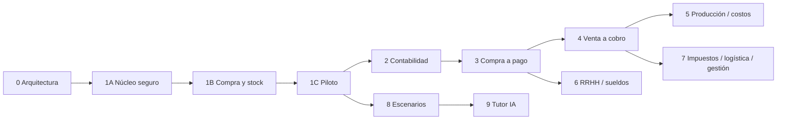

# Roadmap — arquitectura y evolución durante 2027

Propuesta al 26/09/2026. Hitos por resultado, no promesa de completar todos los módulos en fechas fijas. Supuesto de planificación: desarrollo incremental, docente disponible para validar cada circuito y piloto acotado. Estimar esfuerzo después de la primera integración real.

## Secuencia y puertas de salida

| Fase | Ventana orientativa | Entregable | Condición para continuar |
|---|---|---|---|
| 0 · Arquitectura | Ahora | Diagnóstico, modelo, permisos, flujo, MVP y decisiones | Revisión documental coherente; diferencias con el prototipo identificadas |
| 1A · Núcleo seguro | Antes del piloto 2027 | Auth, bootstrap institucional, empresas, membresías, roles, sectores, migraciones, RLS y base de auditoría/tareas | Dos empresas aisladas por pruebas directas de API; altas y revocación verificadas |
| 1B · Compra integrada | Antes del piloto 2027 | Maestros + SC + OC + aprobación + recepción + stock | Circuito completo con cuentas de sectores diferentes y pruebas de concurrencia |
| 1C · Uso en aula | Primer tramo de 2027, sujeto a 1B | Vistas de bandeja, campana y auditoría; dashboard, impresión, panel mínimo y recuperación | Criterios de [MVP](MVP.md) cumplidos y prueba en la red/equipos escolares |
| Piloto y ajustes | Primer tramo de 2027 | Una institución, un curso, una o varias empresas | Observación docente, errores y tiempos medidos; corregir bloqueos antes de ampliar |
| 2 · Base contable | Tras estabilizar MVP | Plan de cuentas, asientos manuales, diario/mayor, sumas y saldos | Partida doble, períodos y reglas modelo validadas por docente |
| 3 · Compra a pago | Durante 2027 | Cotizaciones, factura simulada, cuentas por pagar, tesorería/pagos | Compra → recepción → factura → asiento → pago → banco conciliable |
| 4 · Venta a cobro | Durante 2027 | Presupuesto, pedido, reserva, remito, factura, cuenta corriente y cobro | Efectos coherentes en stock, contabilidad y caja; no vender sin control de existencia |
| 5 · Producción y costos | Segundo tramo, según avance | Lista de materiales, órdenes, consumos, producto terminado, costo previsto/real | Consumos y producción transaccionales; trazabilidad de costo por orden |
| 6 · RRHH y sueldos | Segundo tramo, según prioridad pedagógica | Legajos ficticios, novedades, liquidación, recibo, asiento y pago | Liquidación didáctica reproducible y parametrizada; sin pretensión normativa profesional |
| 7 · Impuestos, logística y gestión | Cierre de 2027 o siguiente ciclo | Obligaciones simuladas, entregas, indicadores interárea | Cada indicador y obligación se explica con datos del circuito que lo origina |
| 8 · Escenarios y docencia avanzada | Luego del núcleo estable | Consignas, progreso, plantillas, rotación de roles, reinicios seguros | Repetición de prácticas sin perder historia ni mezclar empresas |
| 9 · Tutor IA | Posterior, sin fecha comprometida | Orientación contextual de sólo lectura | Evidencia de utilidad pedagógica y respeto de permisos; no resuelve por el alumno |

Si falta tiempo, reducir módulos posteriores; no quitar aislamiento, auditoría ni transacciones del MVP. Ordenar las fases 4–7 según el programa de 4.º, 5.º y 6.º manteniendo sus dependencias.

Auditoría, tareas y notificaciones se persisten junto con los comandos desde 1A/1B. En 1C se completan sus vistas de usuario; no se agregan retrospectivamente a operaciones que antes carecían de trazabilidad.

## Dependencias

Contabilidad antes de activar circuitos que prometan asientos automáticos. La recepción del MVP cambia unidades y registra costo de referencia, pero no genera una deuda ni un asiento inexistente. Inventario inicial tiene respaldo auditado; al habilitar contabilidad se prepara una apertura reconciliada, sin contabilizar hacia atrás silenciosamente.

## Primer bloque de construcción propuesto

1. Reconciliar contratos del prototipo con esta propuesta, mantener la demo aislada y elegir versiones soportadas.
2. Preparar proyecto Supabase de desarrollo, migraciones, roles mínimos y gestión cerrada de usuarios.
3. Crear institución, dos empresas, depósitos y cuatro usuarios de sectores diferentes; probar que las fronteras se cumplen desde la API.
4. Implementar un comando de punta a punta (crear/enviar SC), con auditoría y tarea de Compras en una transacción.
5. Completar OC/aprobación y recepción concurrente con idempotencia antes de sumar más pantallas.
6. Verificar el recorrido en dispositivos separados; sumar la experiencia de aula y ensayar restauración.

Esto es planificación: esta entrega no crea proyectos cloud, cuentas, tablas ni pantallas.

## Datos demostrativos por fase

| Momento | Datos |
|---|---|
| MVP | FORESTAL DEL NORTE SRL; institución demo; sectores/islas; usuarios ficticios; 10 clientes, 10 proveedores, 20 productos incluyendo materias primas/insumos/terminados; depósito y apertura de stock documentada |
| Contabilidad | Plan de cuentas básico validado, apertura coherente con inventario y bancos iniciales |
| Tesorería | Cajas y cuentas bancarias simuladas, saldos iniciales conciliados |
| RRHH | 10 empleados ficticios, distintos de los usuarios estudiantes, legajos y conceptos didácticos |

No crear tablas vacías de bancos, empleados y asientos sólo para cumplir una carga demo anticipada: el pedido ubica estos datos “posteriormente”. Deben estar listos con la fase que permita usarlos.

## Funcionalidades pospuestas deliberadamente

Consolidación de varias SC, una SC con varias OC, cotizaciones, servicios en recepción, unidades alternativas, multi-moneda, cierres de saldo, devoluciones, ajustes generales, PPP, adjuntos, generación PDF en servidor y editor de autorizaciones se incorporan después del piloto. Se preservan identidades documentales y costos de origen para no bloquearlos.

Reiniciar escenarios, eliminar empresas, contabilidad profesional, impuestos reales, nómina legal, integración fiscal, integración con GEST-AR, aplicaciones móviles nativas y tutor IA quedan fuera del MVP. El panel docente mínimo no implica construir todo el motor pedagógico.

## Ritmo de verificación

Cada entrega termina con un flujo demostrable, migración repetible y pruebas relevantes. Al cierre del piloto, registrar cantidad real de usuarios, incidencias, latencia, tareas sin responsable y costos de infraestructura. Esos datos determinan capacidad y presupuesto para el resto de 2027.
